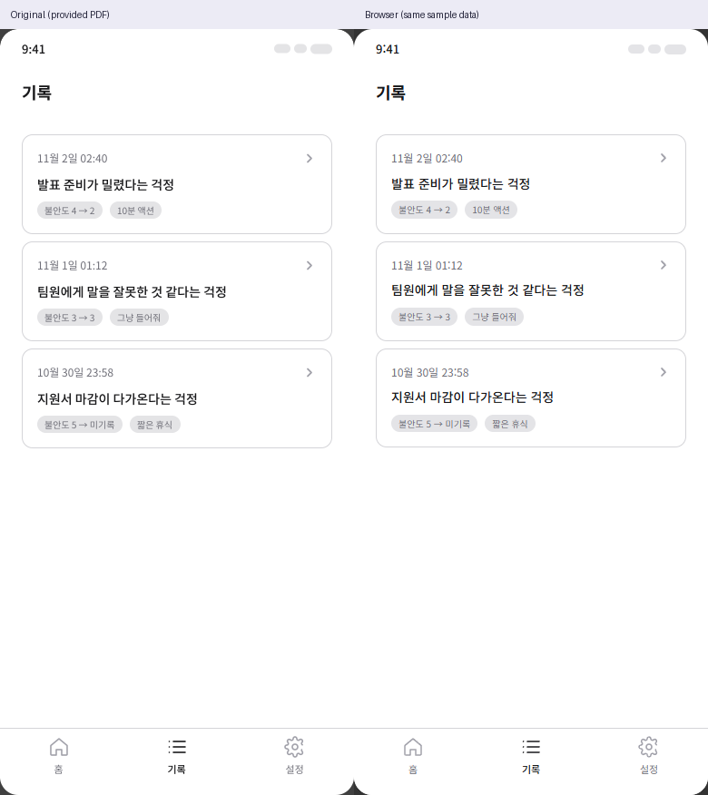

> 2026-11-16: 사용자 요청으로 feat/fe2 업로드를 진행한다. 아래의 보류/미업로드 문구는 디자인 검수 당시의 이력이다. FE1 통합은 별도이며 이 업로드에 포함하지 않는다.

# FE2 원본 대조 재검수

2026-11-15. 앞선 구현 완료/디자인 일치 표현을 이 문서의 실제 검증 범위로 정정한다. Git 커밋·푸시와 FE1 통합은 보류했다. Figma는 조회만 했고 원본을 변경하지 않았다.

## 대조 근거

- 받은 UI PDF/나이트 PNG/컴포넌트 SVG: 프로젝트의 design_sources, design_analysis 및 WOOLY_VAULT_DESIGN.md.
- Figma 파일 B3t4ttRoLZUafyfVuuKWKV의 UI 페이지70:732, 나이트 UI 페이지263:7999 메타데이터와 FE2/공통/달력32개 프레임·패턴의 get_design_context 및 렌더.
- 원본 Figma SVG를 public/fe2/figma에 다운로드하여 사용했다. SVG 내부 경로·색·루트 크기를 편집하지 않았다. 원본 렌더 스크린샷을 UI 배경이나 화면 구현 에셋으로 사용하지 않았다.

| 대상 | 원본 노드 |
| --- | --- |
| 기록 목록/빈 상태/상세/삭제 | 329:1838 / 329:2066 / 329:1878 / 329:1964 |
| 금고/잠금/공개 도달/삭제 | 258:4100 / 258:4125 / 258:4165 / 258:4205 |
| 걱정 상세 | 258:4238 |
| 액션/휴식 시작/진행/그만두기/공감/결과 | 258:3690 / 258:3707 / 258:3724 / 258:3773 / 258:3736 / 258:3747 |
| 파쇄 확인/완료 | 258:3641 / 258:3675 |
| 시간 변경/나이트 | 191:2151 / 263:8590 |
| 수정/저장 불가/실패 | 191:2520 / 196:732 / 201:738 |
| 나이트 수정/불가/실패 | 263:8665 / 263:8704 / 263:8744 |
| 활동 중단 확인/나이트 | 191:2586 / 263:8863 |
| 시연/나이트 | 191:1215 / 263:9078 |
| 오류 패턴/나이트 | 191:1472 / 263:8050 |
| 달력 참고 | 180:1801 |

## 교정한 내용

1. 모든 화면을 같은 작은 글자와 단일 글꼴로 처리하던 부분을 수정했다. 금고 제목16/24, 보조12/20, 도움 안내14/25.2 등을 원본으로 맞췄다. SUITE Regular/Medium/Bold를 구분하고, 원본에 남아 있는 Noto Sans KR를 기록·필드·태그에서 보존했다. 팀 공통 CSS 자체를 고치지 않았다.
2. 헤더48, 탭 헤더52, 패딩20/24, 카드12/16/20 모서리, 버튼12/16 모서리를 화면별로 구분했다. 일부 원본 Noto 텍스트박스의 픽셀 반올림을 반영했다.
3. 아이콘의 벡터 경로를 추출·크기 변경하던 방법을 바꾸고 원본 SVG를 그대로 img로 표시한다. 확인 시점의 표시 이미지76개 사용 위치에서 파일 로딩·자연 크기·렌더 크기 일치를 검사했다. 체크박스14px 체크도 원본 SVG다.
4. 200×200 연출 슬롯 안에80px 원본 아이콘을 놓고 flex 정렬을 복원했다. 휴식·공감·결과·파쇄의 임의 위쪽 패딩과 여백 보정을 제거했다.
5. 정상/저장 불가/저장 실패의 필드·카운터·경고를 따로 처리했다. 원본에 없는 분홍 입력 테두리를 제거했고 실제 원본 회색 테두리·입력 내용 placeholder·14/16px 경고 SVG·Rose/300 문구를 반영했다. 저장 불가 시도는 가이드에 따라 클릭 가능하다.
6. 빈 기록의 원본 자리표시자120×120을 복원했다. 임의 금고 아이콘으로 대체하지 않는다. 실제 일러스트가 제공되었다고 주장하지 않는다.
7. LOCK-01은 제공 원본의 스크림이 시트 위에 있는 레이어 순서를 라이트에서 재현했다. 원본 스크림 때문에 어둡게 보이며, pointer-events:none으로 실제 버튼 동작을 막지 않는다. LOCK-03은 시트 위 스크림을 쓰지 않는 원본을 따랐다.
8. 시연 배너가 앱 콘텐츠 위치를 바꾸지 않도록 개발용 상태바와 화면 밖 비교 도구로 분리했다. 원본 상태바9:41/홈 인디케이터는 개발 모드 비교에서만 표시하며 운영에는 없다. 예시 환경임을 비교 도구와 브라우저 제목에 표시한다.
9. 달력은 제공 Apple compact picker 구조와 크기/색을 참고해 웹 스택으로 구현했다. 실제 요일·윤년·허용 범위를 계산한다. 원본 예시의 SUN 중복과 April2026 고정 날짜는 복제하지 않는다. Apple 네이티브 구현과 동일한 런타임이라고 주장하지 않는다.

## 주요 실측

390×844, 개발용 원본 비교 상태바 포함. 실제 데이터 길이·문구에 따라 가변 영역은 늘어날 수 있다.

| 요소 | 원본 | 브라우저 |
| --- | --- | --- |
| 금고 첫 공개 카드 | x24 y148 / 342×104 | 일치 |
| 상세 회고 | x24 y116 / 342×174 | 일치 |
| 상세 원문 블록 | x24 y310 / 342×108 | 일치 |
| 상세 정리 | x24 y438 / 342×106 | 일치 |
| 현재 불안도 | x24 y564 / 342×102 | 일치 |
| 과거 경험 | x24 y686 / 342×76 | 일치 |
| 첫 도움 선택 | x24 y811 / 342×79 | 일치 |
| 상세 전체 높이 | 1181 | 1181 |
| 공감 카드 | x24 y295.5 / 342×269 | 일치 |
| 파쇄 범위 | x24 y189 / 342×217 | 일치 |
| 결과 평가 | x24 y539 / 342×135 | 일치 |
| 시간 변경창/휠 | 390×534 / x20 y447 350×169 | 일치 |
| 수정 원문/입력/저장 | x20 y140 350×72 / x20 y256 342×148 / x20 y692 350×54 | 일치 |
| 저장 실패 배너 | x20 y442 / 350×40 | 일치 |
| 기록 상세 비교/정리/활동 | 342×213 / 342×127 / 342×148 | 일치 |

소수점 반올림이 남는 예: 타이머 원 y262.406, 휴식 중단창 y299.563/h270.875, 활동 중단창 y271.75/h300.5. 캔버스 반올림 좌표와 브라우저 소수점은 구분한다. 모든 픽셀이 동일하다는 보장은 하지 않는다. 폰트 버전·브라우저 래스터화에 따른 미세 차이가 남을 수 있다.

## 검증

- npm run check:release: 린트·24개 정책/계약/달력 테스트·production build·fixture 제외 검사 통과.
- 17개 열린 상태를320×640/768×900으로 확인한34조건에서 가로 넘침·대화상자 경계 이탈 없음.
- 수집된 pageerror0개. 표시 이미지76개 사용 위치의 원본 치수/로드 검사 통과.
- 수정 저장 실패에서 초안 유지, 저장 불가 클릭/오류, 휴식 명시적 시작/일시정지, 공감 명시적 완료/평가, 파쇄 접수~실제 완료를 브라우저에서 재확인했다.
- design-correction/verification.json에 치수와 검사 결과를 기록했다.

## 비교 이미지

왼쪽은 제공 PDF의 P05-F03, 오른쪽은 브라우저다. 문구·날짜·평가를 동일하게 맞춘 비교용 데이터는 QA 페이지 메모리에서만 주입했다. 실제 제품 데이터를 고정하거나 운영에 fixture를 넣지 않았다. 원본 날짜/개수/문구를 제품에 하드코딩하지 않는다.

로컬 확인: /records?theme=light 또는 /records?theme=night. theme 쿼리·비교 도구는 개발 모드에서만 동작한다. 운영은22:00~06:00 자동 전환을 유지한다.

실제 서버 E2E·DELETE202 완료 계약·FE1 통합이 완료되었다는 의미는 아니다. Git 업로드/FE1 로컬 통합 요청은 디자인 재검수 때문에 보류한 상태다. 다른 브랜치와 main을 변경하지 않았다.
