# 심야 걱정 금고 — UI·나이트 UI·컴포넌트 디자인 구현 기준

기준일: 2026-11-15 KST. 사용자 제공 `UI.zip`, `나이트 UI.zip`, `컴포넌ㄴ트.zip`을 직접 열어 작성했다. Figma 원본을 변경하지 않았다.

## 1. 이 문서를 사용하는 방법

이 문서는 요약만으로 화면을 다시 추측하지 않도록 **화면별 원본 이미지, 원문, PDF 좌표·도형 수치, SVG 원본**을 함께 보존하는 구현 기준이다. 사용자 요구는 디자인과 가이드에 맞춘 재현이다. 임의의 색 교체, 화면 구성 추가, 카드 순서 변경, 다른 아이콘 대체를 하지 않는다.

함께 제공하는 `WOOLY_VAULT_DESIGN_EVIDENCE.zip`을 이 MD와 같은 폴더에 풀면 `design_sources/`, `design_analysis/` 참조가 연결된다. 원본 ZIP 3개와 추출한 파일도 보존되어 있다. 파일명이 `/`를 포함한 Figma 영역 이름은 ZIP 안에서 하위 폴더로 나뉘었다. 폴더가 깊다는 이유로 파일이 누락됐다고 판단하지 않는다.

작업 시 `WOOLY_VAULT_PLAN.md` → 해당 화면의 `WOOLY_VAULT_WIREFRAMES.md` → 이 문서의 화면·상태·원문·수치 → 최신 팀 코드와 API 계약 순서로 대조한다. 사용자 담당은 FE2: 금고·잠금 안내·상세·도움 활동·회고·기록·시연. 다른 화면은 연동을 이해하기 위해 기록했다.

### 확인한 범위

| 자료 | 실제 파일 | 확인 방식 |
| --- | --- | --- |
| UI | PDF 10개, 각 1쪽 | 9개 영역과 디자인 시스템의 렌더·추출 텍스트 전체 확인 |
| UI 내부 화면 | 폭 390 프레임 41개 | 화면별 잘라낸 이미지 확인, 텍스트·도형 좌표 추출. 이 수에는 나이트 시간 설정 및 달력 참고 2개가 포함됨 |
| UI 가이드 | 화면 가이드 제목 42개 | 전문 추출·읽기. 보조 상태 카드/접근성 체크리스트/알림 카드도 별도로 보존 |
| 나이트 UI | PNG 15개 | 6개 단독 화면, 대응 가이드 6개, 안전·보조 보드 1개, 전역 상태 보드 1개, 적용 기준 1개 모두 시각 확인 |
| 컴포넌트 | SVG 18개 | 모두 렌더 확인, viewBox·원본 크기·색·선 두께·경로 보존 |

**업로드 파일 전체 검토와 Figma 전체 파일 검토는 다르다.** 이 ZIP에 없는 나이트 화면의 개별 레이어까지 확인한 것으로 표시하지 않는다. 앞선 Figma 목록 61개·가이드 56개와 이번 수량은 기준이 다르다. 이번 41개는 390폭 PDF 프레임만의 수이며, 알림/전역 카드/가이드/컴포넌트를 모두 화면으로 합산하지 않았다.

### 수치의 신뢰도

| 구분 | 의미 | 구현에서 쓰는 법 |
| --- | --- | --- |
| 원문 명시 | 화면 가이드, 디자인 시스템 HEX, 텍스트 스타일 표 | 정책·문구·스타일 기준으로 사용 |
| PDF 측정 | 페이지 내 좌표, 텍스트 bbox·크기, 도형 경로 | 원본과 대조 가능한 재현 수치. Figma Auto Layout 속성이라고 해석하지 않음 |
| SVG 명시 | width·height·viewBox·path·fill·stroke | 벡터를 그대로 참조. 전체 UI를 SVG 이미지 한 장으로 구현하지 않음 |
| PNG 관찰 | 나이트 색·배치·시각 상태 | CSS 레이아웃·폰트·반경의 정확한 원본 값이라고 단정하지 않음 |
| 미확정 | 반응형·모션 시간·토큰·시안과 가이드 충돌 | 아래 충돌 목록을 유지하고 구현 시 근거 확인 |

PDF에는 글자가 Type3 글리프와 시각 경로로 함께 남아 있다. 추출된 `size`와 bbox는 PDF 값이며 CSS line-height나 실제 font-weight를 그대로 의미하지 않는다. 디자인 시스템은 SUITE를 명시한다. 실제 배포 폰트 파일은 이번 ZIP에 없다.

## 2. 확정된 프론트 기술 스택과 공통 스타일

| 구분 | 사용자 확정 |
| --- | --- |
| 화면 | React |
| 개발·빌드 | Vite |
| 언어 | JavaScript |
| 스타일 | CSS |
| 라우팅 | React Router |
| API | Axios — 모바일 웹에서 Spring 백엔드만 호출 |

팀 FE1 공유: `src/styles/typography.css`, `src/styles/colors.css`를 `main.jsx`에서 import했고 main에 병합했다. 클래스 사용 예는 `className="title-1"`, 색 변수 사용 예는 `var(--gold-200)`이다. **이번 자료에 실제 CSS 파일·최신 main 코드가 포함되지는 않았다.** 다른 클래스 이름·변수 이름·패키지 버전·라우트 URL·폴더 구조를 확정하지 않는다. 기존 main을 확인해 공통 스타일을 재사용하고 중복 정의를 피한다.

## 3. 디자인 시스템

### 3.1 글자 스타일 — P10 원문 표

모든 스타일: SUITE, letter-spacing 0. 굵기 Bold/Regular는 디자인 표의 명시이며 숫자 굵기 매핑은 팀 폰트/CSS에서 확인한다.

| 이름 | 굵기 | 크기 | 행간 |
| --- | --- | ---: | --- |
| Headline L | Bold | 36 | 125% (45) |
| Headline M | Bold | 32 | 125% (40) |
| Headline S | Bold | 28 | 125% (35) |
| Title 1 | Bold | 24 | 125% (30) |
| Title 2 | Bold | 20 | 125% (25) |
| Title 3 | Bold | 18 | 125% (22.5) |
| Label L | Bold | 16 | 24 |
| Label M | Bold | 14 | 20 |
| Label S | Bold | 12 | 20 |
| Body 1 | Regular | 16 | 180% (28.8) |
| Body2 | Regular | 14 | 180% (25.2) |
| Caption L | Regular | 16 | 24 |
| Caption M | Regular | 14 | 20 |
| Caption S | Regular | 12 | 20 |

### 3.2 색상 — 이미지에 인쇄된 HEX 전사

| 그룹 | 이름 | HEX | 표의 용도 |
| --- | --- | --- | --- |
| Gold | 300 | #DDB872 | 포인트·버튼·오브제 |
| Gold | 200 | #E8C98A | Night 강조·호버 |
| Gold | 100 | #F3E5C4 | 연한 배경 |
| Gold | 50 | #FAF3E3 | 선택 상태 배경 |
| Navy | 600 | #14172B | Night 배경·버튼 글씨 |
| Navy | 500 | #1E2240 | Night 표면·카드 |
| Navy | 400 | #24243A | Morning 본문 |
| Navy | 300 | #6E6F8A | Morning 보조 글씨 |
| Navy | 200 | #9A9CB8 | Night 보조 글씨 |
| Navy | 100 | #ECEBF5 | Night 본문 |
| 기본 | White | #FFFFFF | Morning 표면·카드 |
| 기본 | Cream | #FAF6EF | Morning 배경 |
| Rose | 300 | #C9788A | 걱정 파쇄 |
| Rose | 100 | #F4E4E8 | 연한 배경·띠 |
| Sage | 300 | #6E9E8B | 10분 액션 |
| Sage | 100 | #E2ECE8 | 연한 배경·띠 |
| Blue | 300 | #7C8FC4 | 짧은 휴식 |
| Blue | 100 | #E5E9F3 | 연한 배경·띠 |
| Beige | 300 | #D4A373 | 그냥 들어줘 |
| Beige | 100 | #F6EDE3 | 연한 배경·띠 |
| Anxiety | 1 | #D9D5F0 | 불안도 1 |
| Anxiety | 2 | #B9B2E3 | 불안도 2 |
| Anxiety | 3 | #988FD3 | 불안도 3 |
| Anxiety | 4 | #776BC2 | 불안도 4 |
| Anxiety | 5 | #5A4EA8 | 불안도 5 |

Morning Accent는 별도 모드 표에서 **#B88A3E**를 사용한다. 나이트 적용 기준에는 이 색이 컬러차트 팔레트에 아직 없다고 적혀 있다. 표의 용도는 토큰 의도이며, 모든 화면이 이 팔레트로 이미 정비되었다는 뜻은 아니다. 실제 UI PDF에는 White 배경과 회색·검정 와이어 스타일이 혼재한다. 임의로 Cream을 전체 배경에 덮어씌우지 않는다.

### 3.3 모드 매핑 — 나이트 적용 기준 전문 의미 보존

나이트는 **22:00~06:00, 화면 흐름과 무관하게 시각으로 전환**한다. 같은 화면도 아침이면 라이트다. 전체 화면 대상이며, 알림(ALARM)은 OS가 그리므로 대상이 아니다. 디바이스 시간/타임존 판정의 구현 방식은 별도 명시가 없다.

| 역할 | 라이트 기준 | 나이트 기준 |
| --- | --- | --- |
| 배경 | White | Navy/600 |
| 시트·카드 표면 | White | Navy/500 |
| 본문 | Navy/400 | Navy/100 |
| 보조 글씨 | Navy/300 | Navy/200 |
| 강조·Primary | 라이트 시안별 | Gold/200 면 + Navy/600 글씨 |
| 보조 면·칩·옵션 | Navy/100 | Navy/400 |
| 스크림 | Navy/500 50% | Navy/600 70% |
| 휠 배경 | 라이트 시안별 | Navy/600 — 파임 |
| 휠 선택행 | 라이트 시안별 | Navy/400 — 들림 |
| 단계 바 | 라이트 시안별 | 진행 Gold/200, 나머지 Navy/400 |
| 비활성 버튼 | Navy/100 면 + Navy/300 글씨 | Navy/400 면 + Navy/300 글씨 |

원문 주의사항:

- Navy/400~500은 밝기가 비슷해 선이 잘 보이지 않으므로, 나이트에서는 테두리에 의존하지 않고 표면 밝기 차이로 구분한다.
- Navy/400으로 채운 Primary도 단순 본문 색 치환이 아니라 버튼 규칙(Gold/200 + Navy/600)으로 바꾼다. 원본에는 Navy/500 버튼과 Navy/400 버튼이 섞여 있다.
- `icon/*` 컨테이너의 흰 면이 네모로 드러날 수 있다. lock·back·clock·copy의 흰 면 제거 여부를 확인한다.
- 토글 knob는 흰색을 그대로 뒤집으면 사라지므로 Navy/100을 쓴다.
- 상태바 검정은 Navy/100, 배터리 내부 #D9D9D9는 Navy/200으로 매핑한다.
- WF/Flow Header 타이틀이 Navy/400으로 남기 쉬우므로 변환 뒤 대비를 확인한다.
- 불안도 1~5 색은 의미를 유지한다. 나이트 전용 값은 아직 없다.
- 화면정의 패널은 라이트를 유지한다. 주석 문서이므로 앱의 다크 UI에 넣지 않는다.
- S-16도 나이트 대상이며 도움 연결 버튼의 대비를 우선한다.
- 현재 시안은 색을 직접 지정한 상태다. 팔레트 변수·WF Tokens 모드 작업 뒤 다시 바인딩해야 한다.
- `line`, `scrim`, `fill-strong`, `text-on-strong`의 Night 모드 값은 공통 모드 표에 아직 없다. 위 스크림 매핑의 의도와 토큰 미완성을 구분한다.
- Morning Accent #B88A3E는 팔레트 미등록 상태다.

## 4. 레이아웃의 공통 기준과 예외

| 항목 | 확인값 | 적용 주의 |
| --- | --- | --- |
| 기준 폭 | 390 | 390 CSS px 기준 비교용. 모든 화면 절대 좌표 배치라는 뜻 아님 |
| 일반 프레임 높이 | 844 | 스크롤 콘텐츠 높이와 구분 |
| 기본 본문 | x24~366, 폭342 | S-07·도움 활동·기록 등 |
| 보조 편집·시트 계열 | x20~370, 폭350 | 편집 입력란은 x20~362, 폭342인 예외 존재 |
| Primary SVG | 342×56 | 반경12. 화면에 폭350×54 변형도 존재 |
| Secondary SVG | 342×58 | White 면, #D4D4D8 선, #18181B 글씨 |
| Status Bar SVG | 390×44 | 모바일 OS 상태바 참고. 웹에서 실제 OS 표시와 중복 그리지 않도록 구현 환경 확인 |
| 헤더 | App 390×48 / Flow 390×51 / Tab 390×52 | 서로 다른 높이를 임의 통일하지 않음 |
| 작은 버튼 터치 영역 | 최소44pt | 건너뛰기·재알림·수정 포함 |
| 액션 행 | 342×56, 행 사이8 | 컴포넌트 묶음 원본 캔버스 폭762와 구분 |
| 상세 스크롤 | S-08 실제 PDF 390×1181 | 가이드는 390×1224, 뷰포트844라고 명시 — 불일치 기록 |
| 기록 상세 | 실제 PDF 390×882 | 뷰포트844, 하단 삭제까지 스크롤 |
| 설정 | 실제 PDF 390×1072 | FE1 범위, 연동 참고 |
| 시연 | 실제 PDF 390×794 | 844 일반 프레임과 다름 |

별도 화면별 표의 x,y는 해당 프레임 좌상단 기준이다. PDF 캔버스의 회색 배경과 화면 옆 가이드는 앱 UI가 아니다. 그림자 외곽·선 외곽의 bbox와 실제 면의 크기를 구분한다. 아이콘/글자 윤곽도 PDF 도형이므로 부록의 도형 행을 모두 카드로 해석하면 안 된다.

반응형 breakpoint, 키보드 표시 시 버튼 이동 방식, safe-area 처리, hover/focus 전 상태, 모션 지속시간과 easing은 내보낸 파일만으로 확정할 수 없다. 390 기준 배치와 스크롤 규칙을 보존하면서 실제 코드·디자인 확인으로 정한다.

## 5. FE2 화면별 동작·시각 기준

### S-07 금고·잠금 안내 — P03-F01~04

공개 영역 → 잠김 영역 순서다. 공개 카드에는 작성 일시·새로 공개 칩·요약 한 줄·봉인 전 불안도·열림 자물쇠·우측 화살표가 있다. 잠김 카드는 작성 일시·공개 예정 시각·닫힌 자물쇠·화살표만 표시한다. 공개 카드 342×104, 행 간8, 잠긴 카드342×80인 시안이다. 영역별 최신 작성순, 삭제·만료 제외. 요약은 말줄임, 수정본 우선.

잠김 선택 시 아래 시트에 작성 일시·공개 일시·잠금 설명을 보여준다. 시간 변경 → 삭제 → 닫기 순서. 공개 시각에 도달하면 서버 재확인 후 ‘걱정 확인하기’로 바꾸고 시간 변경을 숨긴다. 자동으로 원문을 펼치지 않는다. 원문·메모·AI 정리·불안도는 잠금 중 노출 금지. 삭제 확인에는 작성 시각만으로 대상을 식별하고 성공 전 완료 표시를 하지 않는다.

금고는 별도의 뒤로가기 헤더이고, 원본 P03-F01에는 하단 탭바가 없다. 임의로 하단 내비를 추가하지 않는다. 기록 탭은 공개 기록만 보는 S-14다.

### S-08 걱정 상세·회고·불안도·도움 — P03-F05

아래 순서를 유지한다: 날짜 헤더 → 과거 걱정 회고 카드 → 그날의 걱정·불안도 칩 → 읽기 전용 원문 → 내일 확인할 것 → 정리 카드·수정 → 현재 불안도·건너뛰기 → 과거 경험 카드 → 도움 선택 4개.

회고 선택은 ‘괜찮아짐 / 진행 중 / 걱정대로 됨’, 아래 ‘오늘은 건너뛰기’. 후보는 조건에 맞는 1건, 건너뛰면 같은 날 재제안하지 않는다. 현재 불안도는 1~5와 ‘거의 없음 / 조금 / 보통 / 많이 / 아주 많이’, 선택 입력이고 재입력은 덮어쓰기다. 과거 경험은 최대1건이고 ‘도움 됨’ 응답이 있을 때만 도움이 된 경험이라고 표현한다.

도움 순서는 **10분 액션 → 짧은 휴식 → 그냥 들어줘 → 걱정 파쇄**. AI 추천1개만 칩과 테두리로 강조하고 모두 선택할 수 있다. 시안의 액션 추천은 예시 데이터이며 항상 액션을 추천하도록 하드코딩하지 않는다. 진행 활동이 있으면 중단 확인을 거친다. 상세에 실제 진입한 때 최초 상세 확인을 저장하며 목록에서 요약을 봤다는 이유로 확인 완료 처리하지 않는다.

### S-08 정리 수정·저장 불가·저장 실패 — P07-F03~05 / N04~06

상단 뒤로가기·‘정리 내용 수정’, 자물쇠와 ‘그날의 걱정 · 수정되지 않아요’, 원문 면, ‘AI 정리’ 라벨, 입력란, 우측 카운터, 오류 영역, 하단 저장·취소, 홈 인디케이터 순서다. 원문은 읽기 전용이다. 현재 정리로 입력란을 채워 시작한다. 공백 제외1자 이상·최대500자. 화면의 ‘50/500’은 예시이며 실제 길이를 계산한다.

정상은 오류가 없다. 글자 수 미달은 저장을 눌렀을 때 테두리 강조와 **‘공백 제외 1자 이상 써야 저장할 수 있어요’** 한 줄. 1자 이상이 되면 해제한다. 가이드는 저장을 비활성화하지 말라고 명시한다. 서버 실패는 **‘저장하지 못했어요 · 잠시 뒤 다시 시도해 주세요’**, 입력을 유지하고 같은 화면에서 저장으로 재시도한다. 취소는 변경 없이 복귀한다.

성공 후 S-08 복귀 + **‘저장했어요 · 도움 추천은 그대로예요’** 토스트. 제목은 ‘AI가 정리했어요’에서 ‘내가 정리했어요’로 전환한다. 목록 요약·회고/유사 경험 매칭에서 수정본을 우선한다. AI 원본은 화면에 보여주지 않으며 되돌리기를 제공하지 않는다. 자동 재생성으로 수정본을 덮거나 액션·휴식·공감을 재생성하지 않는다.

### S-08 활동 중단 확인 — P07-F06 / N07

상세 화면 위 스크림·가운데 모달. 제목, 현재 1/3 진행 설명, 단계 바3개, ‘중단하고 바꾸기’, ‘취소’ 순서. 액션 체크는 유지하고 실패로 기록하지 않는다. 확인 후 새 도움으로 전환하며 과거 이력과 홈 진행 활동을 갱신한다. 취소하면 기존 활동을 유지한다. 이 설명을 휴식의 잔여시간 보존 규칙으로 확대하지 않는다.

### S-09 파쇄 확인·완료 — P04-F01~02

확인: 날짜 → 삭제 범위 카드 → 되돌릴 수 없음 안내 → 하단 ‘파쇄하기 / 취소’. 원문·메모, AI 정리·추천, 활동, 회고·평가, 알림 예약을 함께 삭제한다. 서버 검색/캐시 제외도 API 설계와 연계한다.

완료: 중앙 파쇄 아이콘 → ‘파쇄했어요’ → 설명 → 하단 ‘홈으로 / 금고로’. S-13을 거치거나 도움 평가를 묻지 않는다. 연출은 일반 버튼으로 대체 가능하고 소리는 기본 꺼짐. **HTTP 202 접수는 성공 화면 진입 조건이 아니다. job COMPLETED 또는 확정된 즉시 완료 응답을 확인한 뒤 표시한다.** 실제 API는 최신 계약 확인.

### S-10 액션 — P04-F03

헤더 → 제목·‘순서는 자유롭게. 제한 시간은 없어요.’ → 세 행 → 진행 수·안내 → 하단 ‘전체 완료 / 나중에 이어하기’. 체크 순서는 자유다. 세 개 체크 전 전체 완료를 비활성화하며 세 개를 체크해도 버튼을 눌러 저장 성공해야 S-13으로 간다. 원본 1/3 시안에서 Primary가 진하게 보여도 동작 가이드를 따른다. 미저장 실패를 알리고 체크 상태를 유지한 채 중단·이어하기를 제공한다. 제한 시간10분 카운트다운을 추가하지 않는다.

### S-11 휴식 — P04-F04~06

시작 전: 달 아이콘·‘3분만 쉬어가요’·설명·직접 시작까지 대기 칩 → 시작하기·다음에 할게요. 자동 시작 금지. 진행 중: 지름220 원 안 ‘02:14’·남은 시간, 아래 안내, 하단 일시정지·그만두기. 이 시간은 예시다.

일시정지는 잔여시간을 저장하고 재개 시 종료 예정시각을 갱신한다. 정지 상태로 나갔으면 정지 유지. 실행 중 나가면 시간은 흐르고 복귀 시 저장 상태 복원·음수 대신0을 보여준다. 그만두기 모달은 계속하기/그만두기, 재시작은3분부터이며 완료 화면에 보내지 않는다. **0초 도달 자체는 자동 완료가 아니다. 0초 완료 행동의 별도 시안과 일시정지 전용 화면은 이번 자료에 없다.**

### S-12 공감 — P04-F07

중앙 둥근 회색 카드 안 하트 아이콘과 문단 간 여백을 둔 메시지, 하단 ‘읽었어요’. 실시간 채팅 입력을 추가하지 않는다. 봉인 시 생성한 기존 메시지1회를 사용한다. 조회만으로 완료 처리하지 않고 읽었어요 저장 성공 후 S-13으로 간다.

### S-13 활동 완료 — P04-F08

큰 체크 → 완료 제목 → 보조문구 → 도움 평가 카드 → ‘홈으로 / 다음 걱정 보기’. 액션·휴식·공감에 적용하고 제목은 완료 활동에 맞춘다. ‘도움 됨 / 잘 모르겠음 / 도움 안 됨’은 기본 선택 없는 선택 입력. 평가 없이 나가도 완료는 유지한다. 평가 저장 실패와 활동 완료 성공을 구분한다.

### S-14 기록 — P05-F03~06

목록: ‘기록’ 헤더 → 날짜·한 줄 요약·불안도 칩·도움 방식 칩·화살표가 있는 카드 → 하단 탭. 공개 미삭제 최신순, 잠김 제외. 빈 화면은 일러스트 자리·‘아직 공개된 기록이 없어요’·설명·‘걱정 맡기기’·탭바다. 원본 빈 화면 일러스트는 자리표시자 상태다.

상세: 날짜 헤더 → 불안도 비교 카드(봉인 전/공개 후 + 화살표) → 원문 → 메모 → AI 정리 → 한 활동 / 회고 응답 / 도움 여부 행 → 이 기록 삭제. 두 값이 모두 있을 때만 비교하고 없으면 미기록. 치료/성패 판정을 덧붙이지 않는다. 삭제 모달은 되돌릴 수 없음·범위 → 삭제/취소. 성공 후 목록 갱신, 파쇄 연출 없음. 접근 때마다 인증·공개·삭제·만료 검사. 과거 경험 카드가 이 상세에 연결된다.

### S-18 시연 — P06-F03 / N01 우측 화면

헤더 → ‘시연 모드 · 예시 데이터’ 칩 → 타임머신 카드 → 프리셋 카드 → 초기화 카드. 타임머신은 시연 기록 공개 상태만 전환, 실제 기록·실제 알림에 영향 없음. 프리셋 버튼2개는 기본/네트워크 장애 응답, 초기화는 시연 데이터만 지운다. 일반 내비 진입 제외, 서버 권한 확인. 실제 AI 결과와 프리셋 구분.

## 6. 공통 상태와 다른 담당 화면의 연결

| 화면·영역 | 핵심 연결·시각 구조 |
| --- | --- |
| S-01 | 금고 마크·소개·브라우저 이용 안내·시작. 유효 게스트면 홈, 새 발급 성공은 입력으로 바로 이동 가능 |
| S-02 | 기록 없음/잠김/공개 가능3종. 처리 카드·재알림·진행 활동은 데이터 있을 때 표시. 잠긴 원문·요약 숨김 |
| S-03 | 걱정 입력·불안도 필수·선택 메모. 최대500/100. 유효할 때 다음 활성, 다음에서 서버 기록 생성하지 않음 |
| S-04 | 날짜 드롭다운·화면 내 휠·공개 알림 토글·금고에 맡기기. 미래~삭제 예정 이전만, 기본은 다음08:00 |
| S-05 | 닫기·스피너·제목·나가도 계속 안내. 15초 지연,30초 상태확인 후 홈. 최종 실패 확인 때 재시도, 실패를 봉인 성공으로 안내 금지 |
| S-06 | 마크·맡겨두었어요·공개 시각 칩·홈/새 걱정/재알림. 저장 성공 뒤만 표시 |
| AL-04 | 재알림 시트:30분/1시간/예약하지 않기. 기본 없음, 사용자당 활성1개, 기존 교체, 동의 별도, 구독 성공 전 완료 금지 |
| TIME-03 | 공개 시간 변경 시트:대상 날짜·날짜 선택·휠·제약 설명·변경/취소. 이미 공개되면 다시 잠글 수 없음 |
| S-15 | 기본 공개 시간·알림·이용보관·금고 전체 삭제. FE1 담당 연동 참고. 기존 기록 기본시간 소급 변경 금지 |
| S-16 | 위기 분기 시 일반 봉인·활동·알림 중단. 나이트 포함. 이 문서는 제공된 시안 원문을 보존하며 도움 연결 정보의 운영 검증 완료를 뜻하지 않음 |
| S-17 | 선택 호흡. 글로 단계·초 표시, 소리 opt-in, 끝내기/건너뛰기 모두 봉인 완료. 링 추가 금지 |
| AL-09 | 알림 실패 공통 시트. 거절/미지원/예약 실패별 문구, 알림 없이 계속. 권한 반복 요청 금지 |
| COM-01 | 로딩/빈 상태/오류를 구분. 오류에 재시도와 홈 경로, 상태를 글로 표시 |
| COM-02 | 움직임 감소·44pt 터치·본문 대비·연출 없이 행동·자동음성 금지. 마크+글로우 빈 패턴은 홈과 동일 |
| ALARM | 원문·요약·불안도 미포함. 공개 알림 탭은 금고 목록, 재알림 탭은 홈. OS가 그리므로 앱 내 알림 UI로 그대로 복제하지 않음 |

세부 버튼 원문과 가이드 전문은 뒤의 PDF별 원문 부록에 전부 보존했다. 날짜·개수·요약·체크·선택값은 시연용 예시이며 실제 데이터에 따라 갱신한다.

## 7. 원본에서 확인한 충돌·누락과 구현 원칙

| 번호 | 근거 | 확인한 차이 | 처리 기준 |
| --- | --- | --- | --- |
| D01 | P07-F04/N05 vs 대응 가이드 | 저장 불가 시안은 버튼이 비활성처럼 보임. 가이드는 저장 비활성 금지 | 시각 참조 보존, 동작은 가이드. 버튼을 disabled로 만들지 않음. 최종 시각은 디자인 확인 |
| D02 | P04-F03 vs ACT-04 | 1/3 상태에서도 전체 완료 버튼이 진함 | 3/3 이전 동작 비활성 규칙 유지. 비활성 색은 최신 공통 CSS와 확인 |
| D03 | P03-F05 vs 상세 가이드 | 실제 프레임1181, 가이드1224 | 실제 시각 비교는 PDF1181, viewport844.1224 고정 높이 강제 금지 |
| D04 | P10 모드 표 vs 실제 UI | Morning은 Cream 정의지만 많은 실제 화면 White | 팔레트 의도와 현재 화면을 구분. 통일 재색칠 금지 |
| D05 | 컴포넌트 SVG WF vs 실제 화면 | 기본 Wire 검정·회색과 Navy/Gold 상태 혼재 | 개별 화면의 시각을 우선 대조. SVG 기본색을 모든 화면에 복사하지 않음 |
| D06 | N15 | 일부 토큰과 나이트 불안도 미정, Morning accent 팔레트 없음 | 숫자/변수명을 확정된 팀 계약으로 발명하지 않음 |
| D07 | N04~06/P07 | 입력란 폭342, 위 원문·하단 버튼 폭350 | x20 기준을 포함해 실제 차이 보존. 임의로 양끝을 정렬하지 않음 |
| D08 | P03-F02 | PDF 잠금 안내에서 스크림이 시트까지 어둡게 보이는 레이어 순서 | 시각 자료 보존, 의도는 다른 시트·가이드와 대조. 원본을 조용히 수정했다고 주장 금지 |
| D09 | P05-F02/F04 | 인증 오류·기록 빈 상태에 일러스트 자리표시자 남음 | 완성 에셋 확보 전 임의 새 일러스트로 대체하지 않음 |
| D10 | P02-F06/F07 | April2026 달력 참고에 요일 표기 SUN 중복·날짜 정합성 의심 | 날짜 UI 구조 참고. 실제 런타임 요일은 올바른 날짜 계산. 예시 달력을 통째로 하드코딩 금지 |
| D11 | N02·N04~06·N07 | 일부 lock/back이 검게 남음, 중단 단계바 첫색은 밝은색으로 보임 | N15의 아이콘/단계바 지침과 충돌 기록. 사용성에 영향 주는 최종 시각은 확인 |
| D12 | REST-04 | 0초 완료 버튼·정지 상태 전용 시안 부재 | 자동 완료 발명 금지. 기본 규칙 지키며 필요한 표현 확인 |
| D13 | 업로드 전체 | 모든 나이트 화면 개별 시안/Auto Layout/모션/폰트 파일/최신 CSS 없음 | 현재 자료 밖까지 확인 완료라 부르지 않음. 실제 구현 전 최신 코드·추가 에셋과 대조 |

## 8. 구현·시각 QA 체크리스트

- 해당 화면의 원문·실제 이미지·상태 가이드를 모두 읽고 시작한다. 파일명만 읽은 것으로 대체하지 않는다.
- 390폭 기준으로 카드 순서, 여백, 높이, 줄바꿈, 버튼 위치, 아이콘, 라운드, 글자 위계를 원본과 비교한다.
- 스크롤 화면을844높이에 욱여넣지 않는다. 하단 버튼·탭바의 관계를 개별 화면 기준으로 본다.
- 라이트/나이트를 같은 데이터로 비교하고22:00/06:00 경계에서 전환·텍스트 대비를 확인한다.
- 정상/빈 상태/로딩/실패/저장 불가/잠김/공개 전환/확인 모달을 확인한다.
- 글자 수 검증, 수정본 유지, 원문 읽기 전용, 실패 시 초안 보존, 성공 토스트를 검증한다.
- 삭제 접수와 완료, 체크 저장과 활동 완료, 도움 평가 저장을 각각 구분한다.
- 타이머 실행/정지/복귀/0초/중단/새3분 시작을 확인한다.
- 접근성 동작과44pt 터치 영역을 보존한다. 모션을 꺼도 상태·행동이 이해되어야 한다.
- 원본의 예시 날짜·API 상태·추천·문구 길이를 하드코딩하지 않는다.
- 완성 시안이 없는 부분과 충돌을 숨겨 ‘픽셀 단위 동일 보장’이라고 말하지 않는다. 확인값으로 구현하고 실제 화면 비교로 마무리한다.

---

이하 부록은 자동 추출한 원본 데이터와 사람이 확인한 화면 식별자를 결합했다. 화면 밖 가이드의 문장 순서는 PDF 텍스트 추출 순서 때문에 시각 배치와 다를 수 있다. 해당 이미지와 좌표를 함께 참조한다.


## 부록 A. 원본 파일 색인·무결성


| 종류 | 원본 상대 경로 | bytes | SHA-256 |
| --- | --- | --- | --- |
| PDF | design_sources/ui/UI/1. 홈 — S-02 (기록 없음/공개 전/공개 가능).pdf | 1314126 | 5324261bec60fd4b03970c491cafed231e89dcfe2fb142424f06da3284cc2a70 |
| PDF | design_sources/ui/UI/2. 밤 플로우 — S-03 입력 → S-04 공개 시간 → S-05 분석 → S-06 봉인.pdf | 2287566 | cdaaf9c4c284a526c9a30c8774a1dda0e24254e14aa550fb5b921e63354678e1 |
| PDF | design_sources/ui/UI/3. 아침 플로우 — S-07 금고·잠금 안내 → S-08 걱정 확인.pdf | 1297654 | 75604338c6db5e5d722f4672a363af4f1b609104f581298337ddc16d7a6d91b5 |
| PDF | design_sources/ui/UI/4. 도움 활동 — S-09 파쇄/S-10 액션/S-11 휴식/S-12 공감/S-13 완료.pdf | 1348217 | e93a354a371c295c8f793136dc84efeefe4b4f24fac90b4c23255d9e5341e505 |
| PDF | design_sources/ui/UI/5. 진입·기록·설정 — S-01/S-14/S-15.pdf | 2306086 | 671ece6e5a5a7cb974e959271fe96cdf6bb9845e7ece1db2699dfd0931e8a8f2 |
| PDF | design_sources/ui/UI/6. 안전·보조 — S-16 위기 대응/S-17 호흡/S-18 시연.pdf | 954639 | e90def16de20b900eda6fa47cf7288a630ba9581b166c11267d7c5b1ec5897d2 |
| PDF | design_sources/ui/UI/7. 보조 창 — 시각 선택/재알림/요약 수정/중단 확인.pdf | 2815887 | fc9196ced2f483ee1775fd04ce18513a8f27d78c40293c2064f5a4ddc4a365a7 |
| PDF | design_sources/ui/UI/8. 전역 상태 — 알림 오류/공통 상태 패턴.pdf | 1426072 | cb870efd0b81e0a2469e4cce9a86bee5dc7e200595be2f5aecdf4ca5dd27fbdb |
| PDF | design_sources/ui/UI/9. 알림 — 공개 알림/재알림 (푸시).pdf | 1053585 | ba433797cf6ccae3217215c137f1130f400afa257e1d884c9d961d0df695d084 |
| PDF | design_sources/ui/UI/디자인 시스템.pdf | 712313 | d00cdca20e4df8e64a1f55bb81e84925f5e0b23805f16e3aeb54ba0f92c3bb7d |
| PNG | design_sources/night/나이트 UI/6. 안전·보조 — S-16 위기 대응/S-17 호흡/S-18 시연.png | 282064 | eb9b1afb6ac01fd39ad82a54bb021d19c7c4fd8f2d7d8d2d4458a7ad2a55bd10 |
| PNG | design_sources/night/나이트 UI/7. 보조 창 — 시각 선택/재알림/요약 수정/S-06 · 재알림 시간 선택 (AL-04).png | 64197 | cc76f22cedf69bd3329b002aebd706fc52e4e3d24a1eb92f5a2d7959a792f8ae |
| PNG | design_sources/night/나이트 UI/7. 보조 창 — 시각 선택/재알림/요약 수정/S-07 · 공개 시각 변경창 (TIME-03).png | 40368 | 372db4a319e909e94ef642ab7d396c0319aef3095fd759745388bd18031c984a |
| PNG | design_sources/night/나이트 UI/7. 보조 창 — 시각 선택/재알림/요약 수정/S-08 · 정리 내용 수정 (M-04).png | 22909 | 3c4caaa174ada8191877ac6267ec0d0743ef242d7c7c69640c36b6229429f802 |
| PNG | design_sources/night/나이트 UI/7. 보조 창 — 시각 선택/재알림/요약 수정/S-08 · 정리 내용 수정 — 저장 불가 (M-04).png | 20089 | a13c730b849c46c57edcc70b2e46544cc82d07c028ea292c2a339e41830dbb50 |
| PNG | design_sources/night/나이트 UI/7. 보조 창 — 시각 선택/재알림/요약 수정/S-08 · 정리 내용 수정 — 저장 실패 (M-04).png | 25608 | 5bb99a0eca59e4e7a0ba23175fafe91fc5abf122dea6082c4e5711769912353c |
| PNG | design_sources/night/나이트 UI/7. 보조 창 — 시각 선택/재알림/요약 수정/S-08 · 활동 중단 확인 (M-05).png | 66848 | d102ebfd2b53314fedceabb47b7f43c13101da5812c45db72607e13101e85117 |
| PNG | design_sources/night/나이트 UI/7. 보조 창 — 시각 선택/재알림/요약 수정/화면정의 · S-06 · 재알림 시간 선택 (AL-04).png | 26425 | 5b463a29e2a71eb925d46df966710f8b9fdcbd31090a8a84323f89e186cc8520 |
| PNG | design_sources/night/나이트 UI/7. 보조 창 — 시각 선택/재알림/요약 수정/화면정의 · S-07 · 공개 시각 변경창 (TIME-03).png | 22248 | 57167492db6e867af0b5e0de79947a382c34780725cc9cd4259551806bd2fc0b |
| PNG | design_sources/night/나이트 UI/7. 보조 창 — 시각 선택/재알림/요약 수정/화면정의 · S-08 · 정리 내용 수정 (M-04).png | 55799 | 710236ba9aa0f5d40699ea1a486a72d1611435093a488ee53a91dbe49e2f0171 |
| PNG | design_sources/night/나이트 UI/7. 보조 창 — 시각 선택/재알림/요약 수정/화면정의 · S-08 · 정리 내용 수정 — 저장 불가 (M-04).png | 21475 | 269ebac98ee75df31dc539f4d0b6b5f87b652bb0cce94dcae041194eb6198acf |
| PNG | design_sources/night/나이트 UI/7. 보조 창 — 시각 선택/재알림/요약 수정/화면정의 · S-08 · 정리 내용 수정 — 저장 실패 (M-04).png | 24558 | 7e2d682aeb75a82172e05055ec12d73fc912e0de5fa36d8ee32451192dedf41e |
| PNG | design_sources/night/나이트 UI/7. 보조 창 — 시각 선택/재알림/요약 수정/화면정의 · S-08 · 활동 중단 확인 (M-05).png | 21082 | 0387c0a9ea61f4bbf813881c31e94f270b96f4f8745719ff4d39b1d762a20460 |
| PNG | design_sources/night/나이트 UI/8. 전역 상태 — 알림 오류/공통 상태 패턴.png | 280866 | 764bcd723383a71b9ec744a7d6c13dfecf04c94c1ae64ebb304867eea8e6681b |
| PNG | design_sources/night/나이트 UI/나이트 적용 기준.png | 114286 | e4248889b5f485ac45f5816064902c532c1e45eba048dbd023521618996f2ba7 |
| SVG | design_sources/components/컴포넌ㄴ트/bottomsheet.svg | 71442 | 65e578e2fae4fc8793edae5141c1c2b3cff34477052b0f6831cc7b68295792ab |
| SVG | design_sources/components/컴포넌ㄴ트/WF/App Header.svg | 5741 | 1004927e5c6982d6dd6262c85c2fd5032da66acc54886dc39ad4ea6856573669 |
| SVG | design_sources/components/컴포넌ㄴ트/WF/Bottom Nav.svg | 8444 | c50093cec4ee697956361a1561c6615b2a951d6b56874867404d0e5567b300bb |
| SVG | design_sources/components/컴포넌ㄴ트/WF/Button Primary.svg | 667 | 710484aaef882b0d6c8ce953ad64c43e018e23a77b115427a71422dbe1795668 |
| SVG | design_sources/components/컴포넌ㄴ트/WF/Button Secondary.svg | 878 | 84ea2483d460f8cbee180deb4c55a9053dc44855f17998d314840cd244ffaf5e |
| SVG | design_sources/components/컴포넌ㄴ트/WF/Field.svg | 21190 | 40a8ff695b8af18286b45038afc093d10f0265c645899a507136f45dc5adc1b7 |
| SVG | design_sources/components/컴포넌ㄴ트/WF/Flow Header.svg | 2203 | bd4338114f6e6846579be6fc7f9ded65030c3c4c381341083377f0ad2906afe6 |
| SVG | design_sources/components/컴포넌ㄴ트/WF/Processing Card.svg | 7603 | 27acda469e3e10f9db0925181dca74b0b1b2e0a491a9d0075f2943a09d0a7e91 |
| SVG | design_sources/components/컴포넌ㄴ트/WF/Scale Chip.svg | 3037 | 6435a14748578ecad06bfc06f228f1e2765a93ed46e59841bd39f53e8343a989 |
| SVG | design_sources/components/컴포넌ㄴ트/WF/Status Bar.svg | 3713 | 9cee0fe1166df56bab07b1d4a2a677dae8edc85ca243dfa3e094a2bba41dc9f7 |
| SVG | design_sources/components/컴포넌ㄴ트/WF/Step Row.svg | 9369 | 29c1eb069293057309b6d6c291dc971b1a1386ae497c97d3d651a15dc9db5635 |
| SVG | design_sources/components/컴포넌ㄴ트/WF/Tab Header.svg | 2083 | a7abd97000b02399074afcd86c829885d1adc40270ee83b3e549b71b386d1209 |
| SVG | design_sources/components/컴포넌ㄴ트/WF/Time Picker.svg | 23474 | dfe0e7f1e26e574c50389c6028d671b289648ba787123c8d34be534f7f492b58 |
| SVG | design_sources/components/컴포넌ㄴ트/WF/Toggle Row.svg | 3843 | f91bdad69a553215631c3221fbd098227da42b16629b7120b2387f117c7fffbe |
| SVG | design_sources/components/컴포넌ㄴ트/WF/Vault Row.svg | 20462 | 8c0008215f1cb12d2618979f6b98bde02a6a1988004417d2bc3d6a0fa0730e4d |
| SVG | design_sources/components/컴포넌ㄴ트/WF/금고 상태 — 잠김.svg | 13835 | 86b61a40e1d70d9819c37adff6848643cfa8a599ab350d2ef2ebbe504ecd6fc2 |
| SVG | design_sources/components/컴포넌ㄴ트/WF/재알림.svg | 9849 | 625f09692088a82b52063b8cfd25c0704251f9255d927365165d0e4306adbf80 |
| SVG | design_sources/components/컴포넌ㄴ트/WF/진행 중 활동.svg | 8022 | 5a25e0e449d78224e14a990d50642fd4c39f59d935687c67e263c1d38e32b9ab |


### PDF별 페이지·가이드 수


| ID | 원본 파일 | 페이지 크기 | 텍스트 문자 수 | 가이드 제목 수 |
| --- | --- | --- | --- | --- |
| P01 | design_sources\ui\UI\1. 홈 — S-02 (기록 없음\공개 전\공개 가능).pdf | 3190×1004 | 1317 | 3 |
| P02 | design_sources\ui\UI\2. 밤 플로우 — S-03 입력 → S-04 공개 시간 → S-05 분석 → S-06 봉인.pdf | 3955×1982 | 2470 | 4 |
| P03 | design_sources\ui\UI\3. 아침 플로우 — S-07 금고·잠금 안내 → S-08 걱정 확인.pdf | 4450×1384 | 2879 | 5 |
| P04 | design_sources\ui\UI\4. 도움 활동 — S-09 파쇄\S-10 액션\S-11 휴식\S-12 공감\S-13 완료.pdf | 7090×1004 | 2722 | 8 |
| P05 | design_sources\ui\UI\5. 진입·기록·설정 — S-01\S-14\S-15.pdf | 7090×1232 | 4250 | 8 |
| P06 | design_sources\ui\UI\6. 안전·보조 — S-16 위기 대응\S-17 호흡\S-18 시연.pdf | 2790×1128 | 1847 | 3 |
| P07 | design_sources\ui\UI\7. 보조 창 — 시각 선택\재알림\요약 수정\중단 확인.pdf | 6218×1004 | 3297 | 6 |
| P08 | design_sources\ui\UI\8. 전역 상태 — 알림 오류\공통 상태 패턴.pdf | 2710×1589 | 1868 | 2 |
| P09 | design_sources\ui\UI\9. 알림 — 공개 알림\재알림 (푸시).pdf | 2690×1004 | 1084 | 3 |
| P10 | design_sources\ui\UI\디자인 시스템.pdf | 7562×3956 | 1191 | 0 |


## 부록 B. 화면별 이미지·텍스트 좌표·도형 측정

PDF 기준 단위다. x,y는 프레임 내부 좌표, w,h는 bbox의 크기다. 텍스트 표의 크기·색은 PDF 텍스트 추출값이며, 실제 렌더에는 윤곽 경로가 함께 존재하므로 아래 면/선 표와 이미지가 시각 기준이다. 경로 전체와 불투명도는 `design_analysis/Pxx-01.json`에 보존했다. 숫자만으로 CSS font-weight·행간·Auto Layout을 역추정하지 않는다.


| 프레임 ID | 화면 | 크기 | 관련 나이트 |
| --- | --- | --- | --- |
| P01-F01 | S-02 홈 — 기록 없음 | 390×844 | 미제공 또는 UI 내부 참조 |
| P01-F02 | S-02 홈 — 공개 전·잠김 | 390×844 | 미제공 또는 UI 내부 참조 |
| P01-F03 | S-02 홈 — 공개 가능 | 390×844 | 미제공 또는 UI 내부 참조 |
| P02-F01 | S-03 걱정 입력 | 390×844 | 미제공 또는 UI 내부 참조 |
| P02-F02 | S-04 공개 시간 — 라이트 | 390×844 | 미제공 또는 UI 내부 참조 |
| P02-F03 | S-05 분석 중 | 390×844 | 미제공 또는 UI 내부 참조 |
| P02-F04 | S-06 봉인 완료 | 390×844 | 미제공 또는 UI 내부 참조 |
| P02-F05 | S-04 공개 시간 — 나이트 | 390×844 | 미제공 또는 UI 내부 참조 |
| P02-F06 | 달력 참고 — 라이트 | 390×844 | 미제공 또는 UI 내부 참조 |
| P02-F07 | 달력 참고 — 나이트 | 390×844 | 미제공 또는 UI 내부 참조 |
| P03-F01 | S-07 금고 목록 | 390×844 | 미제공 또는 UI 내부 참조 |
| P03-F02 | S-07 잠금 안내 — LOCK-01 | 390×844 | 미제공 또는 UI 내부 참조 |
| P03-F03 | S-07 잠금 안내 — 공개 시각 도달 LOCK-03 | 390×844 | 미제공 또는 UI 내부 참조 |
| P03-F04 | S-07 공개 전 삭제 확인 — LOCK-02 | 390×844 | 미제공 또는 UI 내부 참조 |
| P03-F05 | S-08 걱정 상세 — 스크롤 | 390×1181 | 미제공 또는 UI 내부 참조 |
| P04-F01 | S-09 파쇄 확인 | 390×844 | 미제공 또는 UI 내부 참조 |
| P04-F02 | S-09 파쇄 완료 | 390×844 | 미제공 또는 UI 내부 참조 |
| P04-F03 | S-10 액션 — 1/3 체크 | 390×844 | 미제공 또는 UI 내부 참조 |
| P04-F04 | S-11 휴식 — 시작 전 | 390×844 | 미제공 또는 UI 내부 참조 |
| P04-F05 | S-11 휴식 — 진행 중 | 390×844 | 미제공 또는 UI 내부 참조 |
| P04-F06 | S-11 휴식 — 그만두기 확인 | 390×844 | 미제공 또는 UI 내부 참조 |
| P04-F07 | S-12 공감 메시지 | 390×844 | 미제공 또는 UI 내부 참조 |
| P04-F08 | S-13 활동 완료·도움 평가 | 390×844 | 미제공 또는 UI 내부 참조 |
| P05-F01 | S-01 시작 | 390×844 | 미제공 또는 UI 내부 참조 |
| P05-F02 | 게스트 인증 오류 | 390×844 | 미제공 또는 UI 내부 참조 |
| P05-F03 | S-14 기록 목록 | 390×844 | 미제공 또는 UI 내부 참조 |
| P05-F04 | S-14 기록 빈 상태 | 390×844 | 미제공 또는 UI 내부 참조 |
| P05-F05 | S-14 기록 상세 — 스크롤 | 390×882 | 미제공 또는 UI 내부 참조 |
| P05-F06 | S-14 기록 삭제 확인 | 390×844 | 미제공 또는 UI 내부 참조 |
| P05-F07 | S-15 설정 — 스크롤 | 390×1072 | 미제공 또는 UI 내부 참조 |
| P05-F08 | S-15 금고 전체 삭제 확인 | 390×844 | 미제공 또는 UI 내부 참조 |
| P06-F01 | S-16 위기 안내 | 390×844 | N01 왼쪽 |
| P06-F02 | S-17 선택 호흡 | 390×844 | N01 가운데 |
| P06-F03 | S-18 시연 패널 | 390×794 | N01 오른쪽 |
| P07-F01 | S-07 공개 시각 변경창 — TIME-03 | 390×844 | N03 |
| P07-F02 | S-06 재알림 시간 선택 — AL-04 | 390×844 | N02 |
| P07-F03 | S-08 정리 수정 — 정상 M-04 | 390×844 | N04 |
| P07-F04 | S-08 정리 수정 — 저장 불가 M-04 | 390×844 | N05 |
| P07-F05 | S-08 정리 수정 — 저장 실패 M-04 | 390×844 | N06 |
| P07-F06 | S-08 활동 중단 확인 — M-05 | 390×844 | N07 |
| P08-F01 | 알림 오류 공통 시트 — AL-09 | 390×844 | N14 왼쪽 |


### P01-F01 — S-02 홈 — 기록 없음

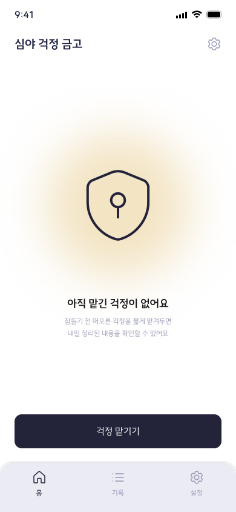

원본 페이지 좌표: (80, 80, 470, 924). 아래 모든 좌표는 프레임 좌상단 기준.

#### 표시 텍스트·좌표


| 텍스트(원문) | x | y | w | h | PDF size | 추출색 |
| --- | --- | --- | --- | --- | --- | --- |
| 9:41 | 24 | 14 | 31.31 | 16.00 | 16 | #000000 |
| 심야 걱정 금고 | 24 | 60 | 112.40 | 20.00 | 20 | #000000 |
| 아직 맡긴 걱정이 없어요 | 111.35 | 489 | 167.22 | 18.00 | 18 | #000000 |
| 잠들기 전 떠오른 걱정을 짧게 맡겨두면  | 106.52 | 522 | 177.00 | 12.00 | 12 | #000000 |
| 내일 정리된 내용을 확인할 수 있어요 | 111.62 | 542 | 166.80 | 12.00 | 12 | #000000 |
| 걱정 맡기기 | 159.17 | 701 | 71.68 | 16.00 | 16 | #000000 |
| 홈 | 59.5 | 805 | 10.20 | 12.00 | 12 | #000000 |
| 기록 | 184.5 | 805 | 20.40 | 12.00 | 12 | #000000 |
| 설정 | 314.5 | 805 | 20.40 | 12.00 | 12 | #000000 |


#### 주요 면·선·컨테이너 측정

높이24 이상·폭40 이상의 도형을 출력했다. 글자 윤곽이나 스크림·그림자도 포함될 수 있다. 원본 경로를 보지 않고 모두 직사각형 카드로 취급하지 않는다.


| x | y | w | h | 면 RGB 근사 | 면 alpha | 선 RGB 근사 | 선 두께 |
| --- | --- | --- | --- | --- | --- | --- | --- |
| 0 | 0 | 390.00 | 844.00 | #000000 | 1.0 | 없음 | None |
| 0 | 0 | 390.00 | 844.00 | #FFFFFF | 1.0 | 없음 | None |
| 142.88 | 279.53 | 104.29 | 117.36 | #24243A | 1.0 | 없음 | None |
| 106.52 | 524.36 | 175.73 | 30.78 | #9A9CB8 | 1.0 | 없음 | None |
| 24 | 683 | 342.00 | 56.00 | #24243A | 1.0 | 없음 | None |
| 0 | 763 | 390.00 | 81.00 | #000000 | 1.0 | 없음 | None |
| 0 | 763 | 390.00 | 81.00 | #ECEBF5 | 1.0 | 없음 | None |


### P01-F02 — S-02 홈 — 공개 전·잠김

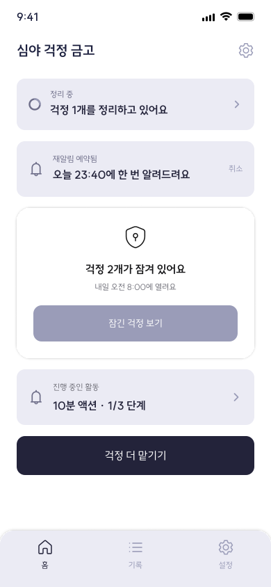

원본 페이지 좌표: (890, 80, 1280, 924). 아래 모든 좌표는 프레임 좌상단 기준.

#### 표시 텍스트·좌표


| 텍스트(원문) | x | y | w | h | PDF size | 추출색 |
| --- | --- | --- | --- | --- | --- | --- |
| 9:41 | 24 | 14 | 31.31 | 16.00 | 16 | #000000 |
| 심야 걱정 금고 | 24 | 60 | 112.40 | 20.00 | 20 | #000000 |
| 정리 중 | 72 | 128 | 33.36 | 12.00 | 12 | #000000 |
| 걱정 1개를 정리하고 있어요 | 72 | 148 | 169.41 | 16.00 | 16 | #000000 |
| 재알림 예약됨 | 76 | 221 | 63.96 | 12.00 | 12 | #000000 |
| 오늘 23:40에 한 번 알려드려요 | 76 | 241 | 197.39 | 16.00 | 16 | #000000 |
| 취소 | 329 | 235 | 20.40 | 12.00 | 12 | #000000 |
| 걱정 2개가 잠겨 있어요 | 122.91 | 377 | 144.10 | 16.00 | 16 | #000000 |
| 내일 오전 8:00에 열려요 | 136.47 | 405 | 117.07 | 12.00 | 12 | #000000 |
| 잠긴 걱정 보기 | 156.09 | 456 | 77.84 | 14.00 | 14 | #000000 |
| 진행 중인 활동 | 76 | 549 | 66.72 | 12.00 | 12 | #000000 |
| 10분 액션 · 1/3 단계 | 76 | 573 | 133.60 | 16.00 | 16 | #000000 |
| 걱정 더 맡기기 | 150.53 | 645 | 88.96 | 16.00 | 16 | #000000 |
| 홈 | 59.5 | 805 | 10.20 | 12.00 | 12 | #000000 |
| 기록 | 184.5 | 805 | 20.40 | 12.00 | 12 | #000000 |
| 설정 | 314.5 | 805 | 20.40 | 12.00 | 12 | #000000 |


#### 주요 면·선·컨테이너 측정

높이24 이상·폭40 이상의 도형을 출력했다. 글자 윤곽이나 스크림·그림자도 포함될 수 있다. 원본 경로를 보지 않고 모두 직사각형 카드로 취급하지 않는다.


| x | y | w | h | 면 RGB 근사 | 면 alpha | 선 RGB 근사 | 선 두께 |
| --- | --- | --- | --- | --- | --- | --- | --- |
| 0 | 0 | 390.00 | 844.00 | #000000 | 1.0 | 없음 | None |
| 0 | 0 | 390.00 | 844.00 | #FFFFFF | 1.0 | 없음 | None |
| 24 | 113 | 342.00 | 74.00 | #ECEBF5 | 1.0 | 없음 | None |
| 24 | 203 | 342.00 | 80.00 | #ECEBF5 | 1.0 | 없음 | None |
| 24 | 299 | 342.00 | 216.00 | #000000 | 1.0 | 없음 | None |
| 24 | 299 | 342.00 | 216.00 | #FFFFFF | 1.0 | 없음 | None |
| 48 | 439 | 294.00 | 52.00 | #9A9CB8 | 1.0 | 없음 | None |
| 24 | 531 | 342.00 | 80.00 | #ECEBF5 | 1.0 | 없음 | None |
| 24 | 627 | 342.00 | 56.00 | #24243A | 1.0 | 없음 | None |
| 0 | 763 | 390.00 | 81.00 | #000000 | 1.0 | 없음 | None |
| 0 | 763 | 390.00 | 81.00 | #ECEBF5 | 1.0 | 없음 | None |


### P01-F03 — S-02 홈 — 공개 가능

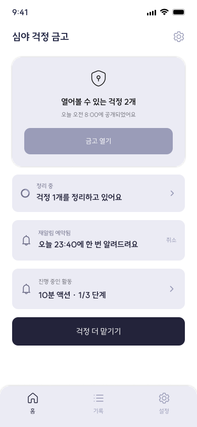

원본 페이지 좌표: (1805, 80, 2195, 924). 아래 모든 좌표는 프레임 좌상단 기준.

#### 표시 텍스트·좌표


| 텍스트(원문) | x | y | w | h | PDF size | 추출색 |
| --- | --- | --- | --- | --- | --- | --- |
| 9:41 | 24 | 14 | 31.31 | 16.00 | 16 | #000000 |
| 심야 걱정 금고 | 24 | 60 | 112.40 | 20.00 | 20 | #000000 |
| 열어볼 수 있는 걱정 2개 | 121.07 | 191 | 147.78 | 16.00 | 16 | #000000 |
| 오늘 오전 8:00에 공개되었어요 | 121.18 | 219 | 147.67 | 12.00 | 12 | #000000 |
| 금고 열기 | 169.6 | 270 | 50.82 | 14.00 | 14 | #000000 |
| 정리 중 | 72 | 360 | 33.36 | 12.00 | 12 | #000000 |
| 걱정 1개를 정리하고 있어요 | 72 | 380 | 169.41 | 16.00 | 16 | #000000 |
| 재알림 예약됨 | 76 | 453 | 63.96 | 12.00 | 12 | #000000 |
| 오늘 23:40에 한 번 알려드려요 | 76 | 473 | 197.39 | 16.00 | 16 | #000000 |
| 취소 | 329 | 467 | 20.40 | 12.00 | 12 | #000000 |
| 진행 중인 활동 | 76 | 549 | 66.72 | 12.00 | 12 | #000000 |
| 10분 액션 · 1/3 단계 | 76 | 573 | 133.60 | 16.00 | 16 | #000000 |
| 걱정 더 맡기기 | 150.53 | 645 | 88.96 | 16.00 | 16 | #000000 |
| 홈 | 59.5 | 805 | 10.20 | 12.00 | 12 | #000000 |
| 기록 | 184.5 | 805 | 20.40 | 12.00 | 12 | #000000 |
| 설정 | 314.5 | 805 | 20.40 | 12.00 | 12 | #000000 |


#### 주요 면·선·컨테이너 측정

높이24 이상·폭40 이상의 도형을 출력했다. 글자 윤곽이나 스크림·그림자도 포함될 수 있다. 원본 경로를 보지 않고 모두 직사각형 카드로 취급하지 않는다.


| x | y | w | h | 면 RGB 근사 | 면 alpha | 선 RGB 근사 | 선 두께 |
| --- | --- | --- | --- | --- | --- | --- | --- |
| 0 | 0 | 390.00 | 844.00 | #000000 | 1.0 | 없음 | None |
| 0 | 0 | 390.00 | 844.00 | #FFFFFF | 1.0 | 없음 | None |
| 24 | 113 | 342.00 | 216.00 | #000000 | 1.0 | 없음 | None |
| 24 | 113 | 342.00 | 216.00 | #ECEBF5 | 1.0 | 없음 | None |
| 48 | 253 | 294.00 | 52.00 | #9A9CB8 | 1.0 | 없음 | None |
| 24 | 345 | 342.00 | 74.00 | #ECEBF5 | 1.0 | 없음 | None |
| 24 | 435 | 342.00 | 80.00 | #ECEBF5 | 1.0 | 없음 | None |
| 24 | 531 | 342.00 | 80.00 | #ECEBF5 | 1.0 | 없음 | None |
| 24 | 627 | 342.00 | 56.00 | #24243A | 1.0 | 없음 | None |
| 0 | 763 | 390.00 | 81.00 | #000000 | 1.0 | 없음 | None |
| 0 | 763 | 390.00 | 81.00 | #ECEBF5 | 1.0 | 없음 | None |


### P02-F01 — S-03 걱정 입력

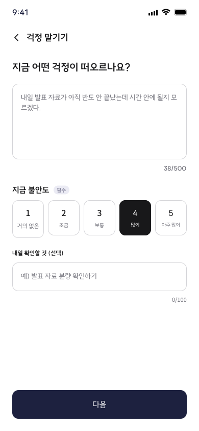

원본 페이지 좌표: (80, 80, 470, 924). 아래 모든 좌표는 프레임 좌상단 기준.

#### 표시 텍스트·좌표


| 텍스트(원문) | x | y | w | h | PDF size | 추출색 |
| --- | --- | --- | --- | --- | --- | --- |
| 9:41 | 24 | 14 | 31.31 | 16.00 | 16 | #000000 |
| 걱정 맡기기 | 52 | 62 | 81.54 | 18.00 | 18 | #000000 |
| 지금 어떤 걱정이 떠오르나요? | 24 | 119 | 231.42 | 20.00 | 20 | #000000 |
| 내일 발표 자료가 아직 반도 안 끝났는데 시간 안에 될지 모 | 41 | 182 | 305.90 | 14.00 | 14 | #000000 |
| 르겠다. | 41 | 202 | 39.40 | 14.00 | 14 | #000000 |
| 38/500 | 321 | 322 | 44.10 | 12.00 | 12 | #000000 |
| 지금 불안도 | 24 | 362 | 72.48 | 16.00 | 16 | #000000 |
| 필수 | 111 | 366.5 | 18.40 | 10.00 | 10 | #000000 |
| 1 | 50.44 | 407 | 9.12 | 16.00 | 16 | #000000 |
| 2 | 120.44 | 407 | 9.12 | 16.00 | 16 | #000000 |
| 3 | 190.44 | 407 | 9.12 | 16.00 | 16 | #000000 |
| 4 | 260.07 | 407 | 9.86 | 16.00 | 16 | #000000 |
| 5 | 330.27 | 407 | 9.47 | 16.00 | 16 | #000000 |
| 거의 없음 | 33.23 | 435 | 43.56 | 12.00 | 12 | #000000 |
| 조금 | 115.8 | 435 | 18.40 | 10.00 | 10 | #000000 |
| 보통 | 185.8 | 435 | 18.40 | 10.00 | 10 | #000000 |
| 많이 | 256.5 | 434 | 17.00 | 10.00 | 10 | #000000 |
| 아주 많이 | 316.86 | 434 | 36.30 | 10.00 | 10 | #000000 |
| 내일 확인할 것 (선택) | 24 | 488 | 100.54 | 12.00 | 12 | #000000 |
| 예) 발표 자료 분량 확인하기 | 41 | 532 | 148.96 | 14.00 | 14 | #000000 |
| 0/100 | 337 | 580 | 28.73 | 11.00 | 11 | #000000 |
| 다음 | 181.41 | 782 | 27.20 | 16.00 | 16 | #000000 |


#### 주요 면·선·컨테이너 측정

높이24 이상·폭40 이상의 도형을 출력했다. 글자 윤곽이나 스크림·그림자도 포함될 수 있다. 원본 경로를 보지 않고 모두 직사각형 카드로 취급하지 않는다.


| x | y | w | h | 면 RGB 근사 | 면 alpha | 선 RGB 근사 | 선 두께 |
| --- | --- | --- | --- | --- | --- | --- | --- |
| 0 | 0 | 390.00 | 844.00 | #FFFFFF | 1.0 | 없음 | None |
| 24 | 164 | 342.00 | 148.00 | #FFFFFF | 1.0 | 없음 | None |
| 23 | 163 | 344.00 | 150.00 | #D4D4D8 | 1.0 | 없음 | None |
| 41 | 184.76 | 305.44 | 32.25 | #71717A | 1.0 | 없음 | None |
| 24 | 392 | 62.00 | 74.00 | #FFFFFF | 1.0 | 없음 | None |
| 23 | 391 | 64.00 | 76.00 | #D4D4D8 | 1.0 | 없음 | None |
| 94 | 392 | 62.00 | 69.00 | #FFFFFF | 1.0 | 없음 | None |
| 93 | 391 | 64.00 | 71.00 | #D4D4D8 | 1.0 | 없음 | None |
| 164 | 392 | 62.00 | 69.00 | #FFFFFF | 1.0 | 없음 | None |
| 163 | 391 | 64.00 | 71.00 | #D4D4D8 | 1.0 | 없음 | None |
| 234 | 392 | 62.00 | 69.00 | #18181B | 1.0 | 없음 | None |
| 233 | 391 | 64.00 | 71.00 | #18181B | 1.0 | 없음 | None |
| 304 | 392 | 62.00 | 69.00 | #FFFFFF | 1.0 | 없음 | None |
| 303 | 391 | 64.00 | 71.00 | #D4D4D8 | 1.0 | 없음 | None |
| 24 | 514 | 342.00 | 56.00 | #FFFFFF | 1.0 | 없음 | None |
| 23 | 513 | 344.00 | 58.00 | #D4D4D8 | 1.0 | 없음 | None |
| 24 | 764 | 342.00 | 56.00 | #1E2240 | 1.0 | 없음 | None |


### P02-F02 — S-04 공개 시간 — 라이트

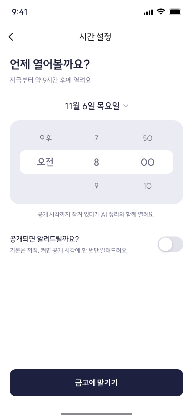

원본 페이지 좌표: (925, 80, 1315, 924). 아래 모든 좌표는 프레임 좌상단 기준.

#### 표시 텍스트·좌표


| 텍스트(원문) | x | y | w | h | PDF size | 추출색 |
| --- | --- | --- | --- | --- | --- | --- |
| 9:41 | 24 | 14 | 31.31 | 16.00 | 16 | #000000 |
| 시간 설정 | 160 | 63 | 65.55 | 18.00 | 18 | #000000 |
| 언제 열어볼까요? | 20 | 114 | 161.61 | 24.00 | 24 | #000000 |
| 지금부터 약 9시간 후에 열려요 | 20 | 153 | 163.87 | 14.00 | 14 | #000000 |
| 11월 6일 목요일 | 131 | 202 | 111.12 | 18.00 | 18 | #000000 |
| 오후 | 78.07 | 268 | 27.20 | 16.00 | 16 | #000000 |
| 7 | 190.59 | 268 | 8.83 | 16.00 | 16 | #000000 |
| 50 | 288.03 | 268 | 20.61 | 16.00 | 16 | #000000 |
| 오전 | 74.46 | 314 | 34.40 | 20.00 | 20 | #000000 |
| 8 | 189.06 | 314 | 11.88 | 20.00 | 20 | #000000 |
| 00 | 283.88 | 314 | 28.92 | 20.00 | 20 | #000000 |
| 9 | 190.3 | 364 | 9.40 | 16.00 | 16 | #000000 |
| 10 | 289.58 | 364 | 17.51 | 16.00 | 16 | #000000 |
| 공개 시각까지 잠겨 있다가 AI 정리와 함께 열려요. | 75.5 | 424.5 | 238.02 | 12.50 | 12.5 | #000000 |
| 공개되면 알려드릴까요? | 20 | 472 | 139.60 | 15.00 | 15 | #000000 |
| 기본은 꺼짐. 켜면 공개 시각에 한 번만 알려드려요 | 20 | 496.5 | 235.89 | 12.50 | 12.5 | #000000 |
| 금고에 맡기기 | 151.86 | 761 | 86.26 | 16.00 | 16 | #000000 |


#### 주요 면·선·컨테이너 측정

높이24 이상·폭40 이상의 도형을 출력했다. 글자 윤곽이나 스크림·그림자도 포함될 수 있다. 원본 경로를 보지 않고 모두 직사각형 카드로 취급하지 않는다.


| x | y | w | h | 면 RGB 근사 | 면 alpha | 선 RGB 근사 | 선 두께 |
| --- | --- | --- | --- | --- | --- | --- | --- |
| 0 | 0 | 390.00 | 844.00 | #FFFFFF | 1.0 | 없음 | None |
| 20 | 242 | 350.00 | 169.00 | #ECEBF5 | 1.0 | 없음 | None |
| 40 | 303 | 310.00 | 47.00 | #FFFFFF | 1.0 | 없음 | None |
| 319 | 476.5 | 51.00 | 31.00 | #E3E2EC | 1.0 | 없음 | None |
| 20 | 744 | 350.00 | 54.00 | #1E2240 | 1.0 | 없음 | None |


### P02-F03 — S-05 분석 중

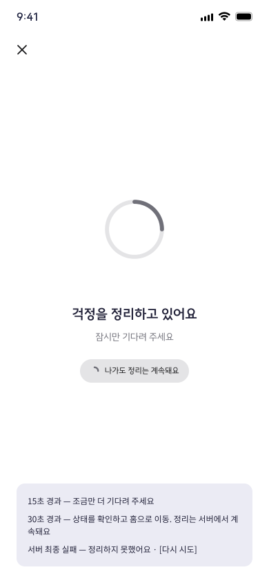

원본 페이지 좌표: (1840, 80, 2230, 924). 아래 모든 좌표는 프레임 좌상단 기준.

#### 표시 텍스트·좌표


| 텍스트(원문) | x | y | w | h | PDF size | 추출색 |
| --- | --- | --- | --- | --- | --- | --- |
| 9:41 | 24 | 14 | 31.31 | 16.00 | 16 | #000000 |
| 걱정을 정리하고 있어요 | 104.36 | 442 | 181.20 | 20.00 | 20 | #000000 |
| 잠시만 기다려 주세요 | 138.25 | 479 | 113.54 | 14.00 | 14 | #000000 |
| 나가도 정리는 계속돼요 | 152 | 529 | 107.52 | 12.00 | 12 | #000000 |
| 15초 경과 — 조금만 더 기다려 주세요 | 40 | 718 | 183.70 | 12.00 | 12 | #000000 |
| 30초 경과 — 상태를 확인하고 홈으로 이동. 정리는 서버에서 계 | 40 | 744 | 305.50 | 12.00 | 12 | #000000 |
| 속돼요 | 40 | 762 | 33.12 | 12.00 | 12 | #000000 |
| 서버 최종 실패 — 정리하지 못했어요 · [다시 시도] | 40 | 788 | 245.80 | 12.00 | 12 | #000000 |


#### 주요 면·선·컨테이너 측정

높이24 이상·폭40 이상의 도형을 출력했다. 글자 윤곽이나 스크림·그림자도 포함될 수 있다. 원본 경로를 보지 않고 모두 직사각형 카드로 취급하지 않는다.


| x | y | w | h | 면 RGB 근사 | 면 alpha | 선 RGB 근사 | 선 두께 |
| --- | --- | --- | --- | --- | --- | --- | --- |
| 0 | 0 | 390.00 | 844.00 | #FFFFFF | 1.0 | 없음 | None |
| 152.28 | 289.28 | 85.44 | 85.44 | #E4E4E7 | 1.0 | 없음 | None |
| 192.1 | 289.28 | 45.62 | 45.62 | #71717A | 1.0 | 없음 | None |
| 116 | 520 | 158.00 | 34.00 | #E4E4E7 | 1.0 | 없음 | None |
| 24 | 700 | 342.00 | 120.00 | #ECEBF5 | 1.0 | 없음 | None |
| 40 | 745.98 | 304.17 | 28.92 | #24243A | 1.0 | 없음 | None |


### P02-F04 — S-06 봉인 완료

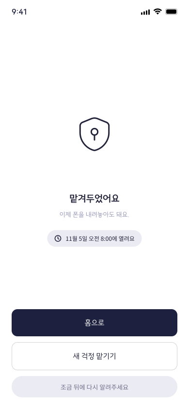

원본 페이지 좌표: (2720, 80, 3110, 924). 아래 모든 좌표는 프레임 좌상단 기준.

#### 표시 텍스트·좌표


| 텍스트(원문) | x | y | w | h | PDF size | 추출색 |
| --- | --- | --- | --- | --- | --- | --- |
| 9:41 | 24 | 14 | 31.31 | 16.00 | 16 | #000000 |
| 맡겨두었어요 | 143.38 | 397 | 103.20 | 20.00 | 20 | #000000 |
| 이제 폰을 내려놓아도 돼요. | 122.89 | 434 | 144.26 | 14.00 | 14 | #000000 |
| 11월 5일 오전 8:00에 열려요 | 135.5 | 485 | 142.37 | 12.00 | 12 | #000000 |
| 홈으로 | 174.61 | 656 | 40.80 | 16.00 | 16 | #000000 |
| 새 걱정 맡기기 | 150.53 | 725 | 88.96 | 16.00 | 16 | #000000 |
| 조금 뒤에 다시 알려주세요 | 124.86 | 791 | 140.28 | 13.00 | 13 | #000000 |


#### 주요 면·선·컨테이너 측정

높이24 이상·폭40 이상의 도형을 출력했다. 글자 윤곽이나 스크림·그림자도 포함될 수 있다. 원본 경로를 보지 않고 모두 직사각형 카드로 취급하지 않는다.


| x | y | w | h | 면 RGB 근사 | 면 alpha | 선 RGB 근사 | 선 두께 |
| --- | --- | --- | --- | --- | --- | --- | --- |
| 0 | 0 | 390.00 | 844.00 | #FFFFFF | 1.0 | 없음 | None |
| 163.82 | 241.75 | 62.39 | 70.15 | #24243A | 1.0 | 없음 | None |
| 97.5 | 475 | 195.00 | 34.00 | #ECEBF5 | 1.0 | 없음 | None |
| 24 | 638 | 342.00 | 56.00 | #1E2240 | 1.0 | 없음 | None |
| 24 | 706 | 342.00 | 58.00 | #FFFFFF | 1.0 | 없음 | None |
| 23 | 705 | 344.00 | 60.00 | #D4D4D8 | 1.0 | 없음 | None |
| 24 | 776 | 342.00 | 44.00 | #ECEBF5 | 1.0 | 없음 | None |


### P02-F05 — S-04 공개 시간 — 나이트

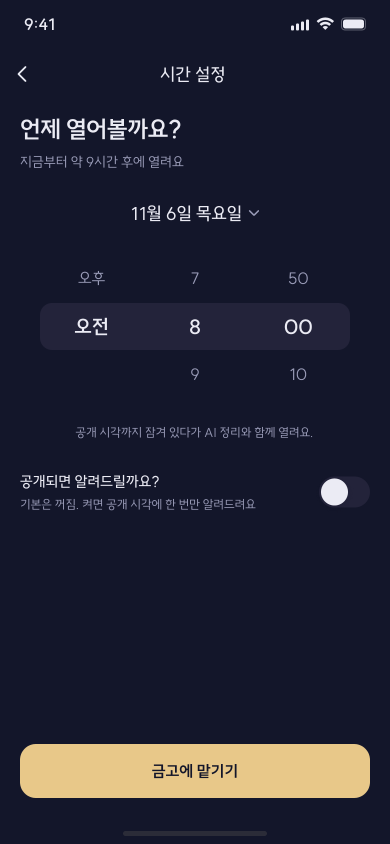

원본 페이지 좌표: (925, 1057, 1315, 1901). 아래 모든 좌표는 프레임 좌상단 기준.

#### 표시 텍스트·좌표


| 텍스트(원문) | x | y | w | h | PDF size | 추출색 |
| --- | --- | --- | --- | --- | --- | --- |
| 9:41 | 24 | 14 | 31.31 | 16.00 | 16 | #000000 |
| 시간 설정 | 160 | 63 | 65.55 | 18.00 | 18 | #000000 |
| 언제 열어볼까요? | 20 | 114 | 161.61 | 24.00 | 24 | #000000 |
| 지금부터 약 9시간 후에 열려요 | 20 | 153 | 163.87 | 14.00 | 14 | #000000 |
| 11월 6일 목요일 | 131 | 202 | 111.12 | 18.00 | 18 | #000000 |
| 오후 | 78.07 | 268 | 27.20 | 16.00 | 16 | #000000 |
| 7 | 190.59 | 268 | 8.83 | 16.00 | 16 | #000000 |
| 50 | 288.03 | 268 | 20.61 | 16.00 | 16 | #000000 |
| 오전 | 74.46 | 314 | 34.40 | 20.00 | 20 | #000000 |
| 8 | 189.06 | 314 | 11.88 | 20.00 | 20 | #000000 |
| 00 | 283.88 | 314 | 28.92 | 20.00 | 20 | #000000 |
| 9 | 190.3 | 364 | 9.40 | 16.00 | 16 | #000000 |
| 10 | 289.58 | 364 | 17.51 | 16.00 | 16 | #000000 |
| 공개 시각까지 잠겨 있다가 AI 정리와 함께 열려요. | 75.5 | 424.5 | 238.02 | 12.50 | 12.5 | #000000 |
| 공개되면 알려드릴까요? | 20 | 472 | 139.60 | 15.00 | 15 | #000000 |
| 기본은 꺼짐. 켜면 공개 시각에 한 번만 알려드려요 | 20 | 496.5 | 235.89 | 12.50 | 12.5 | #000000 |
| 금고에 맡기기 | 151.86 | 761 | 86.26 | 16.00 | 16 | #000000 |


#### 주요 면·선·컨테이너 측정

높이24 이상·폭40 이상의 도형을 출력했다. 글자 윤곽이나 스크림·그림자도 포함될 수 있다. 원본 경로를 보지 않고 모두 직사각형 카드로 취급하지 않는다.


| x | y | w | h | 면 RGB 근사 | 면 alpha | 선 RGB 근사 | 선 두께 |
| --- | --- | --- | --- | --- | --- | --- | --- |
| 0 | 0 | 390.00 | 844.00 | #14172B | 1.0 | 없음 | None |
| 20 | 242 | 350.00 | 169.00 | #14172B | 1.0 | 없음 | None |
| 40 | 303 | 310.00 | 47.00 | #24243A | 1.0 | 없음 | None |
| 319 | 476.5 | 51.00 | 31.00 | #24243A | 1.0 | 없음 | None |
| 20 | 744 | 350.00 | 54.00 | #E8C98A | 1.0 | 없음 | None |


### P02-F06 — 달력 참고 — 라이트

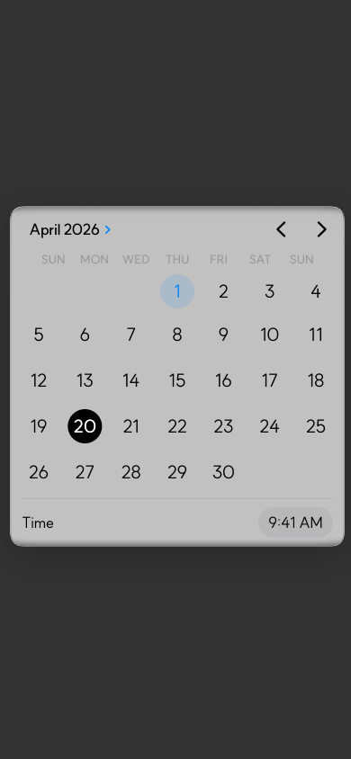

원본 페이지 좌표: (1390, 1057, 1780, 1901). 아래 모든 좌표는 프레임 좌상단 기준.

#### 표시 텍스트·좌표


| 텍스트(원문) | x | y | w | h | PDF size | 추출색 |
| --- | --- | --- | --- | --- | --- | --- |
| April 2026 | 32 | 244 | 78.94 | 17.00 | 17 | #000000 |
|   | 110.94 | 247 | 4.06 | 14.00 | 13 | #000000 |
| 􀆊 | 115 | 247 | 8.03 | 13.00 | 13 | #000000 |
| 􀆉 | 306.04 | 242 | 14.92 | 20.00 | 20 | #000000 |
| 􀆊 | 349.04 | 242 | 14.92 | 20.00 | 20 | #000000 |
| SUN | 45.47 | 280 | 27.06 | 13.00 | 13 | #000000 |
| MON | 89.08 | 280 | 31.83 | 13.00 | 13 | #000000 |
| WED | 135.33 | 280 | 31.35 | 13.00 | 13 | #000000 |
| THU | 183.57 | 280 | 26.86 | 13.00 | 13 | #000000 |
| FRI | 233.03 | 280 | 19.94 | 13.00 | 13 | #000000 |
| SA | 276.42 | 280 | 18.12 | 13.00 | 13 | #000000 |
| T | 293.24 | 280 | 8.35 | 13.00 | 13 | #000000 |
| SUN | 321.47 | 280 | 27.06 | 13.00 | 13 | #000000 |
| 1 | 193.07 | 311 | 7.86 | 20.00 | 20 | #000000 |
| 2 | 242.76 | 311 | 11.16 | 20.00 | 20 | #000000 |
| 3 | 293.82 | 311 | 11.70 | 20.00 | 20 | #000000 |
| 4 | 344.85 | 311 | 12.30 | 20.00 | 20 | #000000 |
| 5 | 37.13 | 359 | 11.74 | 20.00 | 20 | #000000 |
| 6 | 88.46 | 359 | 11.74 | 20.00 | 20 | #000000 |
| 7 | 140.15 | 359 | 11.04 | 20.00 | 20 | #000000 |
| 8 | 191.2 | 359 | 11.60 | 20.00 | 20 | #000000 |
| 9 | 242.46 | 359 | 11.74 | 20.00 | 20 | #000000 |
| 10 | 288.95 | 359 | 21.43 | 20.00 | 20 | #000000 |
| 11 | 342.97 | 359 | 16.07 | 20.00 | 20 | #000000 |
| 12 | 33.72 | 410 | 18.56 | 20.00 | 20 | #000000 |
| 13 | 84.78 | 410 | 19.10 | 20.00 | 20 | #000000 |
| 14 | 135.81 | 410 | 19.71 | 20.00 | 20 | #000000 |
| 15 | 187.43 | 410 | 19.14 | 20.00 | 20 | #000000 |
| 16 | 238.76 | 410 | 19.15 | 20.00 | 20 | #000000 |
| 17 | 290.45 | 410 | 18.44 | 20.00 | 20 | #000000 |
| 18 | 341.5 | 410 | 19.00 | 20.00 | 20 | #000000 |
| 19 | 33.43 | 461 | 19.14 | 20.00 | 20 | #000000 |
| 20 | 81.47 | 461 | 25.72 | 20.00 | 20 | #000000 |
| 21 | 136.39 | 461 | 18.56 | 20.00 | 20 | #000000 |
| 22 | 186.07 | 461 | 21.87 | 20.00 | 20 | #000000 |
| 23 | 237.13 | 461 | 22.41 | 20.00 | 20 | #000000 |
| 24 | 288.16 | 461 | 23.01 | 20.00 | 20 | #000000 |
| 25 | 339.78 | 461 | 22.44 | 20.00 | 20 | #000000 |
| 26 | 31.78 | 512 | 22.44 | 20.00 | 20 | #000000 |
| 27 | 83.46 | 512 | 21.75 | 20.00 | 20 | #000000 |
| 28 | 134.51 | 512 | 22.31 | 20.00 | 20 | #000000 |
| 29 | 185.78 | 512 | 22.44 | 20.00 | 20 | #000000 |
| 30 | 235.7 | 512 | 25.27 | 20.00 | 20 | #000000 |
| Time | 24 | 570 | 36.05 | 17.00 | 17 | #000000 |
| 9:41 A | 298.11 | 570 | 46.97 | 17.00 | 17 | #000000 |
| M | 344.32 | 570 | 14.57 | 17.00 | 17 | #000000 |


#### 주요 면·선·컨테이너 측정

높이24 이상·폭40 이상의 도형을 출력했다. 글자 윤곽이나 스크림·그림자도 포함될 수 있다. 원본 경로를 보지 않고 모두 직사각형 카드로 취급하지 않는다.


| x | y | w | h | 면 RGB 근사 | 면 alpha | 선 RGB 근사 | 선 두께 |
| --- | --- | --- | --- | --- | --- | --- | --- |
| 0 | 0 | 390.00 | 844.00 | #000000 | 0.20000000298023224 | 없음 | None |
| 12 | 230 | 370.00 | 377.00 | #000000 | 1.0 | 없음 | None |
| 12 | 230 | 370.00 | 377.00 | #000000 | 1.0 | 없음 | None |
| 11.5 | 229.5 | 371.00 | 378.00 | #DBDBDB | 1.0 | 없음 | None |
| 12 | 230 | 370.00 | 377.00 | #000000 | 1.0 | 없음 | None |
| 11.5 | 230.75 | 368.50 | 375.50 | #DBDBDB | 1.0 | 없음 | None |
| 12 | 230 | 370.00 | 377.00 | #000000 | 1.0 | 없음 | None |
| 14 | 230.75 | 368.50 | 375.50 | #DBDBDB | 1.0 | 없음 | None |
| 12 | 230 | 370.00 | 377.00 | #FFFFFF | 0.699999988079071 | 없음 | None |
| 12 | 230 | 370.00 | 377.00 | #BFBFBF | 0.10000000149011612 | 없음 | None |
| 12 | 230 | 370.00 | 377.00 | #000000 | 1.0 | 없음 | None |
| 12 | 230 | 370.00 | 377.00 | #FFFFFF | 1.0 | 없음 | None |
| 12 | 230 | 370.00 | 377.00 | #FFFFFF | 1.0 | 없음 | None |
| 12 | 230 | 370.00 | 377.00 | #000000 | 1.0 | 없음 | None |
| 12 | 230 | 370.00 | 377.00 | #282828 | 1.0 | 없음 | None |
| 12 | 230 | 370.00 | 377.00 | #000000 | 1.0 | 없음 | None |
| 12 | 230 | 370.00 | 377.00 | #282828 | 1.0 | 없음 | None |
| 287 | 564 | 83.00 | 34.00 | #767680 | 0.11999999731779099 | 없음 | None |
| 24 | 555 | 346.00 | 52.00 | #000000 | 1.0 | 없음 | None |


### P02-F07 — 달력 참고 — 나이트

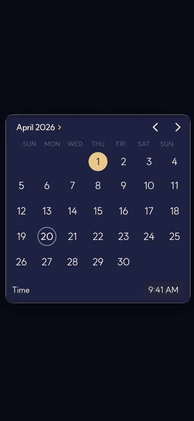

원본 페이지 좌표: (1855, 1057, 2245, 1901). 아래 모든 좌표는 프레임 좌상단 기준.

#### 표시 텍스트·좌표


| 텍스트(원문) | x | y | w | h | PDF size | 추출색 |
| --- | --- | --- | --- | --- | --- | --- |
| April 2026 | 32 | 244 | 78.94 | 17.00 | 17 | #000000 |
|   | 110.94 | 247 | 4.06 | 14.00 | 13 | #000000 |
| 􀆊 | 115 | 247 | 8.03 | 13.00 | 13 | #000000 |
| 􀆉 | 306.04 | 242 | 14.92 | 20.00 | 20 | #000000 |
| 􀆊 | 349.04 | 242 | 14.92 | 20.00 | 20 | #000000 |
| SUN | 45.47 | 280 | 27.06 | 13.00 | 13 | #000000 |
| MON | 89.08 | 280 | 31.83 | 13.00 | 13 | #000000 |
| WED | 135.33 | 280 | 31.35 | 13.00 | 13 | #000000 |
| THU | 183.57 | 280 | 26.86 | 13.00 | 13 | #000000 |
| FRI | 233.03 | 280 | 19.94 | 13.00 | 13 | #000000 |
| SA | 276.42 | 280 | 18.12 | 13.00 | 13 | #000000 |
| T | 293.24 | 280 | 8.35 | 13.00 | 13 | #000000 |
| SUN | 321.47 | 280 | 27.06 | 13.00 | 13 | #000000 |
| 1 | 193.07 | 311 | 7.86 | 20.00 | 20 | #000000 |
| 2 | 242.76 | 311 | 11.16 | 20.00 | 20 | #000000 |
| 3 | 293.82 | 311 | 11.70 | 20.00 | 20 | #000000 |
| 4 | 344.85 | 311 | 12.30 | 20.00 | 20 | #000000 |
| 5 | 37.13 | 359 | 11.74 | 20.00 | 20 | #000000 |
| 6 | 88.46 | 359 | 11.74 | 20.00 | 20 | #000000 |
| 7 | 140.15 | 359 | 11.04 | 20.00 | 20 | #000000 |
| 8 | 191.2 | 359 | 11.60 | 20.00 | 20 | #000000 |
| 9 | 242.46 | 359 | 11.74 | 20.00 | 20 | #000000 |
| 10 | 288.95 | 359 | 21.43 | 20.00 | 20 | #000000 |
| 11 | 342.97 | 359 | 16.07 | 20.00 | 20 | #000000 |
| 12 | 33.72 | 410 | 18.56 | 20.00 | 20 | #000000 |
| 13 | 84.78 | 410 | 19.10 | 20.00 | 20 | #000000 |
| 14 | 135.81 | 410 | 19.71 | 20.00 | 20 | #000000 |
| 15 | 187.43 | 410 | 19.14 | 20.00 | 20 | #000000 |
| 16 | 238.76 | 410 | 19.15 | 20.00 | 20 | #000000 |
| 17 | 290.45 | 410 | 18.44 | 20.00 | 20 | #000000 |
| 18 | 341.5 | 410 | 19.00 | 20.00 | 20 | #000000 |
| 19 | 33.43 | 461 | 19.14 | 20.00 | 20 | #000000 |
| 20 | 81.47 | 461 | 25.72 | 20.00 | 20 | #000000 |
| 21 | 136.39 | 461 | 18.56 | 20.00 | 20 | #000000 |
| 22 | 186.07 | 461 | 21.86 | 20.00 | 20 | #000000 |
| 23 | 237.13 | 461 | 22.40 | 20.00 | 20 | #000000 |
| 24 | 288.16 | 461 | 23.01 | 20.00 | 20 | #000000 |
| 25 | 339.78 | 461 | 22.44 | 20.00 | 20 | #000000 |
| 26 | 31.78 | 512 | 22.44 | 20.00 | 20 | #000000 |
| 27 | 83.46 | 512 | 21.75 | 20.00 | 20 | #000000 |
| 28 | 134.51 | 512 | 22.31 | 20.00 | 20 | #000000 |
| 29 | 185.78 | 512 | 22.44 | 20.00 | 20 | #000000 |
| 30 | 235.7 | 512 | 25.27 | 20.00 | 20 | #000000 |
| Time | 24 | 570 | 36.05 | 17.00 | 17 | #000000 |
| 9:41 A | 298.11 | 570 | 46.97 | 17.00 | 17 | #000000 |
| M | 344.32 | 570 | 14.57 | 17.00 | 17 | #000000 |


#### 주요 면·선·컨테이너 측정

높이24 이상·폭40 이상의 도형을 출력했다. 글자 윤곽이나 스크림·그림자도 포함될 수 있다. 원본 경로를 보지 않고 모두 직사각형 카드로 취급하지 않는다.


| x | y | w | h | 면 RGB 근사 | 면 alpha | 선 RGB 근사 | 선 두께 |
| --- | --- | --- | --- | --- | --- | --- | --- |
| 0 | 0 | 390.00 | 844.00 | #14172B | 1.0 | 없음 | None |
| 0 | 0 | 390.00 | 844.00 | #000000 | 0.47999998927116394 | 없음 | None |
| 11.5 | 229.5 | 371.00 | 378.00 | #A6A6A6 | 1.0 | 없음 | None |
| 11.5 | 230.75 | 368.50 | 375.50 | #A6A6A6 | 1.0 | 없음 | None |
| 14 | 230.75 | 368.50 | 375.50 | #A6A6A6 | 1.0 | 없음 | None |
| 12 | 230 | 370.00 | 377.00 | #1E2240 | 1.0 | 없음 | None |
| 12 | 230 | 370.00 | 377.00 | #000000 | 1.0 | 없음 | None |
| 12 | 230 | 370.00 | 377.00 | #FFFFFF | 1.0 | 없음 | None |
| 12 | 230 | 370.00 | 377.00 | #FFFFFF | 1.0 | 없음 | None |
| 12 | 230 | 370.00 | 377.00 | #000000 | 1.0 | 없음 | None |
| 12 | 230 | 370.00 | 377.00 | #1A1A1A | 1.0 | 없음 | None |
| 12 | 230 | 370.00 | 377.00 | #000000 | 1.0 | 없음 | None |
| 12 | 230 | 370.00 | 377.00 | #1A1A1A | 1.0 | 없음 | None |
| 73.83 | 453.5 | 41.00 | 41.00 | #9A9CB8 | 1.0 | 없음 | None |
| 287 | 564 | 83.00 | 34.00 | #24243A | 1.0 | 없음 | None |
| 24 | 555 | 346.00 | 52.00 | #000000 | 1.0 | 없음 | None |


### P03-F01 — S-07 금고 목록

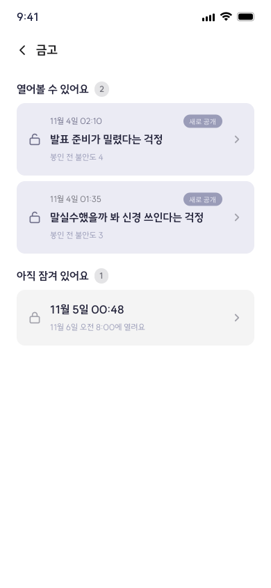

원본 페이지 좌표: (80, 80, 470, 924). 아래 모든 좌표는 프레임 좌상단 기준.

#### 표시 텍스트·좌표


| 텍스트(원문) | x | y | w | h | PDF size | 추출색 |
| --- | --- | --- | --- | --- | --- | --- |
| 9:41 | 24 | 14 | 31.31 | 16.00 | 16 | #000000 |
| 금고 | 52 | 60.5 | 30.96 | 18.00 | 18 | #000000 |
| 열어볼 수 있어요 | 24 | 118 | 103.68 | 16.00 | 16 | #000000 |
| 2 | 143 | 120 | 6.91 | 12.00 | 12 | #000000 |
| 11월 4일 02:10 | 72 | 166 | 74.85 | 12.00 | 12 | #000000 |
| 새로 공개 | 272 | 168.5 | 39.04 | 10.00 | 10 | #000000 |
| 발표 준비가 밀렸다는 걱정 | 72 | 190 | 162.40 | 16.00 | 16 | #000000 |
| 봉인 전 불안도 4 | 72 | 218 | 76.86 | 12.00 | 12 | #000000 |
| 11월 4일 01:35 | 72 | 278 | 73.81 | 12.00 | 12 | #000000 |
| 새로 공개 | 272 | 280.5 | 39.04 | 10.00 | 10 | #000000 |
| 말실수했을까 봐 신경 쓰인다는 걱정 | 72 | 302 | 221.12 | 16.00 | 16 | #000000 |
| 봉인 전 불안도 3 | 72 | 330 | 76.50 | 12.00 | 12 | #000000 |
| 아직 잠겨 있어요 | 24 | 386 | 103.68 | 16.00 | 16 | #000000 |
| 1 | 143 | 388 | 5.26 | 12.00 | 12 | #000000 |
| 11월 5일 00:48 | 72 | 434 | 106.49 | 16.00 | 16 | #000000 |
| 11월 6일 오전 8:00에 열려요 | 72 | 462 | 136.78 | 12.00 | 12 | #000000 |


#### 주요 면·선·컨테이너 측정

높이24 이상·폭40 이상의 도형을 출력했다. 글자 윤곽이나 스크림·그림자도 포함될 수 있다. 원본 경로를 보지 않고 모두 직사각형 카드로 취급하지 않는다.


| x | y | w | h | 면 RGB 근사 | 면 alpha | 선 RGB 근사 | 선 두께 |
| --- | --- | --- | --- | --- | --- | --- | --- |
| 0 | 0 | 390.00 | 844.00 | #FFFFFF | 1.0 | 없음 | None |
| 24 | 148 | 342.00 | 104.00 | #ECEBF5 | 1.0 | 없음 | None |
| 24 | 260 | 342.00 | 104.00 | #ECEBF5 | 1.0 | 없음 | None |
| 24 | 416 | 342.00 | 80.00 | #F4F4F5 | 1.0 | 없음 | None |


### P03-F02 — S-07 잠금 안내 — LOCK-01

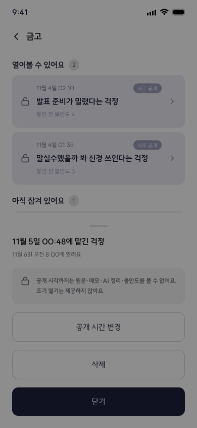

원본 페이지 좌표: (960, 80, 1350, 924). 아래 모든 좌표는 프레임 좌상단 기준.

#### 표시 텍스트·좌표


| 텍스트(원문) | x | y | w | h | PDF size | 추출색 |
| --- | --- | --- | --- | --- | --- | --- |
| 9:41 | 24 | 14 | 31.31 | 16.00 | 16 | #000000 |
| 금고 | 52 | 60.5 | 30.96 | 18.00 | 18 | #000000 |
| 열어볼 수 있어요 | 24 | 118 | 103.68 | 16.00 | 16 | #000000 |
| 2 | 143 | 120 | 6.91 | 12.00 | 12 | #000000 |
| 11월 4일 02:10 | 72 | 166 | 74.85 | 12.00 | 12 | #000000 |
| 새로 공개 | 272 | 168.5 | 39.04 | 10.00 | 10 | #000000 |
| 발표 준비가 밀렸다는 걱정 | 72 | 190 | 162.40 | 16.00 | 16 | #000000 |
| 봉인 전 불안도 4 | 72 | 218 | 76.86 | 12.00 | 12 | #000000 |
| 11월 4일 01:35 | 72 | 278 | 73.81 | 12.00 | 12 | #000000 |
| 새로 공개 | 272 | 280.5 | 39.04 | 10.00 | 10 | #000000 |
| 말실수했을까 봐 신경 쓰인다는 걱정 | 72 | 302 | 221.12 | 16.00 | 16 | #000000 |
| 봉인 전 불안도 3 | 72 | 330 | 76.50 | 12.00 | 12 | #000000 |
| 아직 잠겨 있어요 | 24 | 386 | 103.68 | 16.00 | 16 | #000000 |
| 1 | 143 | 388 | 5.26 | 12.00 | 12 | #000000 |
| 11월 5일 00:48 | 72 | 434 | 106.49 | 16.00 | 16 | #000000 |
| 11월 6일 오전 8:00에 열려요 | 24 | 494 | 136.78 | 12.00 | 12 | #000000 |
| 공개 시각까지는 원문·메모·AI 정리·불안도를 볼 수 없어요.  | 72 | 546 | 280.39 | 12.00 | 12 | #000000 |
| 조기 열기는 제공하지 않아요. | 72 | 566 | 135.46 | 12.00 | 12 | #000000 |
| 11월 5일 00:48에 맡긴 걱정 | 24 | 466 | 182.65 | 16.00 | 16 | #000000 |
| 11월 6일 오전 8:00에 열려요 | 72 | 462 | 136.78 | 12.00 | 12 | #000000 |
| 공개 시간 변경 | 150.53 | 635 | 88.96 | 16.00 | 16 | #000000 |
| 삭제 | 181.41 | 709 | 27.20 | 16.00 | 16 | #000000 |
| 닫기 | 181.41 | 782 | 27.20 | 16.00 | 16 | #000000 |


#### 주요 면·선·컨테이너 측정

높이24 이상·폭40 이상의 도형을 출력했다. 글자 윤곽이나 스크림·그림자도 포함될 수 있다. 원본 경로를 보지 않고 모두 직사각형 카드로 취급하지 않는다.


| x | y | w | h | 면 RGB 근사 | 면 alpha | 선 RGB 근사 | 선 두께 |
| --- | --- | --- | --- | --- | --- | --- | --- |
| 0 | 0 | 390.00 | 844.00 | #FFFFFF | 1.0 | 없음 | None |
| 24 | 148 | 342.00 | 104.00 | #ECEBF5 | 1.0 | 없음 | None |
| 24 | 260 | 342.00 | 104.00 | #ECEBF5 | 1.0 | 없음 | None |
| 24 | 416 | 342.00 | 80.00 | #F4F4F5 | 1.0 | 없음 | None |
| 0 | 420 | 390.00 | 424.00 | #FFFFFF | 1.0 | 없음 | None |
| 24 | 528 | 342.00 | 72.00 | #F4F4F5 | 1.0 | 없음 | None |
| 72 | 548.27 | 276.54 | 31.12 | #71717A | 1.0 | 없음 | None |
| 24 | 616 | 342.00 | 58.00 | #FFFFFF | 1.0 | 없음 | None |
| 23 | 615 | 344.00 | 60.00 | #D4D4D8 | 1.0 | 없음 | None |
| 24 | 690 | 342.00 | 58.00 | #FFFFFF | 1.0 | 없음 | None |
| 23 | 689 | 344.00 | 60.00 | #D4D4D8 | 1.0 | 없음 | None |
| 24 | 764 | 342.00 | 56.00 | #1E2240 | 1.0 | 없음 | None |
| 0 | 0 | 390.00 | 844.00 | #000000 | 0.44999998807907104 | 없음 | None |


### P03-F03 — S-07 잠금 안내 — 공개 시각 도달 LOCK-03

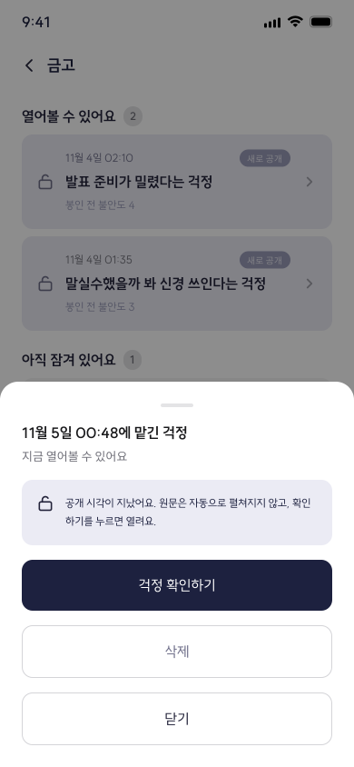

원본 페이지 좌표: (1840, 80, 2230, 924). 아래 모든 좌표는 프레임 좌상단 기준.

#### 표시 텍스트·좌표


| 텍스트(원문) | x | y | w | h | PDF size | 추출색 |
| --- | --- | --- | --- | --- | --- | --- |
| 9:41 | 24 | 14 | 31.31 | 16.00 | 16 | #000000 |
| 금고 | 52 | 60.5 | 30.96 | 18.00 | 18 | #000000 |
| 열어볼 수 있어요 | 24 | 118 | 103.68 | 16.00 | 16 | #000000 |
| 2 | 143 | 120 | 6.91 | 12.00 | 12 | #000000 |
| 11월 4일 02:10 | 72 | 166 | 74.85 | 12.00 | 12 | #000000 |
| 새로 공개 | 272 | 168.5 | 39.04 | 10.00 | 10 | #000000 |
| 발표 준비가 밀렸다는 걱정 | 72 | 190 | 162.40 | 16.00 | 16 | #000000 |
| 봉인 전 불안도 4 | 72 | 218 | 76.86 | 12.00 | 12 | #000000 |
| 11월 4일 01:35 | 72 | 278 | 73.81 | 12.00 | 12 | #000000 |
| 새로 공개 | 272 | 280.5 | 39.04 | 10.00 | 10 | #000000 |
| 말실수했을까 봐 신경 쓰인다는 걱정 | 72 | 302 | 221.12 | 16.00 | 16 | #000000 |
| 봉인 전 불안도 3 | 72 | 330 | 76.50 | 12.00 | 12 | #000000 |
| 아직 잠겨 있어요 | 24 | 386 | 103.68 | 16.00 | 16 | #000000 |
| 1 | 143 | 388 | 5.26 | 12.00 | 12 | #000000 |
| 11월 5일 00:48 | 72 | 434 | 106.49 | 16.00 | 16 | #000000 |
| 지금 열어볼 수 있어요 | 24 | 494 | 116.38 | 13.00 | 13 | #000000 |
| 공개 시각이 지났어요. 원문은 자동으로 펼쳐지지 않고, 확인 | 72 | 546 | 270.56 | 12.00 | 12 | #000000 |
| 하기를 누르면 열려요. | 72 | 566 | 100.49 | 12.00 | 12 | #000000 |
| 걱정 확인하기 | 152.38 | 634 | 85.28 | 16.00 | 16 | #000000 |
| 11월 5일 00:48에 맡긴 걱정 | 24 | 466 | 182.65 | 16.00 | 16 | #000000 |
| 11월 6일 오전 8:00에 열려요 | 72 | 462 | 136.78 | 12.00 | 12 | #000000 |
| 삭제 | 181.41 | 707 | 27.20 | 16.00 | 16 | #000000 |
| 닫기 | 181.41 | 781 | 27.20 | 16.00 | 16 | #000000 |


#### 주요 면·선·컨테이너 측정

높이24 이상·폭40 이상의 도형을 출력했다. 글자 윤곽이나 스크림·그림자도 포함될 수 있다. 원본 경로를 보지 않고 모두 직사각형 카드로 취급하지 않는다.


| x | y | w | h | 면 RGB 근사 | 면 alpha | 선 RGB 근사 | 선 두께 |
| --- | --- | --- | --- | --- | --- | --- | --- |
| -1840 | -80 | 4450.00 | 1384.00 | #404040 | 1.0 | 없음 | None |
| -1841 | -81 | 4452.00 | 1386.00 | #000000 | 0.10000000149011612 | 없음 | None |
| 0 | 0 | 390.00 | 844.00 | #FFFFFF | 1.0 | 없음 | None |
| 24 | 148 | 342.00 | 104.00 | #ECEBF5 | 1.0 | 없음 | None |
| 24 | 260 | 342.00 | 104.00 | #ECEBF5 | 1.0 | 없음 | None |
| 24 | 416 | 342.00 | 80.00 | #F4F4F5 | 1.0 | 없음 | None |
| 0 | 0 | 390.00 | 844.00 | #000000 | 0.44999998807907104 | 없음 | None |
| 0 | 420 | 390.00 | 424.00 | #FFFFFF | 1.0 | 없음 | None |
| 24 | 528 | 342.00 | 72.00 | #ECEBF5 | 1.0 | 없음 | None |
| 72 | 548.28 | 269.30 | 30.61 | #1E2240 | 1.0 | 없음 | None |
| 24 | 616 | 342.00 | 56.00 | #1E2240 | 1.0 | 없음 | None |
| 24 | 688 | 342.00 | 58.00 | #FFFFFF | 1.0 | 없음 | None |
| 23 | 687 | 344.00 | 60.00 | #D4D4D8 | 1.0 | 없음 | None |
| 24 | 762 | 342.00 | 58.00 | #FFFFFF | 1.0 | 없음 | None |
| 23 | 761 | 344.00 | 60.00 | #D4D4D8 | 1.0 | 없음 | None |


### P03-F04 — S-07 공개 전 삭제 확인 — LOCK-02

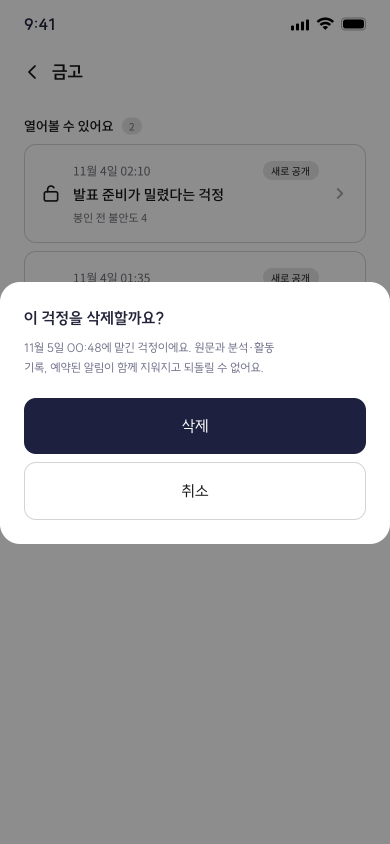

원본 페이지 좌표: (2720, 80, 3110, 924). 아래 모든 좌표는 프레임 좌상단 기준.

#### 표시 텍스트·좌표


| 텍스트(원문) | x | y | w | h | PDF size | 추출색 |
| --- | --- | --- | --- | --- | --- | --- |
| 9:41 | 24 | 14 | 31.31 | 16.00 | 16 | #000000 |
| 금고 | 52 | 60.5 | 30.96 | 18.00 | 18 | #000000 |
| 열어볼 수 있어요 | 24 | 118 | 89.57 | 13.00 | 13 | #000000 |
| 2 | 129 | 120.5 | 5.55 | 10.00 | 10 | #000000 |
| 11월 4일 02:10 | 73 | 163.5 | 77.41 | 12.00 | 12 | #000000 |
| 새로 공개 | 271 | 165 | 39.04 | 10.00 | 10 | #000000 |
| 발표 준비가 밀렸다는 걱정 | 73 | 186 | 151.13 | 14.00 | 14 | #000000 |
| 봉인 전 불안도 4 | 73 | 211 | 74.22 | 11.00 | 11 | #000000 |
| 11월 4일 01:35 | 73 | 270.5 | 77.39 | 12.00 | 12 | #000000 |
| 새로 공개 | 271 | 272 | 39.04 | 10.00 | 10 | #000000 |
| 이 걱정을 삭제할까요? | 24 | 308 | 140.24 | 16.00 | 16 | #000000 |
| 말실수했을까 봐 신경 쓰인다는 걱정. 상 | 73 | 293 | 225.96 | 14.00 | 14 | #000000 |
| 대 | 311.83 | 293 | 3.15 | 14.00 | 14 | #000000 |
|  반응은 아직 모르는 일 | 111.64 | 314 | 48.08 | 14.00 | 14 | #000000 |
| 일 | 185.46 | 314 | 12.88 | 14.00 | 14 | #000000 |
| 봉인 전 불안도 3 | 73 | 318 | 74.20 | 11.00 | 11 | #000000 |
| 11월 5일 00:48에 맡긴 걱정이에요. 원문과 분석·활동   | 24 | 340 | 253.18 | 12.00 | 12 | #000000 |
| 기록, 예약된 알림이 함께 지워지고 되돌릴 수 없어요. | 24 | 360 | 239.92 | 12.00 | 12 | #000000 |
| 아직 잠겨 있어요 | 24 | 372 | 89.56 | 13.00 | 13 | #000000 |
| 1 | 129 | 374.5 | 5.55 | 10.00 | 10 | #000000 |
| 11월 5일 00:48 | 72 | 416 | 92.09 | 14.00 | 14 | #000000 |
| 삭제 | 181.41 | 416 | 27.20 | 16.00 | 16 | #000000 |
| 11월 6일 오전 8:00에 열려요 | 72 | 441 | 130.46 | 11.00 | 11 | #000000 |
| 취소 | 181.41 | 481 | 27.20 | 16.00 | 16 | #000000 |


#### 주요 면·선·컨테이너 측정

높이24 이상·폭40 이상의 도형을 출력했다. 글자 윤곽이나 스크림·그림자도 포함될 수 있다. 원본 경로를 보지 않고 모두 직사각형 카드로 취급하지 않는다.


| x | y | w | h | 면 RGB 근사 | 면 alpha | 선 RGB 근사 | 선 두께 |
| --- | --- | --- | --- | --- | --- | --- | --- |
| 0 | 0 | 390.00 | 844.00 | #FFFFFF | 1.0 | 없음 | None |
| 24 | 144 | 342.00 | 99.00 | #FFFFFF | 1.0 | 없음 | None |
| 23 | 143 | 344.00 | 101.00 | #D4D4D8 | 1.0 | 없음 | None |
| 24 | 251 | 342.00 | 99.00 | #FFFFFF | 1.0 | 없음 | None |
| 23 | 250 | 344.00 | 101.00 | #D4D4D8 | 1.0 | 없음 | None |
| 24 | 398 | 342.00 | 74.00 | #F4F4F5 | 1.0 | 없음 | None |
| 0 | 0 | 390.00 | 844.00 | #000000 | 0.44999998807907104 | 없음 | None |
| 0 | 282 | 390.00 | 262.00 | #FFFFFF | 1.0 | 없음 | None |
| 24 | 342.16 | 250.05 | 31.15 | #6E6F8A | 1.0 | 없음 | None |
| 24 | 398 | 342.00 | 56.00 | #1E2240 | 1.0 | 없음 | None |
| 24 | 462 | 342.00 | 58.00 | #FFFFFF | 1.0 | 없음 | None |
| 23 | 461 | 344.00 | 60.00 | #D4D4D8 | 1.0 | 없음 | None |


### P03-F05 — S-08 걱정 상세 — 스크롤

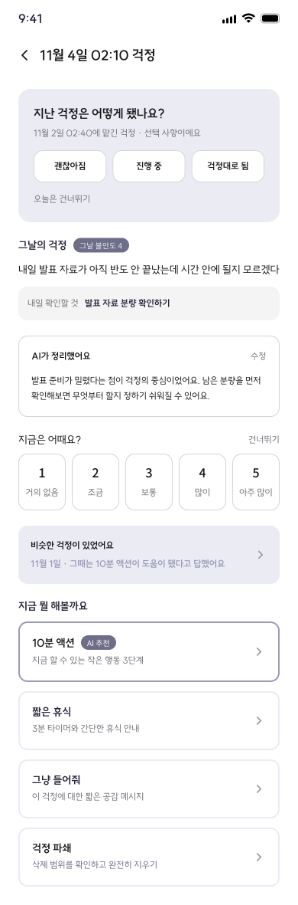

원본 페이지 좌표: (3600, 80, 3990, 1261). 아래 모든 좌표는 프레임 좌상단 기준.

#### 표시 텍스트·좌표


| 텍스트(원문) | x | y | w | h | PDF size | 추출색 |
| --- | --- | --- | --- | --- | --- | --- |
| 9:41 | 24 | 14 | 31.31 | 16.00 | 16 | #000000 |
| 11월 4일 02:10 걱정 | 52 | 60.5 | 151.62 | 18.00 | 18 | #000000 |
| 지난 걱정은 어떻게 됐나요? | 44 | 138 | 171.46 | 16.00 | 16 | #000000 |
| 11월 2일 02:40에 맡긴 걱정 · 선택 사항이에요 | 44 | 166 | 218.83 | 12.00 | 12 | #000000 |
| 괜찮아짐 | 71.02 | 209 | 41.29 | 12.00 | 12 | #000000 |
| 진행 중 | 178.13 | 209 | 33.73 | 12.00 | 12 | #000000 |
| 걱정대로 됨 | 271.14 | 209 | 54.38 | 12.00 | 12 | #000000 |
| 오늘은 건너뛰기 | 44 | 252 | 74.14 | 12.00 | 12 | #000000 |
| 그날의 걱정 | 24 | 311 | 63.43 | 14.00 | 14 | #000000 |
| 그날 불안도 4 | 104 | 314.5 | 56.02 | 10.00 | 10 | #000000 |
| 내일 발표 자료가 아직 반도 안 끝났는데 시간 안에 될지 모르겠다 | 24 | 343 | 341.53 | 14.00 | 14 | #000000 |
| 내일 확인할 것 | 36 | 388 | 66.71 | 12.00 | 12 | #000000 |
| 발표 자료 분량 확인하기 | 111 | 388 | 111.53 | 12.00 | 12 | #000000 |
| AI가 정리했어요 | 41 | 457 | 77.45 | 12.00 | 12 | #000000 |
| 수정 | 328 | 457 | 20.40 | 12.00 | 12 | #000000 |
| 발표 준비가 밀렸다는 점이 걱정의 중심이었어요. 남은 분량을 먼저  | 41 | 489 | 303.32 | 12.00 | 12 | #000000 |
| 확인해보면 무엇부터 할지 정하기 쉬워질 수 있어요. | 41 | 509 | 233.87 | 12.00 | 12 | #000000 |
| 지금은 어때요? | 24 | 565 | 82.18 | 14.00 | 14 | #000000 |
| 건너뛰기 | 325 | 566 | 40.79 | 12.00 | 12 | #000000 |
| 1 | 50.44 | 607 | 9.12 | 16.00 | 16 | #000000 |
| 2 | 120.44 | 607 | 9.12 | 16.00 | 16 | #000000 |
| 3 | 190.44 | 607 | 9.12 | 16.00 | 16 | #000000 |
| 4 | 260.44 | 607 | 9.12 | 16.00 | 16 | #000000 |
| 5 | 330.44 | 607 | 9.12 | 16.00 | 16 | #000000 |
| 거의 없음 | 33.23 | 635 | 43.55 | 12.00 | 12 | #000000 |
| 조금 | 114.8 | 635 | 20.40 | 12.00 | 12 | #000000 |
| 보통 | 184.8 | 635 | 20.40 | 12.00 | 12 | #000000 |
| 많이 | 254.8 | 635 | 20.40 | 12.00 | 12 | #000000 |
| 아주 많이 | 313.23 | 635 | 43.55 | 12.00 | 12 | #000000 |
| 비슷한 걱정이 있었어요 | 40 | 704 | 108.77 | 12.00 | 12 | #000000 |
| 11월 1일 · 그때는 10분 액션이 도움이 됐다고 답했어요 | 40 | 728 | 254.45 | 12.00 | 12 | #000000 |
| 지금 뭘 해볼까요 | 24 | 782 | 90.75 | 14.00 | 14 | #000000 |
| 10분 액션 | 42 | 830 | 55.61 | 14.00 | 14 | #000000 |
| AI 추천 | 114 | 833 | 29.65 | 10.00 | 10 | #000000 |
| 지금 할 수 있는 작은 행동 3단계 | 42 | 854 | 145.97 | 12.00 | 12 | #000000 |
| 짧은 휴식 | 42 | 920 | 51.40 | 14.00 | 14 | #000000 |
| 3분 타이머와 간단한 휴식 안내 | 42 | 943 | 140.43 | 12.00 | 12 | #000000 |
| 그냥 들어줘 | 42 | 1009 | 63.45 | 14.00 | 14 | #000000 |
| 이 걱정에 대한 짧은 공감 메시지 | 42 | 1032 | 146.38 | 12.00 | 12 | #000000 |
| 걱정 파쇄 | 42 | 1098 | 51.40 | 14.00 | 14 | #000000 |
| 삭제 범위를 확인하고 완전히 지우기 | 42 | 1121 | 164.00 | 12.00 | 12 | #000000 |


#### 주요 면·선·컨테이너 측정

높이24 이상·폭40 이상의 도형을 출력했다. 글자 윤곽이나 스크림·그림자도 포함될 수 있다. 원본 경로를 보지 않고 모두 직사각형 카드로 취급하지 않는다.


| x | y | w | h | 면 RGB 근사 | 면 alpha | 선 RGB 근사 | 선 두께 |
| --- | --- | --- | --- | --- | --- | --- | --- |
| 0 | 0 | 390.00 | 1181.00 | #FFFFFF | 1.0 | 없음 | None |
| 24 | 116 | 342.00 | 174.00 | #ECEBF5 | 1.0 | 없음 | None |
| 44 | 196 | 95.33 | 42.00 | #FFFFFF | 1.0 | 없음 | None |
| 43 | 195 | 97.33 | 44.00 | #D4D4D8 | 1.0 | 없음 | None |
| 147.33 | 196 | 95.34 | 42.00 | #FFFFFF | 1.0 | 없음 | None |
| 146.33 | 195 | 97.34 | 44.00 | #D4D4D8 | 1.0 | 없음 | None |
| 250.67 | 196 | 95.33 | 42.00 | #FFFFFF | 1.0 | 없음 | None |
| 249.67 | 195 | 97.33 | 44.00 | #D4D4D8 | 1.0 | 없음 | None |
| 24 | 374 | 342.00 | 44.00 | #F4F4F5 | 1.0 | 없음 | None |
| 24 | 438 | 342.00 | 106.00 | #FFFFFF | 1.0 | 없음 | None |
| 23 | 437 | 344.00 | 108.00 | #D4D4D8 | 1.0 | 없음 | None |
| 41 | 491.28 | 299.31 | 30.74 | #18181B | 1.0 | 없음 | None |
| 24 | 592 | 62.00 | 74.00 | #FFFFFF | 1.0 | 없음 | None |
| 23 | 591 | 64.00 | 76.00 | #D4D4D8 | 1.0 | 없음 | None |
| 94 | 592 | 62.00 | 74.00 | #FFFFFF | 1.0 | 없음 | None |
| 93 | 591 | 64.00 | 76.00 | #D4D4D8 | 1.0 | 없음 | None |
| 164 | 592 | 62.00 | 74.00 | #FFFFFF | 1.0 | 없음 | None |
| 163 | 591 | 64.00 | 76.00 | #D4D4D8 | 1.0 | 없음 | None |
| 234 | 592 | 62.00 | 74.00 | #FFFFFF | 1.0 | 없음 | None |
| 233 | 591 | 64.00 | 76.00 | #D4D4D8 | 1.0 | 없음 | None |
| 304 | 592 | 62.00 | 74.00 | #FFFFFF | 1.0 | 없음 | None |
| 303 | 591 | 64.00 | 76.00 | #D4D4D8 | 1.0 | 없음 | None |
| 24 | 686 | 342.00 | 76.00 | #ECEBF5 | 1.0 | 없음 | None |
| 24 | 811 | 342.00 | 79.00 | #FFFFFF | 1.0 | 없음 | None |
| 22 | 809 | 346.00 | 83.00 | #9A9CB8 | 1.0 | 없음 | None |
| 24 | 902 | 342.00 | 77.00 | #FFFFFF | 1.0 | 없음 | None |
| 22 | 900 | 346.00 | 81.00 | #ECEBF5 | 1.0 | 없음 | None |
| 24 | 991 | 342.00 | 77.00 | #FFFFFF | 1.0 | 없음 | None |
| 22 | 989 | 346.00 | 81.00 | #ECEBF5 | 1.0 | 없음 | None |
| 24 | 1080 | 342.00 | 77.00 | #FFFFFF | 1.0 | 없음 | None |
| 22 | 1078 | 346.00 | 81.00 | #ECEBF5 | 1.0 | 없음 | None |


### P04-F01 — S-09 파쇄 확인

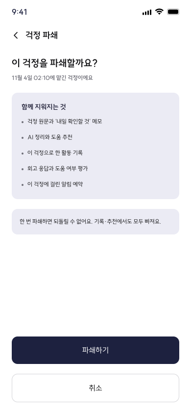

원본 페이지 좌표: (80, 80, 470, 924). 아래 모든 좌표는 프레임 좌상단 기준.

#### 표시 텍스트·좌표


| 텍스트(원문) | x | y | w | h | PDF size | 추출색 |
| --- | --- | --- | --- | --- | --- | --- |
| 9:41 | 24 | 14 | 31.31 | 16.00 | 16 | #000000 |
| 걱정 파쇄 | 52 | 60.5 | 66.06 | 18.00 | 18 | #000000 |
| 이 걱정을 파쇄할까요? | 24 | 116 | 175.22 | 20.00 | 20 | #000000 |
| 11월 4일 02:10에 맡긴 걱정이에요 | 24 | 151 | 165.76 | 12.00 | 12 | #000000 |
| 함께 지워지는 것 | 44 | 209 | 90.72 | 14.00 | 14 | #000000 |
| 걱정 원문과 ‘내일 확인할 것’ 메모 | 56 | 240 | 152.50 | 12.00 | 12 | #000000 |
| AI 정리와 도움 추천 | 56 | 272 | 91.93 | 12.00 | 12 | #000000 |
| 이 걱정으로 한 활동 기록 | 56 | 304 | 113.04 | 12.00 | 12 | #000000 |
| 회고 응답과 도움 여부 평가 | 56 | 336 | 123.24 | 12.00 | 12 | #000000 |
| 이 걱정에 걸린 알림 예약 | 56 | 368 | 113.04 | 12.00 | 12 | #000000 |
| 한 번 파쇄하면 되돌릴 수 없어요. 기록·추천에서도 모두 빠져요. | 40 | 444 | 289.22 | 12.00 | 12 | #000000 |
| 파쇄하기 | 167.81 | 704 | 54.40 | 16.00 | 16 | #000000 |
| 취소 | 181.41 | 781 | 27.20 | 16.00 | 16 | #000000 |


#### 주요 면·선·컨테이너 측정

높이24 이상·폭40 이상의 도형을 출력했다. 글자 윤곽이나 스크림·그림자도 포함될 수 있다. 원본 경로를 보지 않고 모두 직사각형 카드로 취급하지 않는다.


| x | y | w | h | 면 RGB 근사 | 면 alpha | 선 RGB 근사 | 선 두께 |
| --- | --- | --- | --- | --- | --- | --- | --- |
| 0 | 0 | 390.00 | 844.00 | #FFFFFF | 1.0 | 없음 | None |
| 24 | 189 | 342.00 | 217.00 | #ECEBF5 | 1.0 | 없음 | None |
| 24 | 426 | 342.00 | 52.00 | #ECEBF5 | 1.0 | 없음 | None |
| 24 | 686 | 342.00 | 56.00 | #1E2240 | 1.0 | 없음 | None |
| 24 | 762 | 342.00 | 58.00 | #FFFFFF | 1.0 | 없음 | None |
| 23 | 761 | 344.00 | 60.00 | #D4D4D8 | 1.0 | 없음 | None |


### P04-F02 — S-09 파쇄 완료

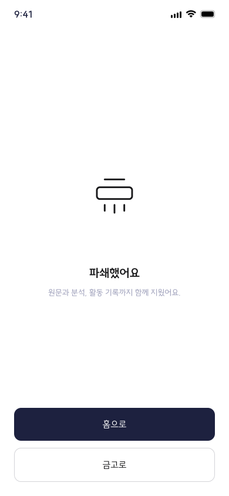

원본 페이지 좌표: (960, 80, 1350, 924). 아래 모든 좌표는 프레임 좌상단 기준.

#### 표시 텍스트·좌표


| 텍스트(원문) | x | y | w | h | PDF size | 추출색 |
| --- | --- | --- | --- | --- | --- | --- |
| 9:41 | 24 | 14 | 31.31 | 16.00 | 16 | #000000 |
| 파쇄했어요 | 151.98 | 452 | 86.00 | 20.00 | 20 | #000000 |
| 원문과 분석, 활동 기록까지 함께 지웠어요. | 82.07 | 489 | 225.92 | 14.00 | 14 | #000000 |
| 홈으로 | 174.61 | 712 | 40.80 | 16.00 | 16 | #000000 |
| 금고로 | 174.61 | 781 | 40.80 | 16.00 | 16 | #000000 |


#### 주요 면·선·컨테이너 측정

높이24 이상·폭40 이상의 도형을 출력했다. 글자 윤곽이나 스크림·그림자도 포함될 수 있다. 원본 경로를 보지 않고 모두 직사각형 카드로 취급하지 않는다.


| x | y | w | h | 면 RGB 근사 | 면 alpha | 선 RGB 근사 | 선 두께 |
| --- | --- | --- | --- | --- | --- | --- | --- |
| 0 | 0 | 390.00 | 844.00 | #FFFFFF | 1.0 | 없음 | None |
| 24 | 694 | 342.00 | 56.00 | #1E2240 | 1.0 | 없음 | None |
| 24 | 762 | 342.00 | 58.00 | #FFFFFF | 1.0 | 없음 | None |
| 23 | 761 | 344.00 | 60.00 | #D4D4D8 | 1.0 | 없음 | None |


### P04-F03 — S-10 액션 — 1/3 체크

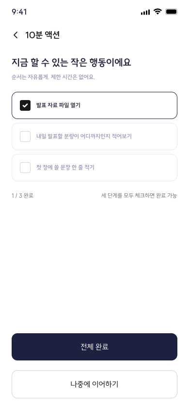

원본 페이지 좌표: (1840, 80, 2230, 924). 아래 모든 좌표는 프레임 좌상단 기준.

#### 표시 텍스트·좌표


| 텍스트(원문) | x | y | w | h | PDF size | 추출색 |
| --- | --- | --- | --- | --- | --- | --- |
| 9:41 | 24 | 14 | 31.31 | 16.00 | 16 | #000000 |
| 10분 액션 | 52 | 60.5 | 71.48 | 18.00 | 18 | #000000 |
| 지금 할 수 있는 작은 행동이에요 | 24 | 116 | 246.60 | 20.00 | 20 | #000000 |
| 순서는 자유롭게. 제한 시간은 없어요. | 24 | 151 | 172.51 | 12.00 | 12 | #000000 |
| 발표 자료 파일 열기 | 75 | 209 | 90.84 | 12.00 | 12 | #000000 |
| 내일 발표할 분량이 어디까지인지 적어보기 | 75 | 273 | 196.80 | 12.00 | 12 | #000000 |
| 첫 장에 쓸 문장 한 줄 적기 | 75 | 337 | 119.76 | 12.00 | 12 | #000000 |
| 1 / 3 완료 | 24 | 395 | 45.13 | 12.00 | 12 | #000000 |
| 세 단계를 모두 체크하면 완료 가능 | 209 | 395 | 156.60 | 12.00 | 12 | #000000 |
| 전체 완료 | 165.97 | 704 | 58.07 | 16.00 | 16 | #000000 |
| 나중에 이어하기 | 145.58 | 781 | 98.87 | 16.00 | 16 | #000000 |


#### 주요 면·선·컨테이너 측정

높이24 이상·폭40 이상의 도형을 출력했다. 글자 윤곽이나 스크림·그림자도 포함될 수 있다. 원본 경로를 보지 않고 모두 직사각형 카드로 취급하지 않는다.


| x | y | w | h | 면 RGB 근사 | 면 alpha | 선 RGB 근사 | 선 두께 |
| --- | --- | --- | --- | --- | --- | --- | --- |
| 0 | 0 | 390.00 | 844.00 | #FFFFFF | 1.0 | 없음 | None |
| 24 | 189 | 342.00 | 56.00 | #FFFFFF | 1.0 | 없음 | None |
| 23 | 188 | 344.00 | 58.00 | #24243A | 1.0 | 없음 | None |
| 24 | 253 | 342.00 | 56.00 | #FFFFFF | 1.0 | 없음 | None |
| 23 | 252 | 344.00 | 58.00 | #ECEBF5 | 1.0 | 없음 | None |
| 24 | 317 | 342.00 | 56.00 | #FFFFFF | 1.0 | 없음 | None |
| 23 | 316 | 344.00 | 58.00 | #ECEBF5 | 1.0 | 없음 | None |
| 24 | 686 | 342.00 | 56.00 | #1E2240 | 1.0 | 없음 | None |
| 24 | 762 | 342.00 | 58.00 | #FFFFFF | 1.0 | 없음 | None |
| 23 | 761 | 344.00 | 60.00 | #D4D4D8 | 1.0 | 없음 | None |


### P04-F04 — S-11 휴식 — 시작 전

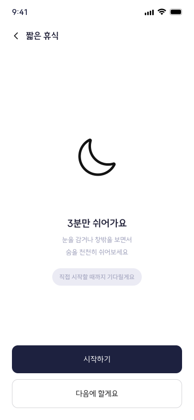

원본 페이지 좌표: (2720, 80, 3110, 924). 아래 모든 좌표는 프레임 좌상단 기준.

#### 표시 텍스트·좌표


| 텍스트(원문) | x | y | w | h | PDF size | 추출색 |
| --- | --- | --- | --- | --- | --- | --- |
| 9:41 | 24 | 14 | 31.31 | 16.00 | 16 | #000000 |
| 짧은 휴식 | 52 | 60.5 | 66.08 | 18.00 | 18 | #000000 |
| 3분만 쉬어가요 | 135.07 | 436 | 119.85 | 20.00 | 20 | #000000 |
| 눈을 감거나 창밖을 보면서  | 124.74 | 473 | 140.53 | 14.00 | 14 | #000000 |
| 숨을 천천히 쉬어보세요 | 132.3 | 498 | 125.41 | 14.00 | 14 | #000000 |
| 직접 시작할 때까지 기다릴게요 | 119 | 549 | 151.58 | 12.00 | 12 | #000000 |
| 시작하기 | 167.81 | 712 | 54.39 | 16.00 | 16 | #000000 |
| 다음에 할게요 | 152.38 | 781 | 85.25 | 16.00 | 16 | #000000 |


#### 주요 면·선·컨테이너 측정

높이24 이상·폭40 이상의 도형을 출력했다. 글자 윤곽이나 스크림·그림자도 포함될 수 있다. 원본 경로를 보지 않고 모두 직사각형 카드로 취급하지 않는다.


| x | y | w | h | 면 RGB 근사 | 면 alpha | 선 RGB 근사 | 선 두께 |
| --- | --- | --- | --- | --- | --- | --- | --- |
| 0 | 0 | 390.00 | 844.00 | #FFFFFF | 1.0 | 없음 | None |
| 157.5 | 278.44 | 75.06 | 75.06 | #131313 | 1.0 | 없음 | None |
| 124.74 | 475.76 | 139.06 | 37.09 | #9A9CB8 | 1.0 | 없음 | None |
| 105 | 539 | 180.00 | 35.00 | #ECEBF5 | 1.0 | 없음 | None |
| 24 | 694 | 342.00 | 56.00 | #1E2240 | 1.0 | 없음 | None |
| 24 | 762 | 342.00 | 58.00 | #FFFFFF | 1.0 | 없음 | None |
| 23 | 761 | 344.00 | 60.00 | #D4D4D8 | 1.0 | 없음 | None |


### P04-F05 — S-11 휴식 — 진행 중

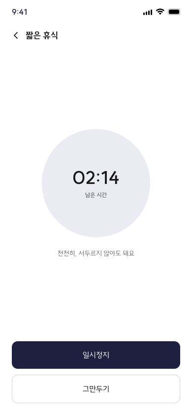

원본 페이지 좌표: (3600, 80, 3990, 924). 아래 모든 좌표는 프레임 좌상단 기준.

#### 표시 텍스트·좌표


| 텍스트(원문) | x | y | w | h | PDF size | 추출색 |
| --- | --- | --- | --- | --- | --- | --- |
| 9:41 | 24 | 14 | 31.31 | 16.00 | 16 | #000000 |
| 짧은 휴식 | 52 | 60.5 | 66.08 | 18.00 | 18 | #000000 |
| 02:14 | 147.22 | 338 | 95.55 | 36.00 | 36 | #000000 |
| 남은 시간 | 172.97 | 389 | 44.04 | 12.00 | 12 | #000000 |
| 천천히, 서두르지 않아도 돼요 | 116.88 | 506.5 | 156.25 | 14.00 | 14 | #000000 |
| 일시정지 | 167.81 | 712 | 54.39 | 16.00 | 16 | #000000 |
| 그만두기 | 167.81 | 781 | 54.39 | 16.00 | 16 | #000000 |


#### 주요 면·선·컨테이너 측정

높이24 이상·폭40 이상의 도형을 출력했다. 글자 윤곽이나 스크림·그림자도 포함될 수 있다. 원본 경로를 보지 않고 모두 직사각형 카드로 취급하지 않는다.


| x | y | w | h | 면 RGB 근사 | 면 alpha | 선 RGB 근사 | 선 두께 |
| --- | --- | --- | --- | --- | --- | --- | --- |
| 0 | 0 | 390.00 | 844.00 | #FFFFFF | 1.0 | 없음 | None |
| 85 | 262.5 | 220.00 | 220.00 | #ECEBF5 | 1.0 | 없음 | None |
| 147.22 | 347.58 | 93.79 | 26.78 | #18181B | 1.0 | 없음 | None |
| 24 | 694 | 342.00 | 56.00 | #1E2240 | 1.0 | 없음 | None |
| 24 | 762 | 342.00 | 58.00 | #FFFFFF | 1.0 | 없음 | None |
| 23 | 761 | 344.00 | 60.00 | #D4D4D8 | 1.0 | 없음 | None |


### P04-F06 — S-11 휴식 — 그만두기 확인

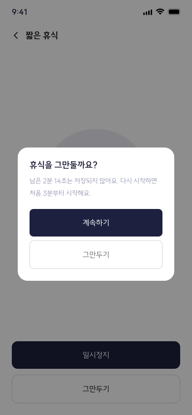

원본 페이지 좌표: (4480, 80, 4870, 924). 아래 모든 좌표는 프레임 좌상단 기준.

#### 표시 텍스트·좌표


| 텍스트(원문) | x | y | w | h | PDF size | 추출색 |
| --- | --- | --- | --- | --- | --- | --- |
| 9:41 | 24 | 14 | 31.31 | 16.00 | 16 | #000000 |
| 짧은 휴식 | 52 | 60.5 | 66.08 | 18.00 | 18 | #000000 |
| 휴식을 그만둘까요? | 60 | 324 | 138.12 | 18.00 | 18 | #000000 |
| 남은 2분 14초는 저장되지 않아요. 다시 시작하면  | 60 | 359 | 262.30 | 14.00 | 14 | #000000 |
| 처음 3분부터 시작해요. | 60 | 384 | 125.39 | 14.00 | 14 | #000000 |
| 02:14 | 147.22 | 338 | 95.55 | 36.00 | 36 | #000000 |
| 남은 시간 | 172.97 | 389 | 44.04 | 12.00 | 12 | #000000 |
| 계속하기 | 167.81 | 443 | 54.39 | 16.00 | 16 | #000000 |
| 천천히, 서두르지 않아도 돼요 | 116.88 | 506.5 | 156.25 | 14.00 | 14 | #000000 |
| 그만두기 | 167.81 | 508 | 54.39 | 16.00 | 16 | #000000 |
| 일시정지 | 167.81 | 712 | 54.39 | 16.00 | 16 | #000000 |
| 그만두기 | 167.81 | 781 | 54.39 | 16.00 | 16 | #000000 |


#### 주요 면·선·컨테이너 측정

높이24 이상·폭40 이상의 도형을 출력했다. 글자 윤곽이나 스크림·그림자도 포함될 수 있다. 원본 경로를 보지 않고 모두 직사각형 카드로 취급하지 않는다.


| x | y | w | h | 면 RGB 근사 | 면 alpha | 선 RGB 근사 | 선 두께 |
| --- | --- | --- | --- | --- | --- | --- | --- |
| 0 | 0 | 390.00 | 844.00 | #FFFFFF | 1.0 | 없음 | None |
| 85 | 262.5 | 220.00 | 220.00 | #ECEBF5 | 1.0 | 없음 | None |
| 147.22 | 347.58 | 93.79 | 26.78 | #18181B | 1.0 | 없음 | None |
| 24 | 694 | 342.00 | 56.00 | #1E2240 | 1.0 | 없음 | None |
| 24 | 762 | 342.00 | 58.00 | #FFFFFF | 1.0 | 없음 | None |
| 23 | 761 | 344.00 | 60.00 | #D4D4D8 | 1.0 | 없음 | None |
| 0 | 0 | 390.00 | 844.00 | #000000 | 0.44999998807907104 | 없음 | None |
| 36 | 300 | 318.00 | 271.00 | #FFFFFF | 1.0 | 없음 | None |
| 60 | 361.66 | 257.63 | 37.36 | #9A9CB8 | 1.0 | 없음 | None |
| 60 | 425 | 270.00 | 56.00 | #1E2240 | 1.0 | 없음 | None |
| 60 | 489 | 270.00 | 58.00 | #FFFFFF | 1.0 | 없음 | None |
| 59 | 488 | 272.00 | 60.00 | #D4D4D8 | 1.0 | 없음 | None |


### P04-F07 — S-12 공감 메시지

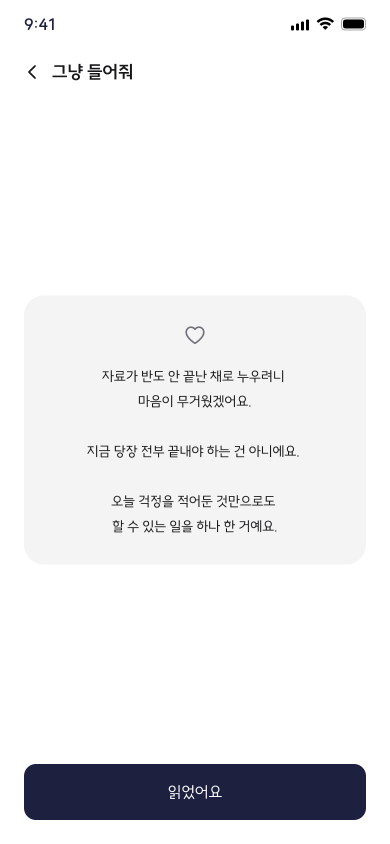

원본 페이지 좌표: (5360, 80, 5750, 924). 아래 모든 좌표는 프레임 좌상단 기준.

#### 표시 텍스트·좌표


| 텍스트(원문) | x | y | w | h | PDF size | 추출색 |
| --- | --- | --- | --- | --- | --- | --- |
| 9:41 | 24 | 14 | 31.31 | 16.00 | 16 | #000000 |
| 그냥 들어줘 | 52 | 60.5 | 81.57 | 18.00 | 18 | #000000 |
| 자료가 반도 안 끝난 채로 누우려니   | 102.06 | 367.5 | 185.90 | 14.00 | 14 | #000000 |
| 마음이 무거웠겠어요.   | 138.02 | 392.5 | 113.97 | 14.00 | 14 | #000000 |
| 지금 당장 전부 끝내야 하는 건 아니에요.    | 86.71 | 442.5 | 216.58 | 14.00 | 14 | #000000 |
| 오늘 걱정을 적어둔 것만으로도   | 111.23 | 492.5 | 167.53 | 14.00 | 14 | #000000 |
| 할 수 있는 일을 하나 한 거예요. | 112.11 | 517.5 | 165.80 | 14.00 | 14 | #000000 |
| 읽었어요 | 167.81 | 782 | 54.39 | 16.00 | 16 | #000000 |


#### 주요 면·선·컨테이너 측정

높이24 이상·폭40 이상의 도형을 출력했다. 글자 윤곽이나 스크림·그림자도 포함될 수 있다. 원본 경로를 보지 않고 모두 직사각형 카드로 취급하지 않는다.


| x | y | w | h | 면 RGB 근사 | 면 alpha | 선 RGB 근사 | 선 두께 |
| --- | --- | --- | --- | --- | --- | --- | --- |
| 0 | 0 | 390.00 | 844.00 | #FFFFFF | 1.0 | 없음 | None |
| 24 | 295.5 | 342.00 | 269.00 | #F4F4F5 | 1.0 | 없음 | None |
| 87.32 | 370.26 | 211.33 | 162.26 | #18181B | 1.0 | 없음 | None |
| 24 | 764 | 342.00 | 56.00 | #1E2240 | 1.0 | 없음 | None |


### P04-F08 — S-13 활동 완료·도움 평가

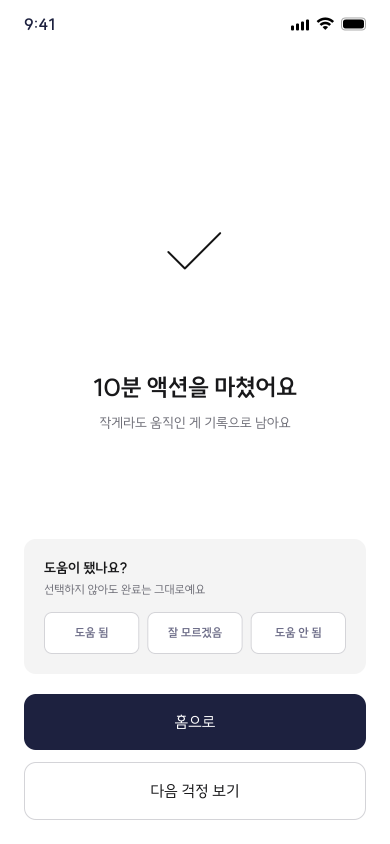

원본 페이지 좌표: (6240, 80, 6630, 924). 아래 모든 좌표는 프레임 좌상단 기준.

#### 표시 텍스트·좌표


| 텍스트(원문) | x | y | w | h | PDF size | 추출색 |
| --- | --- | --- | --- | --- | --- | --- |
| 9:41 | 24 | 14 | 31.31 | 16.00 | 16 | #000000 |
| 10분 액션을 마쳤어요 | 92.94 | 372 | 204.10 | 24.00 | 24 | #000000 |
| 작게라도 움직인 게 기록으로 남아요 | 99.34 | 414 | 191.33 | 14.00 | 14 | #000000 |
| 도움이 됐나요? | 44 | 559 | 83.35 | 14.00 | 14 | #000000 |
| 선택하지 않아도 완료는 그대로예요 | 44 | 582 | 161.24 | 12.00 | 12 | #000000 |
| 도움 됨 | 74.8 | 625 | 33.73 | 12.00 | 12 | #000000 |
| 잘 모르겠음 | 167.81 | 625 | 54.37 | 12.00 | 12 | #000000 |
| 도움 안 됨 | 274.92 | 625 | 46.82 | 12.00 | 12 | #000000 |
| 홈으로 | 174.61 | 712 | 40.80 | 16.00 | 16 | #000000 |
| 다음 걱정 보기 | 150.53 | 781 | 88.95 | 16.00 | 16 | #000000 |


#### 주요 면·선·컨테이너 측정

높이24 이상·폭40 이상의 도형을 출력했다. 글자 윤곽이나 스크림·그림자도 포함될 수 있다. 원본 경로를 보지 않고 모두 직사각형 카드로 취급하지 않는다.


| x | y | w | h | 면 RGB 근사 | 면 alpha | 선 RGB 근사 | 선 두께 |
| --- | --- | --- | --- | --- | --- | --- | --- |
| 0 | 0 | 390.00 | 844.00 | #FFFFFF | 1.0 | 없음 | None |
| 167.24 | 232.05 | 54.05 | 37.45 | #131313 | 1.0 | 없음 | None |
| 24 | 539 | 342.00 | 135.00 | #F4F4F5 | 1.0 | 없음 | None |
| 44 | 612 | 95.33 | 42.00 | #FFFFFF | 1.0 | 없음 | None |
| 43 | 611 | 97.33 | 44.00 | #D4D4D8 | 1.0 | 없음 | None |
| 147.33 | 612 | 95.34 | 42.00 | #FFFFFF | 1.0 | 없음 | None |
| 146.33 | 611 | 97.34 | 44.00 | #D4D4D8 | 1.0 | 없음 | None |
| 250.67 | 612 | 95.33 | 42.00 | #FFFFFF | 1.0 | 없음 | None |
| 249.67 | 611 | 97.33 | 44.00 | #D4D4D8 | 1.0 | 없음 | None |
| 24 | 694 | 342.00 | 56.00 | #1E2240 | 1.0 | 없음 | None |
| 24 | 762 | 342.00 | 58.00 | #FFFFFF | 1.0 | 없음 | None |
| 23 | 761 | 344.00 | 60.00 | #D4D4D8 | 1.0 | 없음 | None |


### P05-F01 — S-01 시작

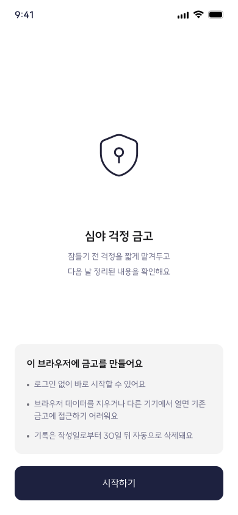

원본 페이지 좌표: (80, 80, 470, 924). 아래 모든 좌표는 프레임 좌상단 기준.

#### 표시 텍스트·좌표


| 텍스트(원문) | x | y | w | h | PDF size | 추출색 |
| --- | --- | --- | --- | --- | --- | --- |
| 9:41 | 24 | 14 | 31.31 | 16.00 | 16 | #000000 |
| 심야 걱정 금고 | 138.77 | 374.5 | 112.40 | 20.00 | 20 | #000000 |
| 잠들기 전 걱정을 짧게 맡겨두고  | 111.23 | 411.5 | 167.58 | 14.00 | 14 | #000000 |
| 다음 날 정리된 내용을 확인해요 | 111.23 | 436.5 | 167.58 | 14.00 | 14 | #000000 |
| 이 브라우저에 금고를 만들어요 | 44 | 586 | 189.92 | 16.00 | 16 | #000000 |
| 로그인 없이 바로 시작할 수 있어요 | 56 | 621 | 182.70 | 14.00 | 14 | #000000 |
| 브라우저 데이터를 지우거나 다른 기기에서 열면 기존  | 56 | 653 | 284.34 | 14.00 | 14 | #000000 |
| 금고에 접근하기 어려워요 | 56 | 673 | 137.34 | 14.00 | 14 | #000000 |
| 기록은 작성일로부터 30일 뒤 자동으로 삭제돼요 | 56 | 705 | 260.20 | 14.00 | 14 | #000000 |
| 시작하기 | 167.81 | 782 | 54.40 | 16.00 | 16 | #000000 |


#### 주요 면·선·컨테이너 측정

높이24 이상·폭40 이상의 도형을 출력했다. 글자 윤곽이나 스크림·그림자도 포함될 수 있다. 원본 경로를 보지 않고 모두 직사각형 카드로 취급하지 않는다.


| x | y | w | h | 면 RGB 근사 | 면 alpha | 선 RGB 근사 | 선 두께 |
| --- | --- | --- | --- | --- | --- | --- | --- |
| 0 | 0 | 390.00 | 844.00 | #FFFFFF | 1.0 | 없음 | None |
| 163.82 | 219.25 | 62.39 | 70.15 | #24243A | 1.0 | 없음 | None |
| 111.23 | 414.26 | 167.14 | 37.57 | #6E6F8A | 1.0 | 없음 | None |
| 24 | 564 | 342.00 | 180.00 | #F4F4F5 | 1.0 | 없음 | None |
| 56 | 655.76 | 280.64 | 32.11 | #6E6F8A | 1.0 | 없음 | None |
| 24 | 764 | 342.00 | 56.00 | #1E2240 | 1.0 | 없음 | None |


### P05-F02 — 게스트 인증 오류

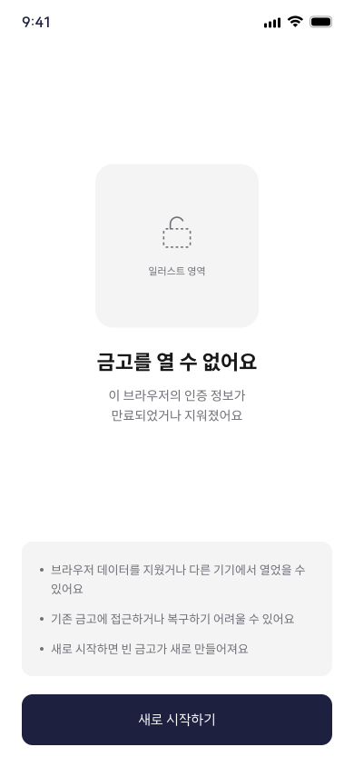

원본 페이지 좌표: (960, 80, 1350, 924). 아래 모든 좌표는 프레임 좌상단 기준.

#### 표시 텍스트·좌표


| 텍스트(원문) | x | y | w | h | PDF size | 추출색 |
| --- | --- | --- | --- | --- | --- | --- |
| 9:41 | 24 | 14 | 31.31 | 16.00 | 16 | #000000 |
| 일러스트 영역 | 163.41 | 291.5 | 63.18 | 11.00 | 11 | #000000 |
| 금고를 열 수 없어요 | 106.57 | 384.5 | 176.86 | 22.00 | 22 | #000000 |
| 이 브라우저의 인증 정보가  | 119.47 | 426.5 | 151.06 | 14.00 | 14 | #000000 |
| 만료되었거나 지워졌어요 | 122.6 | 448.5 | 144.80 | 14.00 | 14 | #000000 |
| 브라우저 데이터를 지웠거나 다른 기기에서 열었을 수  | 56 | 619 | 283.45 | 13.00 | 13 | #000000 |
| 있어요 | 56 | 640 | 35.88 | 13.00 | 13 | #000000 |
| 기존 금고에 접근하거나 복구하기 어려울 수 있어요 | 56 | 673 | 268.58 | 13.00 | 13 | #000000 |
| 새로 시작하면 빈 금고가 새로 만들어져요 | 56 | 706 | 217.84 | 13.00 | 13 | #000000 |
| 새로 시작하기 | 152.38 | 782 | 85.27 | 16.00 | 16 | #000000 |


#### 주요 면·선·컨테이너 측정

높이24 이상·폭40 이상의 도형을 출력했다. 글자 윤곽이나 스크림·그림자도 포함될 수 있다. 원본 경로를 보지 않고 모두 직사각형 카드로 취급하지 않는다.


| x | y | w | h | 면 RGB 근사 | 면 alpha | 선 RGB 근사 | 선 두께 |
| --- | --- | --- | --- | --- | --- | --- | --- |
| 0 | 0 | 390.00 | 844.00 | #FFFFFF | 1.0 | 없음 | None |
| 105 | 180.5 | 180.00 | 180.00 | #F4F4F5 | 1.0 | 없음 | None |
| 119.47 | 428.92 | 150.63 | 34.69 | #71717A | 1.0 | 없음 | None |
| 24 | 596 | 342.00 | 148.00 | #F4F4F5 | 1.0 | 없음 | None |
| 56 | 621.25 | 279.85 | 32.78 | #71717A | 1.0 | 없음 | None |
| 24 | 764 | 342.00 | 56.00 | #1E2240 | 1.0 | 없음 | None |


### P05-F03 — S-14 기록 목록

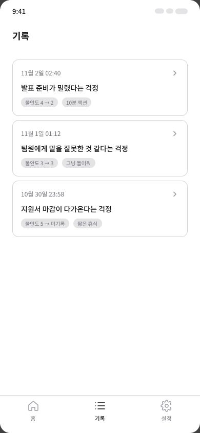

원본 페이지 좌표: (1840, 80, 2230, 924). 아래 모든 좌표는 프레임 좌상단 기준.

#### 표시 텍스트·좌표


| 텍스트(원문) | x | y | w | h | PDF size | 추출색 |
| --- | --- | --- | --- | --- | --- | --- |
| 9:41 | 24 | 14 | 26.10 | 13.00 | 13 | #000000 |
| 기록 | 24 | 59 | 33.12 | 18.00 | 18 | #000000 |
| 11월 2일 02:40 | 41 | 135 | 77.41 | 12.00 | 12 | #000000 |
| 발표 준비가 밀렸다는 걱정 | 41 | 163 | 151.13 | 14.00 | 14 | #000000 |
| 불안도 4 → 2 | 49 | 194 | 55.42 | 10.00 | 10 | #000000 |
| 10분 액션 | 129 | 194 | 40.94 | 10.00 | 10 | #000000 |
| 11월 1일 01:12 | 41 | 253 | 77.41 | 12.00 | 12 | #000000 |
| 팀원에게 말을 잘못한 것 같다는 걱정 | 41 | 281 | 208.95 | 14.00 | 14 | #000000 |
| 불안도 3 → 3 | 49 | 312 | 55.42 | 10.00 | 10 | #000000 |
| 그냥 들어줘 | 129 | 312 | 48.24 | 10.00 | 10 | #000000 |
| 10월 30일 23:58 | 41 | 371 | 84.07 | 12.00 | 12 | #000000 |
| 지원서 마감이 다가온다는 걱정 | 41 | 399 | 176.89 | 14.00 | 14 | #000000 |
| 불안도 5 → 미기록 | 49 | 430 | 77.47 | 10.00 | 10 | #000000 |
| 짧은 휴식 | 151 | 430 | 39.04 | 10.00 | 10 | #000000 |
| 홈 | 59.5 | 809 | 10.12 | 11.00 | 11 | #000000 |
| 기록 | 184.5 | 809 | 20.24 | 11.00 | 11 | #000000 |
| 설정 | 314.5 | 809 | 20.24 | 11.00 | 11 | #000000 |


#### 주요 면·선·컨테이너 측정

높이24 이상·폭40 이상의 도형을 출력했다. 글자 윤곽이나 스크림·그림자도 포함될 수 있다. 원본 경로를 보지 않고 모두 직사각형 카드로 취급하지 않는다.


| x | y | w | h | 면 RGB 근사 | 면 alpha | 선 RGB 근사 | 선 두께 |
| --- | --- | --- | --- | --- | --- | --- | --- |
| 0 | 0 | 390.00 | 844.00 | #000000 | 1.0 | 없음 | None |
| 0 | 0 | 390.00 | 844.00 | #FFFFFF | 1.0 | 없음 | None |
| 24 | 116 | 342.00 | 110.00 | #FFFFFF | 1.0 | 없음 | None |
| 23 | 115 | 344.00 | 112.00 | #D4D4D8 | 1.0 | 없음 | None |
| 24 | 234 | 342.00 | 110.00 | #FFFFFF | 1.0 | 없음 | None |
| 23 | 233 | 344.00 | 112.00 | #D4D4D8 | 1.0 | 없음 | None |
| 24 | 352 | 342.00 | 110.00 | #FFFFFF | 1.0 | 없음 | None |
| 23 | 351 | 344.00 | 112.00 | #D4D4D8 | 1.0 | 없음 | None |
| 0 | 770 | 390.00 | 74.00 | #FFFFFF | 1.0 | 없음 | None |


### P05-F04 — S-14 기록 빈 상태

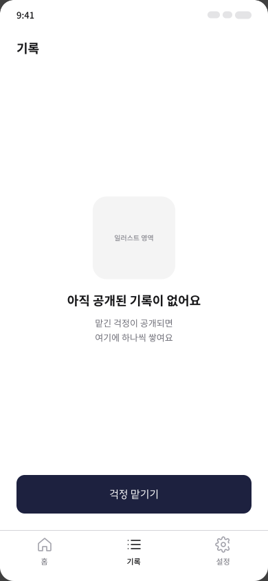

원본 페이지 좌표: (2720, 80, 3110, 924). 아래 모든 좌표는 프레임 좌상단 기준.

#### 표시 텍스트·좌표


| 텍스트(원문) | x | y | w | h | PDF size | 추출색 |
| --- | --- | --- | --- | --- | --- | --- |
| 9:41 | 24 | 14 | 26.10 | 13.00 | 13 | #000000 |
| 기록 | 24 | 59 | 33.12 | 18.00 | 18 | #000000 |
| 일러스트 영역 | 166.28 | 339.5 | 57.44 | 10.00 | 10 | #000000 |
| 아직 공개된 기록이 없어요 | 97.81 | 425.5 | 194.38 | 18.00 | 18 | #000000 |
| 맡긴 걱정이 공개되면  | 138.28 | 461.5 | 113.44 | 13.00 | 13 | #000000 |
| 여기에 하나씩 쌓여요 | 138.28 | 482.5 | 113.44 | 13.00 | 13 | #000000 |
| 걱정 맡기기 | 159.17 | 708 | 71.68 | 16.00 | 16 | #000000 |
| 홈 | 59.5 | 809 | 10.12 | 11.00 | 11 | #000000 |
| 기록 | 184.5 | 809 | 20.24 | 11.00 | 11 | #000000 |
| 설정 | 314.5 | 809 | 20.24 | 11.00 | 11 | #000000 |


#### 주요 면·선·컨테이너 측정

높이24 이상·폭40 이상의 도형을 출력했다. 글자 윤곽이나 스크림·그림자도 포함될 수 있다. 원본 경로를 보지 않고 모두 직사각형 카드로 취급하지 않는다.


| x | y | w | h | 면 RGB 근사 | 면 alpha | 선 RGB 근사 | 선 두께 |
| --- | --- | --- | --- | --- | --- | --- | --- |
| 0 | 0 | 390.00 | 844.00 | #000000 | 1.0 | 없음 | None |
| 0 | 0 | 390.00 | 844.00 | #FFFFFF | 1.0 | 없음 | None |
| 135 | 285.5 | 120.00 | 120.00 | #F4F4F5 | 1.0 | 없음 | None |
| 138.28 | 463.75 | 112.79 | 32.78 | #71717A | 1.0 | 없음 | None |
| 24 | 690 | 342.00 | 56.00 | #1E2240 | 1.0 | 없음 | None |
| 0 | 770 | 390.00 | 74.00 | #FFFFFF | 1.0 | 없음 | None |


### P05-F05 — S-14 기록 상세 — 스크롤

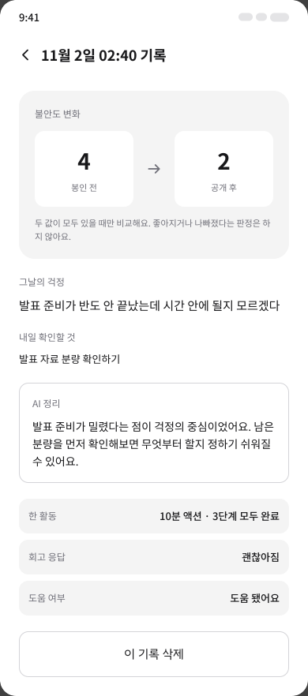

원본 페이지 좌표: (3600, 80, 3990, 962). 아래 모든 좌표는 프레임 좌상단 기준.

#### 표시 텍스트·좌표


| 텍스트(원문) | x | y | w | h | PDF size | 추출색 |
| --- | --- | --- | --- | --- | --- | --- |
| 9:41 | 24 | 14 | 26.10 | 13.00 | 13 | #000000 |
| 11월 2일 02:40 기록 | 52 | 59 | 158.69 | 18.00 | 18 | #000000 |
| 불안도 변화 | 44 | 137 | 57.89 | 12.00 | 12 | #000000 |
| 4 | 98.24 | 187 | 16.52 | 28.00 | 28 | #000000 |
| 2 | 275.24 | 187 | 16.52 | 28.00 | 28 | #000000 |
| 봉인 전 | 90.09 | 231 | 32.83 | 11.00 | 11 | #000000 |
| 공개 후 | 267.09 | 231 | 32.83 | 11.00 | 11 | #000000 |
| 두 값이 모두 있을 때만 비교해요. 좋아지거나 나빠졌다는 판정은 하 | 44 | 276 | 298.42 | 11.00 | 11 | #000000 |
| 지 않아요. | 44 | 293 | 46.00 | 11.00 | 11 | #000000 |
| 그날의 걱정 | 24 | 350 | 57.88 | 12.00 | 12 | #000000 |
| 발표 준비가 반도 안 끝났는데 시간 안에 될지 모르겠다 | 24 | 378 | 330.41 | 15.00 | 15 | #000000 |
| 내일 확인할 것 | 24 | 420 | 71.60 | 12.00 | 12 | #000000 |
| 발표 자료 분량 확인하기 | 24 | 447 | 128.31 | 13.00 | 13 | #000000 |
| AI 정리 | 41 | 504 | 35.58 | 12.00 | 12 | #000000 |
| 발표 준비가 밀렸다는 점이 걱정의 중심이었어요. 남은  | 41 | 532 | 309.15 | 14.00 | 14 | #000000 |
| 분량을 먼저 확인해보면 무엇부터 할지 정하기 쉬워질  | 41 | 554 | 305.26 | 14.00 | 14 | #000000 |
| 수 있어요. | 41 | 576 | 58.54 | 14.00 | 14 | #000000 |
| 한 활동 | 36 | 646.5 | 35.80 | 12.00 | 12 | #000000 |
| 회고 응답 | 36 | 698.5 | 46.84 | 12.00 | 12 | #000000 |
| 도움 여부 | 36 | 750.5 | 46.84 | 12.00 | 12 | #000000 |
| 10분 액션 · 3단계 모두 완료 | 202.06 | 646 | 151.94 | 13.00 | 13 | #000000 |
| 괜찮아짐 | 306.16 | 698 | 47.84 | 13.00 | 13 | #000000 |
| 도움 됐어요 | 291.29 | 750 | 62.71 | 13.00 | 13 | #000000 |
| 이 기록 삭제 | 157.33 | 819 | 75.36 | 16.00 | 16 | #000000 |


#### 주요 면·선·컨테이너 측정

높이24 이상·폭40 이상의 도형을 출력했다. 글자 윤곽이나 스크림·그림자도 포함될 수 있다. 원본 경로를 보지 않고 모두 직사각형 카드로 취급하지 않는다.


| x | y | w | h | 면 RGB 근사 | 면 alpha | 선 RGB 근사 | 선 두께 |
| --- | --- | --- | --- | --- | --- | --- | --- |
| 0 | 0 | 390.00 | 882.00 | #000000 | 1.0 | 없음 | None |
| 0 | 0 | 390.00 | 882.00 | #FFFFFF | 1.0 | 없음 | None |
| 24 | 115 | 342.00 | 213.00 | #F4F4F5 | 1.0 | 없음 | None |
| 44 | 166 | 125.00 | 96.00 | #FFFFFF | 1.0 | 없음 | None |
| 221 | 166 | 125.00 | 96.00 | #FFFFFF | 1.0 | 없음 | None |
| 44 | 277.9 | 298.12 | 26.96 | #71717A | 1.0 | 없음 | None |
| 24 | 485 | 342.00 | 127.00 | #FFFFFF | 1.0 | 없음 | None |
| 23 | 484 | 344.00 | 129.00 | #D4D4D8 | 1.0 | 없음 | None |
| 41 | 534.42 | 305.28 | 56.69 | #18181B | 1.0 | 없음 | None |
| 24 | 632 | 342.00 | 44.00 | #F4F4F5 | 1.0 | 없음 | None |
| 24 | 684 | 342.00 | 44.00 | #F4F4F5 | 1.0 | 없음 | None |
| 24 | 736 | 342.00 | 44.00 | #F4F4F5 | 1.0 | 없음 | None |
| 24 | 800 | 342.00 | 58.00 | #FFFFFF | 1.0 | 없음 | None |
| 23 | 799 | 344.00 | 60.00 | #D4D4D8 | 1.0 | 없음 | None |


### P05-F06 — S-14 기록 삭제 확인

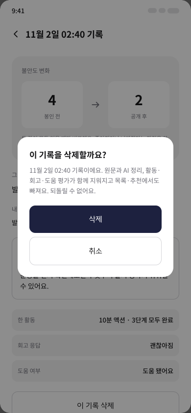

원본 페이지 좌표: (4480, 80, 4870, 924). 아래 모든 좌표는 프레임 좌상단 기준.

#### 표시 텍스트·좌표


| 텍스트(원문) | x | y | w | h | PDF size | 추출색 |
| --- | --- | --- | --- | --- | --- | --- |
| 9:41 | 24 | 14 | 26.10 | 13.00 | 13 | #000000 |
| 11월 2일 02:40 기록 | 52 | 59 | 158.69 | 18.00 | 18 | #000000 |
| 불안도 변화 | 44 | 137 | 57.89 | 12.00 | 12 | #000000 |
| 4 | 98.24 | 187 | 16.52 | 28.00 | 28 | #000000 |
| 봉인 전 | 90.09 | 231 | 32.83 | 11.00 | 11 | #000000 |
| 2 | 275.24 | 187 | 16.52 | 28.00 | 28 | #000000 |
| 공개 후 | 267.09 | 231 | 32.83 | 11.00 | 11 | #000000 |
| 두 값이 모두 있을 때만 비교해요. 좋아지거나 나빠졌다는 판정은 하 | 44 | 276 | 298.42 | 11.00 | 11 | #000000 |
| 지 않아요. | 44 | 293 | 46.00 | 11.00 | 11 | #000000 |
| 이 기록을 삭제할까요? | 60 | 306 | 157.20 | 17.00 | 17 | #000000 |
| 그날의 걱정 | 24 | 350 | 57.88 | 12.00 | 12 | #000000 |
| 발표 준비가 반도 안 끝났는데 시간 안에 될지 모르겠다 | 24 | 378 | 330.41 | 15.00 | 15 | #000000 |
| 11월 2일 02:40 기록이에요. 원문과 AI 정리, 활동· | 60 | 340 | 268.12 | 13.00 | 13 | #000000 |
| 회고·도움 평가가 함께 지워지고 목록·추천에서도  | 60 | 361 | 268.30 | 13.00 | 13 | #000000 |
| 빠져요. 되돌릴 수 없어요. | 60 | 382 | 135.54 | 13.00 | 13 | #000000 |
| 내일 확인할 것 | 24 | 420 | 71.60 | 12.00 | 12 | #000000 |
| 발표 자료 분량 확인하기 | 24 | 447 | 128.31 | 13.00 | 13 | #000000 |
| 삭제 | 181.41 | 438 | 27.20 | 16.00 | 16 | #000000 |
| 취소 | 181.41 | 503 | 27.20 | 16.00 | 16 | #000000 |
| AI 정리 | 41 | 504 | 35.58 | 12.00 | 12 | #000000 |
| 발표 준비가 밀렸다는 점이 걱정의 중심이었어요. 남은  | 41 | 532 | 309.15 | 14.00 | 14 | #000000 |
| 분량을 먼저 확인해보면 무엇부터 할지 정하기 쉬워질  | 41 | 554 | 305.26 | 14.00 | 14 | #000000 |
| 수 있어요. | 41 | 576 | 58.54 | 14.00 | 14 | #000000 |
| 한 활동 | 36 | 646.5 | 35.80 | 12.00 | 12 | #000000 |
| 회고 응답 | 36 | 698.5 | 46.84 | 12.00 | 12 | #000000 |
| 도움 여부 | 36 | 750.5 | 46.84 | 12.00 | 12 | #000000 |
| 10분 액션 · 3단계 모두 완료 | 202.06 | 646 | 151.94 | 13.00 | 13 | #000000 |
| 괜찮아짐 | 306.16 | 698 | 47.84 | 13.00 | 13 | #000000 |
| 도움 됐어요 | 291.29 | 750 | 62.71 | 13.00 | 13 | #000000 |
| 이 기록 삭제 | 157.33 | 819 | 75.36 | 16.00 | 16 | #000000 |


#### 주요 면·선·컨테이너 측정

높이24 이상·폭40 이상의 도형을 출력했다. 글자 윤곽이나 스크림·그림자도 포함될 수 있다. 원본 경로를 보지 않고 모두 직사각형 카드로 취급하지 않는다.


| x | y | w | h | 면 RGB 근사 | 면 alpha | 선 RGB 근사 | 선 두께 |
| --- | --- | --- | --- | --- | --- | --- | --- |
| 0 | 0 | 390.00 | 844.00 | #000000 | 1.0 | 없음 | None |
| 0 | 0 | 390.00 | 844.00 | #FFFFFF | 1.0 | 없음 | None |
| 24 | 115 | 342.00 | 213.00 | #F4F4F5 | 1.0 | 없음 | None |
| 44 | 166 | 125.00 | 96.00 | #FFFFFF | 1.0 | 없음 | None |
| 221 | 166 | 125.00 | 96.00 | #FFFFFF | 1.0 | 없음 | None |
| 44 | 277.9 | 298.12 | 26.96 | #71717A | 1.0 | 없음 | None |
| 24 | 485 | 342.00 | 127.00 | #FFFFFF | 1.0 | 없음 | None |
| 23 | 484 | 344.00 | 129.00 | #D4D4D8 | 1.0 | 없음 | None |
| 41 | 534.42 | 305.28 | 56.69 | #18181B | 1.0 | 없음 | None |
| 24 | 632 | 342.00 | 44.00 | #F4F4F5 | 1.0 | 없음 | None |
| 24 | 684 | 342.00 | 44.00 | #F4F4F5 | 1.0 | 없음 | None |
| 24 | 736 | 342.00 | 44.00 | #F4F4F5 | 1.0 | 없음 | None |
| 24 | 800 | 342.00 | 58.00 | #FFFFFF | 1.0 | 없음 | None |
| 23 | 799 | 344.00 | 60.00 | #D4D4D8 | 1.0 | 없음 | None |
| 0 | 0 | 390.00 | 844.00 | #000000 | 0.44999998807907104 | 없음 | None |
| 36 | 280 | 318.00 | 286.00 | #FFFFFF | 1.0 | 없음 | None |
| 60 | 342.14 | 265.28 | 53.89 | #71717A | 1.0 | 없음 | None |
| 60 | 420 | 270.00 | 56.00 | #1E2240 | 1.0 | 없음 | None |
| 60 | 484 | 270.00 | 58.00 | #FFFFFF | 1.0 | 없음 | None |
| 59 | 483 | 272.00 | 60.00 | #D4D4D8 | 1.0 | 없음 | None |


### P05-F07 — S-15 설정 — 스크롤

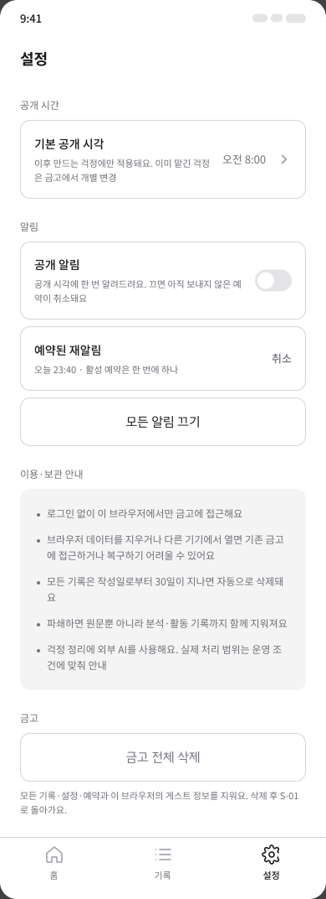

원본 페이지 좌표: (5360, 80, 5750, 1152). 아래 모든 좌표는 프레임 좌상단 기준.

#### 표시 텍스트·좌표


| 텍스트(원문) | x | y | w | h | PDF size | 추출색 |
| --- | --- | --- | --- | --- | --- | --- |
| 9:41 | 24 | 14 | 26.10 | 13.00 | 13 | #000000 |
| 설정 | 24 | 59 | 33.12 | 18.00 | 18 | #000000 |
| 공개 시간 | 24 | 118 | 46.84 | 12.00 | 12 | #000000 |
| 기본 공개 시각 | 41 | 163 | 83.56 | 14.00 | 14 | #000000 |
| 이후 만드는 걱정에만 적용돼요. 이미 맡긴 걱정 | 41 | 188 | 210.09 | 11.00 | 11 | #000000 |
| 은 금고에서 개별 변경 | 41 | 205 | 98.45 | 11.00 | 11 | #000000 |
| 오전 8:00 | 266 | 182 | 52.09 | 13.00 | 13 | #000000 |
| 알림 | 24 | 263 | 22.08 | 12.00 | 12 | #000000 |
| 공개 알림 | 41 | 307 | 54.66 | 14.00 | 14 | #000000 |
| 공개 시각에 한 번 알려드려요. 끄면 아직 보내지 않은 예 | 41 | 332 | 247.82 | 11.00 | 11 | #000000 |
| 약이 취소돼요 | 41 | 349 | 63.18 | 11.00 | 11 | #000000 |
| 예약된 재알림 | 41 | 409 | 80.42 | 14.00 | 14 | #000000 |
| 오늘 23:40 · 활성 예약은 한 번에 하나 | 41 | 434 | 172.29 | 11.00 | 11 | #000000 |
| 모든 알림 끄기 | 150.53 | 493 | 88.95 | 16.00 | 16 | #000000 |
| 취소 | 325 | 419.5 | 23.92 | 13.00 | 13 | #000000 |
| 이용·보관 안내 | 24 | 558 | 75.65 | 12.00 | 12 | #000000 |
| 로그인 없이 이 브라우저에서만 금고에 접근해요 | 56 | 605 | 234.20 | 12.00 | 12 | #000000 |
| 브라우저 데이터를 지우거나 다른 기기에서 열면 기존 금고 | 56 | 636 | 283.72 | 12.00 | 12 | #000000 |
| 에 접근하거나 복구하기 어려울 수 있어요 | 56 | 655 | 201.08 | 12.00 | 12 | #000000 |
| 모든 기록은 작성일로부터 30일이 지나면 자동으로 삭제돼 | 56 | 686 | 283.31 | 12.00 | 12 | #000000 |
| 요 | 56 | 705 | 11.04 | 12.00 | 12 | #000000 |
| 파쇄하면 원문뿐 아니라 분석·활동 기록까지 함께 지워져요 | 56 | 736 | 287.77 | 12.00 | 12 | #000000 |
| 걱정 정리에 외부 AI를 사용해요. 실제 처리 범위는 운영 조 | 56 | 767 | 281.17 | 12.00 | 12 | #000000 |
| 건에 맞춰 안내 | 56 | 786 | 71.60 | 12.00 | 12 | #000000 |
| 금고 | 24 | 849 | 22.08 | 12.00 | 12 | #000000 |
| 금고 전체 삭제 | 150.53 | 893 | 88.94 | 16.00 | 16 | #000000 |
| 모든 기록·설정·예약과 이 브라우저의 게스트 정보를 지워요. 삭제 후 S-01 | 24 | 942 | 333.47 | 11.00 | 11 | #000000 |
| 로 돌아가요. | 24 | 959 | 56.12 | 11.00 | 11 | #000000 |
| 홈 | 59.5 | 1037 | 10.12 | 11.00 | 11 | #000000 |
| 기록 | 184.5 | 1037 | 20.24 | 11.00 | 11 | #000000 |
| 설정 | 314.5 | 1037 | 20.24 | 11.00 | 11 | #000000 |


#### 주요 면·선·컨테이너 측정

높이24 이상·폭40 이상의 도형을 출력했다. 글자 윤곽이나 스크림·그림자도 포함될 수 있다. 원본 경로를 보지 않고 모두 직사각형 카드로 취급하지 않는다.


| x | y | w | h | 면 RGB 근사 | 면 alpha | 선 RGB 근사 | 선 두께 |
| --- | --- | --- | --- | --- | --- | --- | --- |
| 0 | 0 | 390.00 | 1072.00 | #000000 | 1.0 | 없음 | None |
| 0 | 0 | 390.00 | 1072.00 | #FFFFFF | 1.0 | 없음 | None |
| 24 | 143 | 342.00 | 94.00 | #FFFFFF | 1.0 | 없음 | None |
| 23 | 142 | 344.00 | 96.00 | #D4D4D8 | 1.0 | 없음 | None |
| 41 | 189.85 | 208.73 | 27.02 | #71717A | 1.0 | 없음 | None |
| 24 | 288 | 342.00 | 93.00 | #FFFFFF | 1.0 | 없음 | None |
| 23 | 287 | 344.00 | 95.00 | #D4D4D8 | 1.0 | 없음 | None |
| 41 | 333.9 | 246.71 | 26.97 | #71717A | 1.0 | 없음 | None |
| 305 | 321.5 | 44.00 | 26.00 | #E4E4E7 | 1.0 | 없음 | None |
| 24 | 389 | 342.00 | 77.00 | #FFFFFF | 1.0 | 없음 | None |
| 23 | 388 | 344.00 | 79.00 | #D4D4D8 | 1.0 | 없음 | None |
| 24 | 474 | 342.00 | 58.00 | #FFFFFF | 1.0 | 없음 | None |
| 23 | 473 | 344.00 | 60.00 | #D4D4D8 | 1.0 | 없음 | None |
| 24 | 583 | 342.00 | 240.00 | #F4F4F5 | 1.0 | 없음 | None |
| 56 | 638.08 | 283.09 | 29.87 | #71717A | 1.0 | 없음 | None |
| 56 | 688.08 | 282.04 | 28.46 | #71717A | 1.0 | 없음 | None |
| 56 | 769.08 | 280.57 | 29.86 | #71717A | 1.0 | 없음 | None |
| 24 | 874 | 342.00 | 58.00 | #FFFFFF | 1.0 | 없음 | None |
| 23 | 873 | 344.00 | 60.00 | #D4D4D8 | 1.0 | 없음 | None |
| 24 | 943.85 | 332.75 | 27.01 | #71717A | 1.0 | 없음 | None |
| 0 | 998 | 390.00 | 74.00 | #FFFFFF | 1.0 | 없음 | None |


### P05-F08 — S-15 금고 전체 삭제 확인

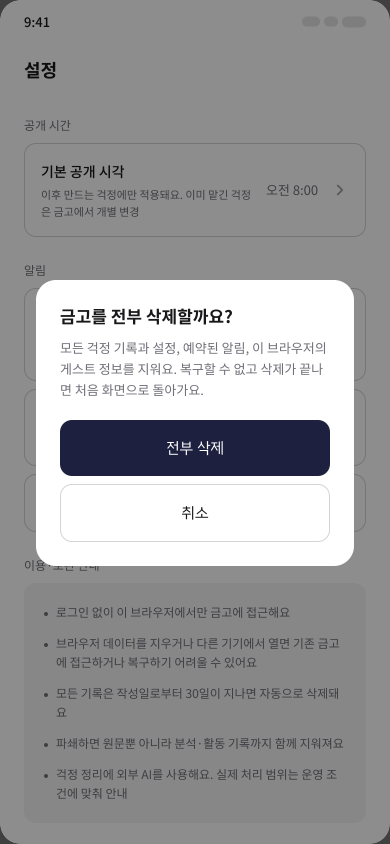

원본 페이지 좌표: (6240, 80, 6630, 924). 아래 모든 좌표는 프레임 좌상단 기준.

#### 표시 텍스트·좌표


| 텍스트(원문) | x | y | w | h | PDF size | 추출색 |
| --- | --- | --- | --- | --- | --- | --- |
| 9:41 | 24 | 14 | 26.10 | 13.00 | 13 | #000000 |
| 설정 | 24 | 59 | 33.12 | 18.00 | 18 | #000000 |
| 공개 시간 | 24 | 118 | 46.84 | 12.00 | 12 | #000000 |
| 기본 공개 시각 | 41 | 163 | 83.56 | 14.00 | 14 | #000000 |
| 이후 만드는 걱정에만 적용돼요. 이미 맡긴 걱정 | 41 | 188 | 210.09 | 11.00 | 11 | #000000 |
| 은 금고에서 개별 변경 | 41 | 205 | 98.45 | 11.00 | 11 | #000000 |
| 알림 | 24 | 263 | 22.08 | 12.00 | 12 | #000000 |
| 오전 8:00 | 266 | 182 | 52.09 | 13.00 | 13 | #000000 |
| 공개 알림 | 41 | 307 | 54.66 | 14.00 | 14 | #000000 |
| 금고를 전부 삭제할까요? | 60 | 306 | 172.83 | 17.00 | 17 | #000000 |
| 공개 시각에 한 번 알려드려요. 끄면 아직 보내지 않은 예 | 41 | 332 | 247.82 | 11.00 | 11 | #000000 |
| 약이 취소돼요 | 41 | 349 | 63.18 | 11.00 | 11 | #000000 |
| 모든 걱정 기록과 설정, 예약된 알림, 이 브라우저의  | 60 | 340 | 269.68 | 13.00 | 13 | #000000 |
| 게스트 정보를 지워요. 복구할 수 없고 삭제가 끝나 | 60 | 361 | 263.15 | 13.00 | 13 | #000000 |
| 면 처음 화면으로 돌아가요. | 60 | 382 | 143.89 | 13.00 | 13 | #000000 |
| 예약된 재알림 | 41 | 409 | 80.42 | 14.00 | 14 | #000000 |
| 오늘 23:40 · 활성 예약은 한 번에 하나 | 41 | 434 | 172.29 | 11.00 | 11 | #000000 |
| 전부 삭제 | 165.97 | 438 | 58.08 | 16.00 | 16 | #000000 |
| 취소 | 325 | 419.5 | 23.92 | 13.00 | 13 | #000000 |
| 모든 알림 끄기 | 150.53 | 493 | 88.95 | 16.00 | 16 | #000000 |
| 취소 | 181.41 | 503 | 27.20 | 16.00 | 16 | #000000 |
| 이용·보관 안내 | 24 | 558 | 75.65 | 12.00 | 12 | #000000 |
| 로그인 없이 이 브라우저에서만 금고에 접근해요 | 56 | 605 | 234.20 | 12.00 | 12 | #000000 |
| 브라우저 데이터를 지우거나 다른 기기에서 열면 기존 금고 | 56 | 636 | 283.72 | 12.00 | 12 | #000000 |
| 에 접근하거나 복구하기 어려울 수 있어요 | 56 | 655 | 201.08 | 12.00 | 12 | #000000 |
| 모든 기록은 작성일로부터 30일이 지나면 자동으로 삭제돼 | 56 | 686 | 283.31 | 12.00 | 12 | #000000 |
| 요 | 56 | 705 | 11.04 | 12.00 | 12 | #000000 |
| 파쇄하면 원문뿐 아니라 분석·활동 기록까지 함께 지워져요 | 56 | 736 | 287.77 | 12.00 | 12 | #000000 |
| 걱정 정리에 외부 AI를 사용해요. 실제 처리 범위는 운영 조 | 56 | 767 | 281.17 | 12.00 | 12 | #000000 |
| 건에 맞춰 안내 | 56 | 786 | 71.60 | 12.00 | 12 | #000000 |


#### 주요 면·선·컨테이너 측정

높이24 이상·폭40 이상의 도형을 출력했다. 글자 윤곽이나 스크림·그림자도 포함될 수 있다. 원본 경로를 보지 않고 모두 직사각형 카드로 취급하지 않는다.


| x | y | w | h | 면 RGB 근사 | 면 alpha | 선 RGB 근사 | 선 두께 |
| --- | --- | --- | --- | --- | --- | --- | --- |
| 0 | 0 | 390.00 | 844.00 | #000000 | 1.0 | 없음 | None |
| 0 | 0 | 390.00 | 844.00 | #FFFFFF | 1.0 | 없음 | None |
| 24 | 143 | 342.00 | 94.00 | #FFFFFF | 1.0 | 없음 | None |
| 23 | 142 | 344.00 | 96.00 | #D4D4D8 | 1.0 | 없음 | None |
| 41 | 189.85 | 208.73 | 27.02 | #71717A | 1.0 | 없음 | None |
| 24 | 288 | 342.00 | 93.00 | #FFFFFF | 1.0 | 없음 | None |
| 23 | 287 | 344.00 | 95.00 | #D4D4D8 | 1.0 | 없음 | None |
| 41 | 333.9 | 246.71 | 26.97 | #71717A | 1.0 | 없음 | None |
| 305 | 321.5 | 44.00 | 26.00 | #E4E4E7 | 1.0 | 없음 | None |
| 24 | 389 | 342.00 | 77.00 | #FFFFFF | 1.0 | 없음 | None |
| 23 | 388 | 344.00 | 79.00 | #D4D4D8 | 1.0 | 없음 | None |
| 24 | 474 | 342.00 | 58.00 | #FFFFFF | 1.0 | 없음 | None |
| 23 | 473 | 344.00 | 60.00 | #D4D4D8 | 1.0 | 없음 | None |
| 24 | 583 | 342.00 | 240.00 | #F4F4F5 | 1.0 | 없음 | None |
| 56 | 638.08 | 283.09 | 29.87 | #71717A | 1.0 | 없음 | None |
| 56 | 688.08 | 282.04 | 28.46 | #71717A | 1.0 | 없음 | None |
| 56 | 769.08 | 280.57 | 29.86 | #71717A | 1.0 | 없음 | None |
| 0 | 0 | 390.00 | 844.00 | #000000 | 0.44999998807907104 | 없음 | None |
| 36 | 280 | 318.00 | 286.00 | #FFFFFF | 1.0 | 없음 | None |
| 60 | 342.25 | 265.04 | 53.78 | #71717A | 1.0 | 없음 | None |
| 60 | 420 | 270.00 | 56.00 | #1E2240 | 1.0 | 없음 | None |
| 60 | 484 | 270.00 | 58.00 | #FFFFFF | 1.0 | 없음 | None |
| 59 | 483 | 272.00 | 60.00 | #D4D4D8 | 1.0 | 없음 | None |


### P06-F01 — S-16 위기 안내

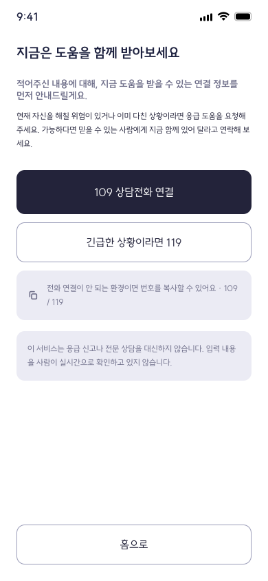

원본 페이지 좌표: (80, 80, 470, 924). 아래 모든 좌표는 프레임 좌상단 기준.

#### 표시 텍스트·좌표


| 텍스트(원문) | x | y | w | h | PDF size | 추출색 |
| --- | --- | --- | --- | --- | --- | --- |
| 9:41 | 24 | 14 | 31.31 | 16.00 | 16 | #000000 |
| 지금은 도움을 함께 받아보세요 | 24 | 64 | 237.40 | 20.00 | 20 | #000000 |
| 적어주신 내용에 대해, 지금 도움을 받을 수 있는 연결 정보를   | 24 | 113 | 325.29 | 14.00 | 14 | #000000 |
| 먼저 안내드릴게요. | 24 | 130 | 103.43 | 14.00 | 14 | #000000 |
| 현재 자신을 해칠 위험이 있거나 이미 다친 상황이라면 응급 도움을 요청해  | 24 | 161 | 336.36 | 12.00 | 12 | #000000 |
| 주세요. 가능하다면 믿을 수 있는 사람에게 지금 함께 있어 달라고 연락해 보 | 24 | 181 | 339.53 | 12.00 | 12 | #000000 |
| 세요. | 24 | 201 | 23.57 | 12.00 | 12 | #000000 |
| 109 상담전화 연결 | 137.09 | 269 | 115.85 | 16.00 | 16 | #000000 |
| 긴급한 상황이라면 119 | 125.64 | 342 | 138.76 | 16.00 | 16 | #000000 |
| 전화 연결이 안 되는 환경이면 번호를 복사할 수 있어요 · 109  | 68 | 411 | 280.74 | 12.00 | 12 | #000000 |
| / 119 | 68 | 431 | 24.43 | 12.00 | 12 | #000000 |
| 이 서비스는 응급 신고나 전문 상담을 대신하지 않습니다. 입력 내용 | 40 | 499 | 303.41 | 12.00 | 12 | #000000 |
| 을 사람이 실시간으로 확인하고 있지 않습니다. | 40 | 519 | 210.77 | 12.00 | 12 | #000000 |
| 홈으로 | 174.61 | 781 | 40.80 | 16.00 | 16 | #000000 |


#### 주요 면·선·컨테이너 측정

높이24 이상·폭40 이상의 도형을 출력했다. 글자 윤곽이나 스크림·그림자도 포함될 수 있다. 원본 경로를 보지 않고 모두 직사각형 카드로 취급하지 않는다.


| x | y | w | h | 면 RGB 근사 | 면 alpha | 선 RGB 근사 | 선 두께 |
| --- | --- | --- | --- | --- | --- | --- | --- |
| 0 | 0 | 390.00 | 844.00 | #FFFFFF | 1.0 | 없음 | None |
| 24 | 115.48 | 321.86 | 29.54 | #6E6F8A | 1.0 | 없음 | None |
| 24 | 163.28 | 339.10 | 50.24 | #24243A | 1.0 | 없음 | None |
| 24 | 247 | 342.00 | 64.00 | #24243A | 1.0 | 없음 | None |
| 24 | 323 | 342.00 | 58.00 | #FFFFFF | 1.0 | 없음 | None |
| 23 | 322 | 344.00 | 60.00 | #9A9CB8 | 1.0 | 없음 | None |
| 24 | 393 | 342.00 | 72.00 | #ECEBF5 | 1.0 | 없음 | None |
| 68 | 413.28 | 277.26 | 30.44 | #6E6F8A | 1.0 | 없음 | None |
| 24 | 481 | 342.00 | 72.00 | #ECEBF5 | 1.0 | 없음 | None |
| 40 | 501.24 | 302.95 | 30.64 | #6E6F8A | 1.0 | 없음 | None |
| 24 | 762 | 342.00 | 58.00 | #FFFFFF | 1.0 | 없음 | None |
| 23 | 761 | 344.00 | 60.00 | #9A9CB8 | 1.0 | 없음 | None |


### P06-F02 — S-17 선택 호흡

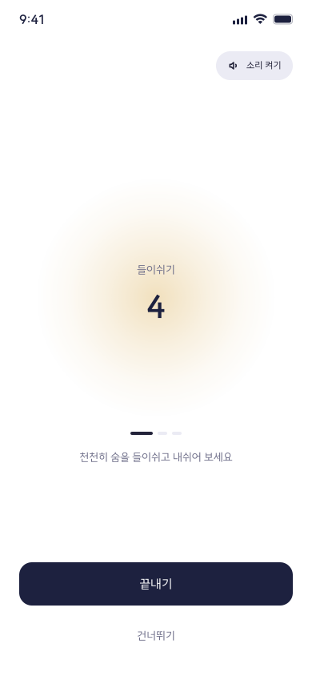

원본 페이지 좌표: (960, 80, 1350, 924). 아래 모든 좌표는 프레임 좌상단 기준.

#### 표시 텍스트·좌표


| 텍스트(원문) | x | y | w | h | PDF size | 추출색 |
| --- | --- | --- | --- | --- | --- | --- |
| 9:41 | 24 | 14 | 31.31 | 16.00 | 16 | #000000 |
| 소리 켜기 | 308 | 74 | 43.56 | 12.00 | 12 | #000000 |
| 들이쉬기 | 171.21 | 328 | 47.60 | 14.00 | 14 | #000000 |
| 4 | 182.62 | 357 | 24.76 | 40.00 | 40 | #000000 |
| 천천히 숨을 들이쉬고 내쉬어 보세요 | 99.34 | 562 | 191.38 | 14.00 | 14 | #000000 |
| 끝내기 | 174.61 | 719 | 40.80 | 16.00 | 16 | #000000 |
| 건너뛰기 | 171.21 | 785 | 47.60 | 14.00 | 14 | #000000 |


#### 주요 면·선·컨테이너 측정

높이24 이상·폭40 이상의 도형을 출력했다. 글자 윤곽이나 스크림·그림자도 포함될 수 있다. 원본 경로를 보지 않고 모두 직사각형 카드로 취급하지 않는다.


| x | y | w | h | 면 RGB 근사 | 면 alpha | 선 RGB 근사 | 선 두께 |
| --- | --- | --- | --- | --- | --- | --- | --- |
| 0 | 0 | 390.00 | 844.00 | #FFFFFF | 1.0 | 없음 | None |
| 270 | 64 | 96.00 | 36.00 | #ECEBF5 | 1.0 | 없음 | None |
| 24 | 702 | 342.00 | 54.00 | #1E2240 | 1.0 | 없음 | None |


### P06-F03 — S-18 시연 패널

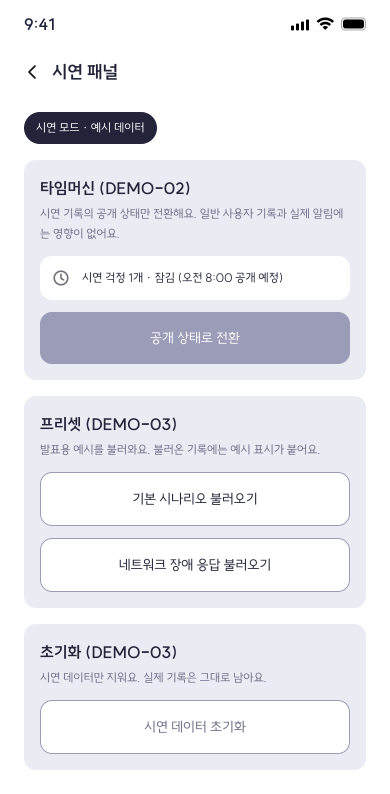

원본 페이지 좌표: (1840, 80, 2230, 874). 아래 모든 좌표는 프레임 좌상단 기준.

#### 표시 텍스트·좌표


| 텍스트(원문) | x | y | w | h | PDF size | 추출색 |
| --- | --- | --- | --- | --- | --- | --- |
| 9:41 | 24 | 14 | 31.31 | 16.00 | 16 | #000000 |
| 시연 패널 | 52 | 60.5 | 66.06 | 18.00 | 18 | #000000 |
| 시연 모드 · 예시 데이터 | 36 | 120 | 108.65 | 12.00 | 12 | #000000 |
| 타임머신 (DEMO-02) | 40 | 178 | 150.90 | 16.00 | 16 | #000000 |
| 시연 기록의 공개 상태만 전환해요. 일반 사용자 기록과 실제 알림에 | 40 | 206 | 303.34 | 12.00 | 12 | #000000 |
| 는 영향이 없어요. | 40 | 226 | 80.08 | 12.00 | 12 | #000000 |
| 시연 걱정 1개 · 잠김 (오전 8:00 공개 예정) | 82 | 270 | 201.28 | 12.00 | 12 | #000000 |
| 공개 상태로 전환 | 150.14 | 329 | 89.73 | 14.00 | 14 | #000000 |
| 프리셋 (DEMO-03) | 40 | 414 | 137.56 | 16.00 | 16 | #000000 |
| 발표용 예시를 불러와요. 불러온 기록에는 예시 표시가 붙어요. | 40 | 442 | 280.58 | 12.00 | 12 | #000000 |
| 기본 시나리오 불러오기 | 132.3 | 490 | 125.40 | 14.00 | 14 | #000000 |
| 네트워크 장애 응답 불러오기 | 118.79 | 556 | 152.42 | 14.00 | 14 | #000000 |
| 초기화 (DEMO-03) | 40 | 642 | 137.56 | 16.00 | 16 | #000000 |
| 시연 데이터만 지워요. 실제 기록은 그대로 남아요. | 40 | 670 | 226.84 | 12.00 | 12 | #000000 |
| 시연 데이터 초기화 | 144.2 | 718 | 101.62 | 14.00 | 14 | #000000 |


#### 주요 면·선·컨테이너 측정

높이24 이상·폭40 이상의 도형을 출력했다. 글자 윤곽이나 스크림·그림자도 포함될 수 있다. 원본 경로를 보지 않고 모두 직사각형 카드로 취급하지 않는다.


| x | y | w | h | 면 RGB 근사 | 면 alpha | 선 RGB 근사 | 선 두께 |
| --- | --- | --- | --- | --- | --- | --- | --- |
| 0 | 0 | 390.00 | 794.00 | #FFFFFF | 1.0 | 없음 | None |
| 24 | 112 | 133.00 | 32.00 | #24243A | 1.0 | 없음 | None |
| 24 | 160 | 342.00 | 220.00 | #ECEBF5 | 1.0 | 없음 | None |
| 40 | 208.28 | 302.37 | 30.74 | #6E6F8A | 1.0 | 없음 | None |
| 40 | 256 | 310.00 | 44.00 | #FFFFFF | 1.0 | 없음 | None |
| 40 | 312 | 310.00 | 52.00 | #9A9CB8 | 1.0 | 없음 | None |
| 24 | 396 | 342.00 | 212.00 | #ECEBF5 | 1.0 | 없음 | None |
| 40 | 472 | 310.00 | 54.00 | #FFFFFF | 1.0 | 없음 | None |
| 39 | 471 | 312.00 | 56.00 | #9A9CB8 | 1.0 | 없음 | None |
| 40 | 538 | 310.00 | 54.00 | #FFFFFF | 1.0 | 없음 | None |
| 39 | 537 | 312.00 | 56.00 | #9A9CB8 | 1.0 | 없음 | None |
| 24 | 624 | 342.00 | 146.00 | #ECEBF5 | 1.0 | 없음 | None |
| 40 | 700 | 310.00 | 54.00 | #FFFFFF | 1.0 | 없음 | None |
| 39 | 699 | 312.00 | 56.00 | #9A9CB8 | 1.0 | 없음 | None |


### P07-F01 — S-07 공개 시각 변경창 — TIME-03

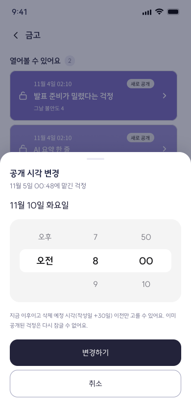

원본 페이지 좌표: (45, 80, 435, 924). 아래 모든 좌표는 프레임 좌상단 기준.

#### 표시 텍스트·좌표


| 텍스트(원문) | x | y | w | h | PDF size | 추출색 |
| --- | --- | --- | --- | --- | --- | --- |
| 9:41 | 24 | 14 | 31.31 | 16.00 | 16 | #000000 |
| 금고 | 52 | 60.5 | 30.96 | 18.00 | 18 | #000000 |
| 열어볼 수 있어요 | 20 | 114 | 103.72 | 16.00 | 16 | #000000 |
| 2 | 139 | 116 | 6.70 | 12.00 | 12 | #000000 |
| 11월 4일 02:10 | 69 | 163.5 | 77.38 | 12.00 | 12 | #000000 |
| 새로 공개 | 267 | 165 | 39.04 | 10.00 | 10 | #000000 |
| 발표 준비가 밀렸다는 걱정 | 69 | 186 | 162.47 | 16.00 | 16 | #000000 |
| 그날 불안도 4 | 69 | 214 | 61.62 | 11.00 | 11 | #000000 |
| 11월 4일 02:10 | 69 | 273.5 | 77.38 | 12.00 | 12 | #000000 |
| 새로 공개 | 267 | 275 | 39.04 | 10.00 | 10 | #000000 |
| AI 요약 한 줄 | 69 | 296 | 73.98 | 14.00 | 14 | #000000 |
| 그날 불안도 4 | 69 | 321 | 61.62 | 11.00 | 11 | #000000 |
| 공개 시각 변경 | 20 | 342 | 101.20 | 18.00 | 18 | #000000 |
| 아직 잠겨 있어요 | 20 | 371 | 103.72 | 16.00 | 16 | #000000 |
| 11월 5일 00:48에 맡긴 걱정 | 20 | 370 | 156.29 | 14.00 | 14 | #000000 |
| 1 | 139 | 373 | 4.72 | 12.00 | 12 | #000000 |
| 11월 10일 화요일 | 20 | 407 | 120.56 | 18.00 | 18 | #000000 |
| 11월 5일 00:48 | 69 | 420 | 106.50 | 16.00 | 16 | #000000 |
| 11월 6일 오전 8:00에 열려요 | 69 | 448 | 136.78 | 12.00 | 12 | #000000 |
| 오후 | 78.07 | 473 | 27.20 | 16.00 | 16 | #000000 |
| 7 | 190.59 | 473 | 8.83 | 16.00 | 16 | #000000 |
| 50 | 288.03 | 473 | 20.61 | 16.00 | 16 | #000000 |
| 오전 | 74.46 | 519 | 34.40 | 20.00 | 20 | #000000 |
| 8 | 189.06 | 519 | 11.88 | 20.00 | 20 | #000000 |
| 00 | 283.88 | 519 | 28.92 | 20.00 | 20 | #000000 |
| 9 | 190.3 | 569 | 9.40 | 16.00 | 16 | #000000 |
| 10 | 289.58 | 569 | 17.51 | 16.00 | 16 | #000000 |
| 지금 이후이고 삭제 예정 시각(작성일 +30일) 이전만 고를 수 있어요. 이미  | 20 | 636 | 341.89 | 12.00 | 12 | #000000 |
| 공개된 걱정은 다시 잠글 수 없어요. | 20 | 656 | 159.74 | 12.00 | 12 | #000000 |
| 변경하기 | 167.81 | 709 | 54.39 | 16.00 | 16 | #000000 |
| 취소 | 181.41 | 772 | 27.20 | 16.00 | 16 | #000000 |


#### 주요 면·선·컨테이너 측정

높이24 이상·폭40 이상의 도형을 출력했다. 글자 윤곽이나 스크림·그림자도 포함될 수 있다. 원본 경로를 보지 않고 모두 직사각형 카드로 취급하지 않는다.


| x | y | w | h | 면 RGB 근사 | 면 alpha | 선 RGB 근사 | 선 두께 |
| --- | --- | --- | --- | --- | --- | --- | --- |
| 0 | 0 | 390.00 | 844.00 | #000000 | 1.0 | 없음 | None |
| 0 | 0 | 390.00 | 844.00 | #FFFFFF | 1.0 | 없음 | None |
| 20 | 144 | 342.00 | 102.00 | #776AC2 | 1.0 | 없음 | None |
| 19 | 143 | 344.00 | 104.00 | #D4D4D8 | 1.0 | 없음 | None |
| 20 | 254 | 342.00 | 99.00 | #978FD3 | 1.0 | 없음 | None |
| 19 | 253 | 344.00 | 101.00 | #D4D4D8 | 1.0 | 없음 | None |
| 20 | 401 | 350.00 | 82.00 | #FFFFFF | 1.0 | 없음 | None |
| 19 | 400 | 352.00 | 84.00 | #9A9CB8 | 1.0 | 없음 | None |
| 0 | 0 | 390.00 | 844.00 | #1E2240 | 0.5 | 없음 | None |
| 0 | 310 | 390.00 | 534.00 | #FFFFFF | 1.0 | 없음 | None |
| 20 | 447 | 350.00 | 169.00 | #F4F4F5 | 1.0 | 없음 | None |
| 40 | 508 | 310.00 | 47.00 | #FFFFFF | 1.0 | 없음 | None |
| 20 | 638.23 | 337.83 | 31.03 | #6E6F8A | 1.0 | 없음 | None |
| 20 | 692 | 350.00 | 54.00 | #24243A | 1.0 | 없음 | None |
| 20 | 754 | 350.00 | 56.00 | #FFFFFF | 1.0 | 없음 | None |
| 19 | 753 | 352.00 | 58.00 | #9A9CB8 | 1.0 | 없음 | None |


### P07-F02 — S-06 재알림 시간 선택 — AL-04

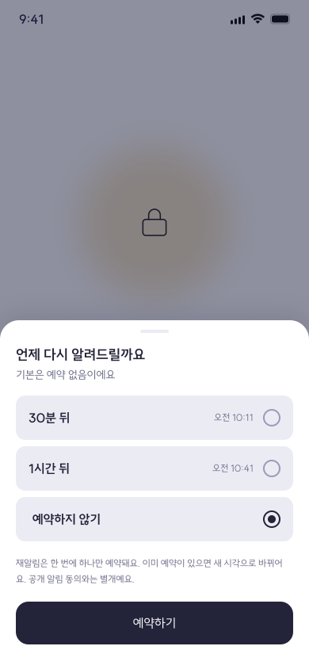

원본 페이지 좌표: (1835, 80, 2225, 924). 아래 모든 좌표는 프레임 좌상단 기준.

#### 표시 텍스트·좌표


| 텍스트(원문) | x | y | w | h | PDF size | 추출색 |
| --- | --- | --- | --- | --- | --- | --- |
| 9:41 | 24 | 14 | 31.31 | 16.00 | 16 | #000000 |
| 맡겨두었어요. | 140.6 | 400.5 | 108.76 | 20.00 | 20 | #000000 |
| 언제 다시 알려드릴까요 | 20 | 436 | 163.08 | 18.00 | 18 | #000000 |
| 이제 폰을 내려놓아도 돼요. | 122.89 | 434.5 | 144.26 | 14.00 | 14 | #000000 |
| 기본은 예약 없음이에요 | 20 | 464 | 125.44 | 14.00 | 14 | #000000 |
| 11월 5일 오전 8:00에 열려요 | 138.5 | 483.5 | 136.78 | 12.00 | 12 | #000000 |
| 30분 뒤 | 36 | 517 | 52.38 | 16.00 | 16 | #000000 |
| 1시간 뒤 | 36 | 581 | 51.97 | 16.00 | 16 | #000000 |
| 예약하지 않기 | 40.86 | 645 | 86.24 | 16.00 | 16 | #000000 |
| 홈으로 | 174.61 | 659 | 40.80 | 16.00 | 16 | #000000 |
| 오전 10:11 | 270 | 519 | 49.60 | 12.00 | 12 | #000000 |
| 오전 10:41 | 268 | 583 | 51.79 | 12.00 | 12 | #000000 |
| 재알림은 한 번에 하나만 예약돼요. 이미 예약이 있으면 새 시각으로 바뀌어 | 20 | 703 | 336.77 | 12.00 | 12 | #000000 |
| 요. 공개 알림 동의와는 별개예요. | 20 | 723 | 149.98 | 12.00 | 12 | #000000 |
| 새 걱정 맡기기 | 150.53 | 726 | 88.96 | 16.00 | 16 | #000000 |
| 조금 뒤에 다시 알려주세요 | 124.74 | 789 | 140.56 | 14.00 | 14 | #000000 |
| 예약하기 | 167.81 | 776 | 54.40 | 16.00 | 16 | #000000 |


#### 주요 면·선·컨테이너 측정

높이24 이상·폭40 이상의 도형을 출력했다. 글자 윤곽이나 스크림·그림자도 포함될 수 있다. 원본 경로를 보지 않고 모두 직사각형 카드로 취급하지 않는다.


| x | y | w | h | 면 RGB 근사 | 면 alpha | 선 RGB 근사 | 선 두께 |
| --- | --- | --- | --- | --- | --- | --- | --- |
| 0 | 0 | 390.00 | 844.00 | #000000 | 1.0 | 없음 | None |
| 0 | 0 | 390.00 | 844.00 | #FFFFFF | 1.0 | 없음 | None |
| 100.5 | 473.5 | 189.00 | 36.00 | #ECEBF5 | 1.0 | 없음 | None |
| 20 | 642 | 350.00 | 54.00 | #1E2240 | 1.0 | 없음 | None |
| 20 | 708 | 350.00 | 56.00 | #FFFFFF | 1.0 | 없음 | None |
| 19 | 707 | 352.00 | 58.00 | #9A9CB8 | 1.0 | 없음 | None |
| 20 | 776 | 350.00 | 44.00 | #ECEBF5 | 1.0 | 없음 | None |
| 0 | 0 | 390.00 | 844.00 | #1E2240 | 0.5 | 없음 | None |
| 0 | 404 | 390.00 | 443.00 | #FFFFFF | 1.0 | 없음 | None |
| 20 | 499 | 350.00 | 56.00 | #ECEBF5 | 1.0 | 없음 | None |
| 20 | 563 | 350.00 | 56.00 | #ECEBF5 | 1.0 | 없음 | None |
| 20 | 627 | 350.00 | 56.00 | #ECEBF5 | 1.0 | 없음 | None |
| 20 | 705.28 | 335.44 | 30.98 | #6E6F8A | 1.0 | 없음 | None |
| 20 | 759 | 350.00 | 54.00 | #24243A | 1.0 | 없음 | None |


### P07-F03 — S-08 정리 수정 — 정상 M-04

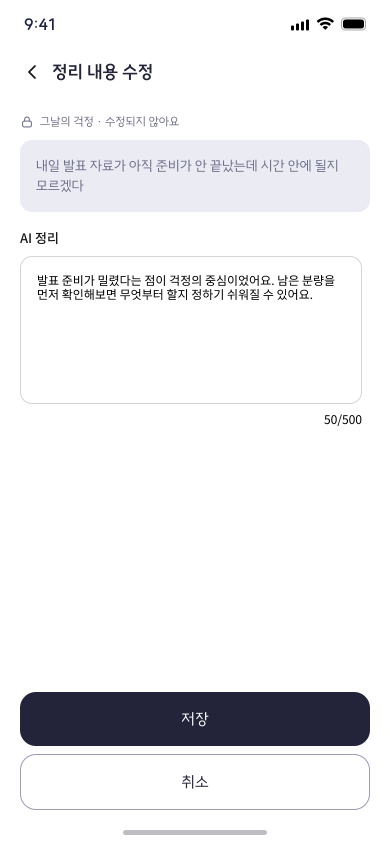

원본 페이지 좌표: (2685, 80, 3075, 924). 아래 모든 좌표는 프레임 좌상단 기준.

#### 표시 텍스트·좌표


| 텍스트(원문) | x | y | w | h | PDF size | 추출색 |
| --- | --- | --- | --- | --- | --- | --- |
| 9:41 | 24 | 14 | 31.31 | 16.00 | 16 | #000000 |
| 정리 내용 수정 | 52 | 60.5 | 101.20 | 18.00 | 18 | #000000 |
| 그날의 걱정 · 수정되지 않아요 | 40 | 114 | 139.23 | 12.00 | 12 | #000000 |
| 내일 발표 자료가 아직 준비가 안 끝났는데 시간 안에 될지 
 | 36 | 157 | 305.84 | 14.00 | 14 | #000000 |
| 모르겠다 | 36 | 177 | 47.58 | 14.00 | 14 | #000000 |
| AI 정리 | 20 | 230 | 38.94 | 13.00 | 13 | #000000 |
| 발표 준비가 밀렸다는 점이 걱정의 중심이었어요. 남은 분량을  | 37 | 273 | 300.79 | 12.00 | 12 | #000000 |
| 먼저 확인해보면 무엇부터 할지 정하기 쉬워질 수 있어요. | 37 | 287 | 276.02 | 12.00 | 12 | #000000 |
| 50/500 | 324 | 412 | 37.99 | 12.00 | 12 | #000000 |
| 저장 | 181.41 | 709 | 27.20 | 16.00 | 16 | #000000 |
| 취소 | 181.41 | 772 | 27.20 | 16.00 | 16 | #000000 |


#### 주요 면·선·컨테이너 측정

높이24 이상·폭40 이상의 도형을 출력했다. 글자 윤곽이나 스크림·그림자도 포함될 수 있다. 원본 경로를 보지 않고 모두 직사각형 카드로 취급하지 않는다.


| x | y | w | h | 면 RGB 근사 | 면 alpha | 선 RGB 근사 | 선 두께 |
| --- | --- | --- | --- | --- | --- | --- | --- |
| 0 | 0 | 390.00 | 844.00 | #FFFFFF | 1.0 | 없음 | None |
| 20 | 140 | 350.00 | 72.00 | #ECEBF5 | 1.0 | 없음 | None |
| 36 | 159.76 | 301.23 | 32.25 | #6E6F8A | 1.0 | 없음 | None |
| 20 | 256 | 342.00 | 148.00 | #FFFFFF | 1.0 | 없음 | None |
| 19 | 255 | 344.00 | 150.00 | #D4D4D8 | 1.0 | 없음 | None |
| 37 | 275.08 | 297.47 | 24.87 | #000000 | 1.0 | 없음 | None |
| 20 | 692 | 350.00 | 54.00 | #24243A | 1.0 | 없음 | None |
| 20 | 754 | 350.00 | 56.00 | #FFFFFF | 1.0 | 없음 | None |
| 19 | 753 | 352.00 | 58.00 | #9A9CB8 | 1.0 | 없음 | None |


### P07-F04 — S-08 정리 수정 — 저장 불가 M-04

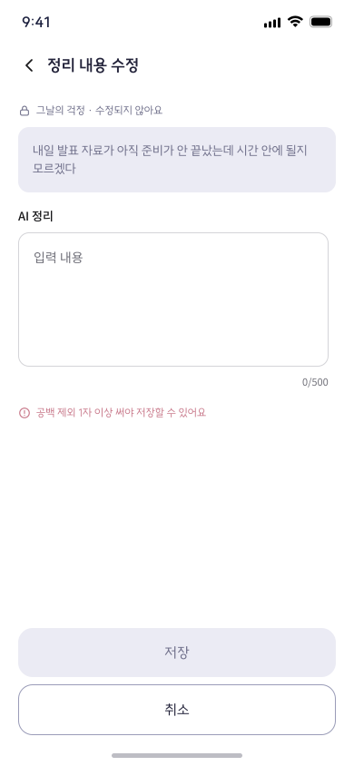

원본 페이지 좌표: (3570, 80, 3960, 924). 아래 모든 좌표는 프레임 좌상단 기준.

#### 표시 텍스트·좌표


| 텍스트(원문) | x | y | w | h | PDF size | 추출색 |
| --- | --- | --- | --- | --- | --- | --- |
| 9:41 | 24 | 14 | 31.31 | 16.00 | 16 | #000000 |
| 정리 내용 수정 | 52 | 60.5 | 101.20 | 18.00 | 18 | #000000 |
| 그날의 걱정 · 수정되지 않아요 | 40 | 114 | 139.23 | 12.00 | 12 | #000000 |
| 내일 발표 자료가 아직 준비가 안 끝났는데 시간 안에 될지 
 | 36 | 157 | 305.84 | 14.00 | 14 | #000000 |
| 모르겠다 | 36 | 177 | 47.58 | 14.00 | 14 | #000000 |
| AI 정리 | 20 | 230 | 38.94 | 13.00 | 13 | #000000 |
| 입력 내용 | 37 | 275 | 54.65 | 14.00 | 14 | #000000 |
| 0/500 | 333 | 414 | 28.72 | 11.00 | 11 | #000000 |
| 공백 제외 1자 이상 써야 저장할 수 있어요 | 40 | 447 | 187.20 | 12.00 | 12 | #000000 |
| 저장 | 181.41 | 709 | 27.20 | 16.00 | 16 | #000000 |
| 취소 | 181.41 | 772 | 27.20 | 16.00 | 16 | #000000 |


#### 주요 면·선·컨테이너 측정

높이24 이상·폭40 이상의 도형을 출력했다. 글자 윤곽이나 스크림·그림자도 포함될 수 있다. 원본 경로를 보지 않고 모두 직사각형 카드로 취급하지 않는다.


| x | y | w | h | 면 RGB 근사 | 면 alpha | 선 RGB 근사 | 선 두께 |
| --- | --- | --- | --- | --- | --- | --- | --- |
| 0 | 0 | 390.00 | 844.00 | #FFFFFF | 1.0 | 없음 | None |
| 20 | 140 | 350.00 | 72.00 | #ECEBF5 | 1.0 | 없음 | None |
| 36 | 159.76 | 301.23 | 32.25 | #6E6F8A | 1.0 | 없음 | None |
| 20 | 256 | 342.00 | 148.00 | #FFFFFF | 1.0 | 없음 | None |
| 19 | 255 | 344.00 | 150.00 | #D4D4D8 | 1.0 | 없음 | None |
| 20 | 692 | 350.00 | 54.00 | #ECEBF5 | 1.0 | 없음 | None |
| 20 | 754 | 350.00 | 56.00 | #FFFFFF | 1.0 | 없음 | None |
| 19 | 753 | 352.00 | 58.00 | #9A9CB8 | 1.0 | 없음 | None |


### P07-F05 — S-08 정리 수정 — 저장 실패 M-04

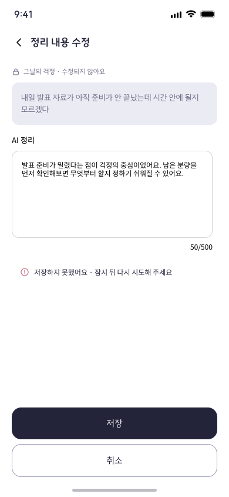

원본 페이지 좌표: (4460, 80, 4850, 924). 아래 모든 좌표는 프레임 좌상단 기준.

#### 표시 텍스트·좌표


| 텍스트(원문) | x | y | w | h | PDF size | 추출색 |
| --- | --- | --- | --- | --- | --- | --- |
| 9:41 | 24 | 14 | 31.31 | 16.00 | 16 | #000000 |
| 정리 내용 수정 | 52 | 60.5 | 101.20 | 18.00 | 18 | #000000 |
| 그날의 걱정 · 수정되지 않아요 | 40 | 114 | 139.23 | 12.00 | 12 | #000000 |
| 내일 발표 자료가 아직 준비가 안 끝났는데 시간 안에 될지 
 | 36 | 157 | 305.84 | 14.00 | 14 | #000000 |
| 모르겠다 | 36 | 177 | 47.58 | 14.00 | 14 | #000000 |
| AI 정리 | 20 | 230 | 38.94 | 13.00 | 13 | #000000 |
| 발표 준비가 밀렸다는 점이 걱정의 중심이었어요. 남은 분량을  | 37 | 273 | 300.79 | 12.00 | 12 | #000000 |
| 먼저 확인해보면 무엇부터 할지 정하기 쉬워질 수 있어요. | 37 | 287 | 276.02 | 12.00 | 12 | #000000 |
| 50/500 | 324 | 412 | 37.99 | 12.00 | 12 | #000000 |
| 저장하지 못했어요 · 잠시 뒤 다시 시도해 주세요 | 58 | 455 | 235.26 | 12.00 | 12 | #000000 |
| 저장 | 181.41 | 709 | 27.20 | 16.00 | 16 | #000000 |
| 취소 | 181.41 | 772 | 27.20 | 16.00 | 16 | #000000 |


#### 주요 면·선·컨테이너 측정

높이24 이상·폭40 이상의 도형을 출력했다. 글자 윤곽이나 스크림·그림자도 포함될 수 있다. 원본 경로를 보지 않고 모두 직사각형 카드로 취급하지 않는다.


| x | y | w | h | 면 RGB 근사 | 면 alpha | 선 RGB 근사 | 선 두께 |
| --- | --- | --- | --- | --- | --- | --- | --- |
| 0 | 0 | 390.00 | 844.00 | #FFFFFF | 1.0 | 없음 | None |
| 20 | 140 | 350.00 | 72.00 | #ECEBF5 | 1.0 | 없음 | None |
| 36 | 159.76 | 301.23 | 32.25 | #6E6F8A | 1.0 | 없음 | None |
| 20 | 256 | 342.00 | 148.00 | #FFFFFF | 1.0 | 없음 | None |
| 19 | 255 | 344.00 | 150.00 | #D4D4D8 | 1.0 | 없음 | None |
| 37 | 275.08 | 297.47 | 24.87 | #000000 | 1.0 | 없음 | None |
| 20 | 692 | 350.00 | 54.00 | #24243A | 1.0 | 없음 | None |
| 20 | 754 | 350.00 | 56.00 | #FFFFFF | 1.0 | 없음 | None |
| 19 | 753 | 352.00 | 58.00 | #9A9CB8 | 1.0 | 없음 | None |


### P07-F06 — S-08 활동 중단 확인 — M-05

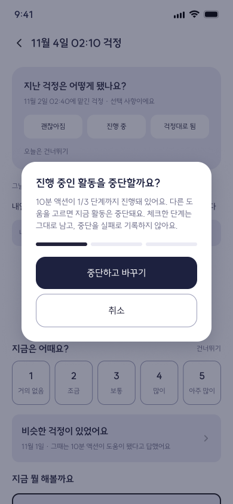

원본 페이지 좌표: (5350, 80, 5740, 924). 아래 모든 좌표는 프레임 좌상단 기준.

#### 표시 텍스트·좌표


| 텍스트(원문) | x | y | w | h | PDF size | 추출색 |
| --- | --- | --- | --- | --- | --- | --- |
| 9:41 | 24 | 14 | 31.31 | 16.00 | 16 | #000000 |
| 11월 4일 02:10 걱정 | 52 | 60.5 | 151.67 | 18.00 | 18 | #000000 |
| 지난 걱정은 어떻게 됐나요? | 40 | 134 | 171.46 | 16.00 | 16 | #000000 |
| 11월 2일 02:40에 맡긴 걱정 · 선택 사항이에요 | 40 | 162 | 218.83 | 12.00 | 12 | #000000 |
| 괜찮아짐 | 68.61 | 204 | 40.79 | 12.00 | 12 | #000000 |
| 진행 중 | 178.32 | 204 | 33.36 | 12.00 | 12 | #000000 |
| 걱정대로 됨 | 274.13 | 204 | 53.75 | 12.00 | 12 | #000000 |
| 오늘은 건너뛰기 | 40 | 246 | 74.14 | 12.00 | 12 | #000000 |
| 그날의 걱정 | 20 | 304 | 53.75 | 12.00 | 12 | #000000 |
| 진행 중인 활동을 중단할까요? | 60 | 295 | 208.38 | 18.00 | 18 | #000000 |
| 그날 불안도 4 | 90 | 304 | 63.89 | 12.00 | 12 | #000000 |
| 내일 발표 자료가 아직 반도 안 끝났는데 시간 안에 될지 모르겠다 | 20 | 337 | 341.53 | 14.00 | 14 | #000000 |
| 내일 확인할 것 | 32 | 382 | 66.71 | 12.00 | 12 | #000000 |
| 10분 액션이 1/3 단계까지 진행돼 있어요. 다른 도 | 60 | 329 | 262.98 | 14.00 | 14 | #000000 |
| 움을 고르면 지금 활동은 중단돼요. 체크한 단계는  | 60 | 349 | 264.17 | 14.00 | 14 | #000000 |
| 그대로 남고, 중단을 실패로 기록하지 않아요. | 60 | 369 | 237.77 | 14.00 | 14 | #000000 |
| 발표 자료 분량 확인하기 | 107 | 382 | 110.26 | 12.00 | 12 | #000000 |
| AI가 정리했어요 | 36 | 446 | 103.29 | 16.00 | 16 | #000000 |
| 중단하고 바꾸기 | 145.58 | 447 | 98.85 | 16.00 | 16 | #000000 |
| 수정 | 333 | 448 | 20.40 | 12.00 | 12 | #000000 |
| 발표 준비가 밀렸다는 점이 걱정의 중심이었어요. 남은 분 | 36 | 481 | 299.86 | 14.00 | 14 | #000000 |
| 량을 먼저 확인해보면 무엇부터 할지 정하기 쉬워질 수 있 | 36 | 501 | 299.39 | 14.00 | 14 | #000000 |
| 어요. | 36 | 521 | 27.50 | 14.00 | 14 | #000000 |
| 취소 | 181.41 | 510 | 27.20 | 16.00 | 16 | #000000 |
| 지금은 어때요? | 20 | 574 | 95.26 | 16.00 | 16 | #000000 |
| 건너뛰기 | 329 | 576 | 40.79 | 12.00 | 12 | #000000 |
| 1 | 48.29 | 619 | 7.01 | 16.00 | 16 | #000000 |
| 2 | 118.79 | 619 | 9.22 | 16.00 | 16 | #000000 |
| 3 | 190.2 | 619 | 9.61 | 16.00 | 16 | #000000 |
| 4 | 261.65 | 619 | 9.90 | 16.00 | 16 | #000000 |
| 5 | 333.39 | 619 | 9.63 | 16.00 | 16 | #000000 |
| 거의 없음 | 30.03 | 647 | 43.55 | 12.00 | 12 | #000000 |
| 조금 | 113.21 | 647 | 20.40 | 12.00 | 12 | #000000 |
| 보통 | 184.8 | 647 | 20.41 | 12.00 | 12 | #000000 |
| 많이 | 256.4 | 647 | 20.40 | 12.00 | 12 | #000000 |
| 아주 많이 | 316.43 | 647 | 43.55 | 12.00 | 12 | #000000 |
| 비슷한 걱정이 있었어요 | 36 | 712 | 145.01 | 16.00 | 16 | #000000 |
| 11월 1일 · 그때는 10분 액션이 도움이 됐다고 답했어요 | 36 | 740 | 249.40 | 12.00 | 12 | #000000 |
| 지금 뭘 해볼까요 | 20 | 792 | 103.72 | 16.00 | 16 | #000000 |


#### 주요 면·선·컨테이너 측정

높이24 이상·폭40 이상의 도형을 출력했다. 글자 윤곽이나 스크림·그림자도 포함될 수 있다. 원본 경로를 보지 않고 모두 직사각형 카드로 취급하지 않는다.


| x | y | w | h | 면 RGB 근사 | 면 alpha | 선 RGB 근사 | 선 두께 |
| --- | --- | --- | --- | --- | --- | --- | --- |
| 0 | 0 | 390.00 | 844.00 | #000000 | 1.0 | 없음 | None |
| 0 | 0 | 390.00 | 844.00 | #FFFFFF | 1.0 | 없음 | None |
| 20 | 112 | 350.00 | 172.00 | #ECEBF5 | 1.0 | 없음 | None |
| 40 | 192 | 98.00 | 40.00 | #FFFFFF | 1.0 | 없음 | None |
| 146 | 192 | 98.00 | 40.00 | #FFFFFF | 1.0 | 없음 | None |
| 252 | 192 | 98.00 | 40.00 | #FFFFFF | 1.0 | 없음 | None |
| 82 | 300 | 80.00 | 24.00 | #ECEBF5 | 1.0 | 없음 | None |
| 20 | 368 | 350.00 | 44.00 | #ECEBF5 | 1.0 | 없음 | None |
| 20 | 428 | 350.00 | 128.00 | #FFFFFF | 1.0 | 없음 | None |
| 36 | 483.66 | 299.44 | 51.96 | #24243A | 1.0 | 없음 | None |
| 20 | 604 | 63.60 | 74.00 | #FFFFFF | 1.0 | 없음 | None |
| 19 | 603 | 65.60 | 76.00 | #9A9CB8 | 1.0 | 없음 | None |
| 91.6 | 604 | 63.60 | 74.00 | #FFFFFF | 1.0 | 없음 | None |
| 90.6 | 603 | 65.60 | 76.00 | #9A9CB8 | 1.0 | 없음 | None |
| 163.2 | 604 | 63.60 | 74.00 | #FFFFFF | 1.0 | 없음 | None |
| 162.2 | 603 | 65.60 | 76.00 | #9A9CB8 | 1.0 | 없음 | None |
| 234.8 | 604 | 63.60 | 74.00 | #FFFFFF | 1.0 | 없음 | None |
| 233.8 | 603 | 65.60 | 76.00 | #9A9CB8 | 1.0 | 없음 | None |
| 306.4 | 604 | 63.60 | 74.00 | #FFFFFF | 1.0 | 없음 | None |
| 305.4 | 603 | 65.60 | 76.00 | #9A9CB8 | 1.0 | 없음 | None |
| 20 | 694 | 350.00 | 80.00 | #ECEBF5 | 1.0 | 없음 | None |
| 0 | 0 | 390.00 | 844.00 | #1E2240 | 0.5 | 없음 | None |
| 36 | 271 | 318.00 | 301.00 | #FFFFFF | 1.0 | 없음 | None |
| 60 | 331.76 | 262.55 | 52.77 | #6E6F8A | 1.0 | 없음 | None |
| 60 | 430 | 270.00 | 54.00 | #1E2240 | 1.0 | 없음 | None |
| 60 | 492 | 270.00 | 56.00 | #FFFFFF | 1.0 | 없음 | None |
| 59 | 491 | 272.00 | 58.00 | #9A9CB8 | 1.0 | 없음 | None |


### P08-F01 — 알림 오류 공통 시트 — AL-09

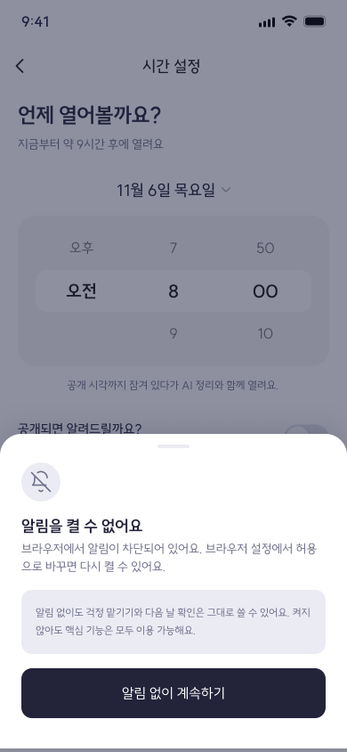

원본 페이지 좌표: (67, 80, 457, 924). 아래 모든 좌표는 프레임 좌상단 기준.

#### 표시 텍스트·좌표


| 텍스트(원문) | x | y | w | h | PDF size | 추출색 |
| --- | --- | --- | --- | --- | --- | --- |
| 9:41 | 24 | 14 | 31.31 | 16.00 | 16 | #000000 |
| 시간 설정 | 160 | 63 | 65.55 | 18.00 | 18 | #000000 |
| 언제 열어볼까요? | 20 | 114 | 161.61 | 24.00 | 24 | #000000 |
| 지금부터 약 9시간 후에 열려요 | 20 | 153 | 163.86 | 14.00 | 14 | #000000 |
| 11월 6일 목요일 | 131 | 202 | 111.12 | 18.00 | 18 | #000000 |
| 오후 | 78.07 | 268 | 27.20 | 16.00 | 16 | #000000 |
| 7 | 190.59 | 268 | 8.83 | 16.00 | 16 | #000000 |
| 50 | 288.03 | 268 | 20.61 | 16.00 | 16 | #000000 |
| 오전 | 74.46 | 314 | 34.41 | 20.00 | 20 | #000000 |
| 8 | 189.06 | 314 | 11.88 | 20.00 | 20 | #000000 |
| 00 | 283.88 | 314 | 28.92 | 20.00 | 20 | #000000 |
| 9 | 190.3 | 364 | 9.40 | 16.00 | 16 | #000000 |
| 10 | 289.58 | 364 | 17.51 | 16.00 | 16 | #000000 |
| 공개 시각까지 잠겨 있다가 AI 정리와 함께 열려요. | 75.5 | 424.5 | 238.01 | 12.50 | 12.5 | #000000 |
| 공개되면 알려드릴까요? | 20 | 472 | 139.56 | 15.00 | 15 | #000000 |
| 기본은 꺼짐. 켜면 공개 시각에 한 번만 알려드려요 | 20 | 496.5 | 235.87 | 12.50 | 12.5 | #000000 |
| 알림을 켤 수 없어요 | 24 | 579 | 136.31 | 18.00 | 18 | #000000 |
| 브라우저에서 알림이 차단되어 있어요. 브라우저 설정에서 허용 | 24 | 607 | 332.42 | 14.00 | 14 | #000000 |
| 으로 바꾸면 다시 켤 수 있어요. | 24 | 627 | 162.60 | 14.00 | 14 | #000000 |
| 알림 없이도 걱정 맡기기와 다음 날 확인은 그대로 쓸 수 있어요. 켜지  | 40 | 680 | 311.63 | 12.00 | 12 | #000000 |
| 않아도 핵심 기능은 모두 이용 가능해요. | 40 | 700 | 180.13 | 12.00 | 12 | #000000 |
| 알림 없이 계속하기 | 136.94 | 768 | 116.13 | 16.00 | 16 | #000000 |
| 금고에 맡기기 | 151.86 | 761 | 86.26 | 16.00 | 16 | #000000 |


#### 주요 면·선·컨테이너 측정

높이24 이상·폭40 이상의 도형을 출력했다. 글자 윤곽이나 스크림·그림자도 포함될 수 있다. 원본 경로를 보지 않고 모두 직사각형 카드로 취급하지 않는다.


| x | y | w | h | 면 RGB 근사 | 면 alpha | 선 RGB 근사 | 선 두께 |
| --- | --- | --- | --- | --- | --- | --- | --- |
| 0 | 0 | 390.00 | 844.00 | #000000 | 1.0 | 없음 | None |
| 0 | 0 | 390.00 | 844.00 | #FFFFFF | 1.0 | 없음 | None |
| 20 | 242 | 350.00 | 169.00 | #F4F4F5 | 1.0 | 없음 | None |
| 40 | 303 | 310.00 | 47.00 | #FFFFFF | 1.0 | 없음 | None |
| 319 | 476.5 | 51.00 | 31.00 | #E3E2EC | 1.0 | 없음 | None |
| 20 | 744 | 350.00 | 54.00 | #1E2240 | 1.0 | 없음 | None |
| 0 | 0 | 390.00 | 844.00 | #1E2240 | 0.5 | 없음 | None |
| 0 | 487 | 390.00 | 353.00 | #FFFFFF | 1.0 | 없음 | None |
| 24 | 519 | 44.00 | 44.00 | #000000 | 1.0 | 없음 | None |
| 24 | 519 | 44.00 | 44.00 | #ECEBF5 | 1.0 | 없음 | None |
| 24 | 609.66 | 331.87 | 32.38 | #6E6F8A | 1.0 | 없음 | None |
| 24 | 662 | 342.00 | 72.00 | #ECEBF5 | 1.0 | 없음 | None |
| 40 | 682.28 | 307.68 | 30.86 | #6E6F8A | 1.0 | 없음 | None |
| 24 | 750 | 342.00 | 56.00 | #24243A | 1.0 | 없음 | None |


## 부록 C. PDF별 화면 문구·가이드 전문

가이드42개와 보조 상태 텍스트를 포함한 텍스트 추출 전체다. 카드와 가이드가 섞이는 곳은 부록 B의 좌표·이미지를 함께 확인한다. PDF에 인쇄되지 않은 Figma 레이어 이름은 추가하지 않았다.


### P01 — 공개 가능).pdf

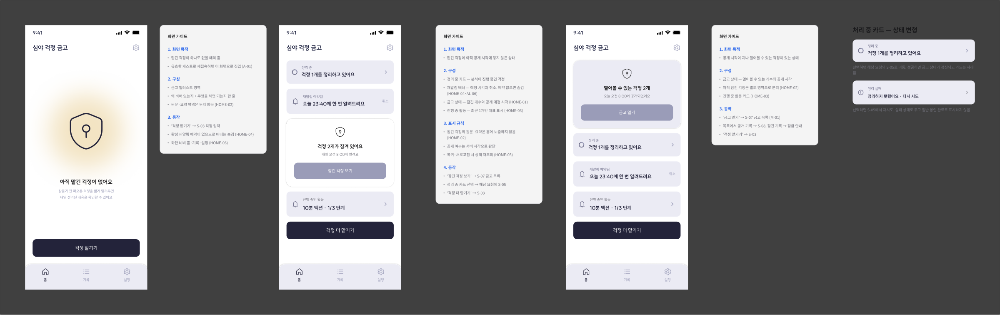

```text
9:41
심야 걱정 금고
아직 맡긴 걱정이 없어요
잠들기 전 떠오른 걱정을 짧게 맡겨두면
내일 정리된 내용을 확인할 수 있어요
걱정 맡기기
홈
기록
설정
화면 가이드
1. 화면 목적
맡긴 걱정이 하나도 없을 때의 홈
유효한 게스트로 재접속하면 이 화면으로 진입 (A-01)
2. 구성
금고 일러스트 영역
왜 비어 있는지 + 무엇을 하면 되는지 한 줄
원문·요약 영역은 두지 않음 (HOME-02)
3. 동작
‘걱정 맡기기’ → S-03 걱정 입력
활성 재알림 예약이 없으므로 배너는 숨김 (HOME-04)
하단 네비 홈·기록·설정 (HOME-06)
9:41
심야 걱정 금고
정리 중
걱정 1개를 정리하고 있어요
재알림 예약됨
오늘 23:40에 한 번 알려드려요
취소
걱정 2개가 잠겨 있어요
내일 오전 8:00에 열려요
잠긴 걱정 보기
진행 중인 활동
10분 액션 · 1/3 단계
걱정 더 맡기기
홈
기록
설정
화면 가이드
1. 화면 목적
맡긴 걱정이 아직 공개 시각에 닿지 않은 상태
2. 구성
정리 중 카드 — 분석이 진행 중인 걱정
재알림 배너 — 예정 시각과 취소. 예약 없으면 숨김 
(HOME-04·AL-06)
금고 상태 — 잠긴 개수와 공개 예정 시각 (HOME-01)
진행 중 활동 — 최근 1개만 대표 표시 (HOME-03)
3. 표시 규칙
잠긴 걱정의 원문·요약은 홈에 노출하지 않음 
(HOME-02)
공개 여부는 서버 시각으로 판단
복귀·새로고침 시 상태 재조회 (HOME-05)
4. 동작
‘잠긴 걱정 보기’ → S-07 금고 목록
정리 중 카드 선택 → 해당 요청의 S-05
‘걱정 더 맡기기’ → S-03
9:41
심야 걱정 금고
열어볼 수 있는 걱정 2개
오늘 오전 8:00에 공개되었어요
금고 열기
정리 중
걱정 1개를 정리하고 있어요
재알림 예약됨
오늘 23:40에 한 번 알려드려요
취소
진행 중인 활동
10분 액션 · 1/3 단계
걱정 더 맡기기
홈
기록
설정
화면 가이드
1. 화면 목적
공개 시각이 지나 열어볼 수 있는 걱정이 있는 상태
2. 구성
금고 상태 — 열어볼 수 있는 개수와 공개 시각
아직 잠긴 걱정은 별도 영역으로 분리 (HOME-02)
진행 중 활동 카드 (HOME-03)
3. 동작
‘금고 열기’ → S-07 금고 목록 (M-01)
목록에서 공개 기록 → S-08, 잠긴 기록 → 잠금 안내
‘걱정 맡기기’ → S-03
처리 중 카드 — 상태 변형
정리 중
걱정 1개를 정리하고 있어요
선택하면 해당 요청의 S-05로 이동. 성공하면 금고 상태가 갱신되고 카드는 사라
짐
정리 실패
정리하지 못했어요 · 다시 시도
선택하면 S-05에서 재시도. 실패 상태로 두고 일반 봉인 완료로 표시하지 않음

```


### P02 — 2. 밤 플로우 — S-03 입력 → S-04 공개 시간 → S-05 분석 → S-06 봉인.pdf

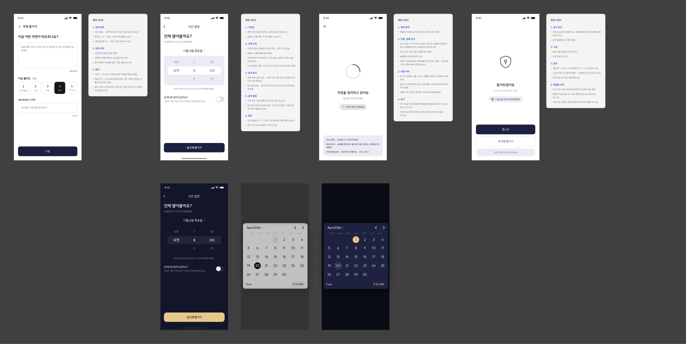

```text
9:41
걱정 맡기기
지금 어떤 걱정이 떠오르나요?
내일 발표 자료가 아직 반도 안 끝났는데 시간 안에 될지 모
르겠다.
38/500
지금 불안도
필수
1
2
3
4
5
거의 없음
조금
보통
많이
아주 많이
내일 확인할 것 (선택)
예) 발표 자료 분량 확인하기
0/100
다음
화면 가이드
1. 입력 항목
걱정 내용 — 공백 제외 1자 이상, 최대 500자 (N-01)
불안도 1~5 — 필수, 기본 선택 없음 (N-02)
내일 확인할 것 — 선택, 최대 100자 (N-03)
2. 입력 규칙
걱정은 한 번에 1개만 등록
공백만 입력한 메모는 값 없음으로 처리
필수 항목이 유효할 때만 ‘다음’ 활성 (N-04)
3. 동작
‘다음’ → S-04. 이 시점에 서버 기록을 만들지 않음
뒤로가기 → S-02 홈의 현재 상태. 기존 기록이 있어도 빈 
홈으로 보내지 않음
앞뒤 이동 시 입력 유지. 새로고침·종료 후 복구는 보장하
지 않음 (N-05)
9:41
시간 설정
언제 열어볼까요?
지금부터 약 9시간 후에 열려요
11월 6일 목요일
오후
7
50
오전
8
00
9
10
공개 시각까지 잠겨 있다가 AI 정리와 함께 열려요.
공개되면 알려드릴까요?
기본은 꺼짐. 켜면 공개 시각에 한 번만 알려드려요
금고에 맡기기
9:41
시간 설정
언제 열어볼까요?
지금부터 약 9시간 후에 열려요
11월 6일 목요일
오후
7
50
오전
8
00
9
10
공개 시각까지 잠겨 있다가 AI 정리와 함께 열려요.
공개되면 알려드릴까요?
기본은 꺼짐. 켜면 공개 시각에 한 번만 알려드려요
금고에 맡기기
화면 가이드
1. 기본값
현재 이후 처음 도래하는 오전 08:00 (TIME-01)
날짜는 드롭다운, 시각은 휠로 나눠 표시
2. 선택 규칙
시각은 화면 안 휠에서 바로 선택 — 별도 시트 없음
날짜는 드롭다운을 눌러 변경
미래이면서 삭제 예정 시각(작성일 +30일) 이전만 허용 
(TIME-02)
이 걱정에만 적용. 기본 공개 시각(SET-01)은 바뀌지 않음
3. 안내 표시
제목 아래 남은 시간 — 서버 시각 기준 (예: 지금부터 약 9
시간 후에 열려요)
휠 아래 한 줄 — 공개 시각까지 잠겨 있다가 AI 정리와 함
께 열림
4. 공개 알림
기본 꺼짐. 최초 등록 때 한 번만 제안 (AL-01)
켠 뒤에 브라우저 권한 요청. 구독 성공 전에는 켜짐으로 
표시하지 않음 (AL-02)
5. 동작
‘금고에 맡기기’ → S-05. 처리 중 중복 제출 제한 (AI-01)
뒤로 가도 S-03 입력은 유지 (N-05)
April 2026 􀆊
􀆉
􀆊
SUN
MON
WED
THU
FRI
SAT
SUN
1
2
3
4
5
6
7
8
9
10
11
12
13
14
15
16
17
18
19
20
21
22
23
24
25
26
27
28
29
30
Time
9:41 AM
9:41
걱정을 정리하고 있어요
잠시만 기다려 주세요
나가도 정리는 계속돼요
15초 경과 — 조금만 더 기다려 주세요
30초 경과 — 상태를 확인하고 홈으로 이동. 정리는 서버에서 계
속돼요
서버 최종 실패 — 정리하지 못했어요 · [다시 시도]
화면 가이드
1. 화면 목적
제출한 걱정을 AI가 정리하는 동안의 대기 화면
2. 진행·실패 안내
15초 경과 시 지연 안내. 30초가 지나도 실패로 단정하지 
않고 상태를 확인한 뒤 홈으로 이동 (AI-03)
재시도 전 기존 요청 상태를 먼저 확인
실패해도 현재 입력은 유지
서버가 최종 실패로 확인했을 때만 재시도 제공 — 임의 재
시도는 중복 생성 위험 (AI-04)
3. 이탈 처리
닫기로 언제든 나갈 수 있고, 제출된 분석은 서버에서 계속 
처리
완료 시 다른 화면에 있는 사용자를 S-06으로 강제 이동시
키지 않음
이탈한 경우 홈의 ‘정리 중’ 카드에서 결과를 확인
4. 분기
위기 대응 조건에 해당하면 일반 봉인을 중단하고 S-16으
로 분기 (C-01)
저장이 성공하기 전에는 봉인 완료로 넘어가지 않음 
(AI-04)
April 2026 􀆊
􀆉
􀆊
SUN
MON
WED
THU
FRI
SAT
SUN
1
2
3
4
5
6
7
8
9
10
11
12
13
14
15
16
17
18
19
20
21
22
23
24
25
26
27
28
29
30
Time
9:41 AM
9:41
맡겨두었어요
이제 폰을 내려놓아도 돼요.
11월 5일 오전 8:00에 열려요
홈으로
새 걱정 맡기기
조금 뒤에 다시 알려주세요
화면 가이드
1. 표시 조건
저장이 성공한 뒤에만 표시. 연출 실패와 저장 실패를 구분 
(SEAL-01)
공개 알림을 다시 묻지 않음
2. 구성
봉인 연출 영역과 마무리 문구
공개 예정 일시 칩
3. 동작
‘홈으로’ → S-02, ‘새 걱정 맡기기’ → S-03 (SEAL-02)
‘조금 뒤에 다시 알려주세요’ → 재알림 시간 선택 (AL-04)
아무것도 하지 않고 종료해도 됨
4. 재알림 규칙
문구 고정. 작은 회색 버튼이되 터치 영역 44pt 확보
예약은 사용자당 1개. 기존 예약이 있으면 교체 안내 
(AL-05)
구독 성공 전에는 ‘예약 완료’로 표시하지 않음 (AL-02)

```


### P03 — 3. 아침 플로우 — S-07 금고·잠금 안내 → S-08 걱정 확인.pdf

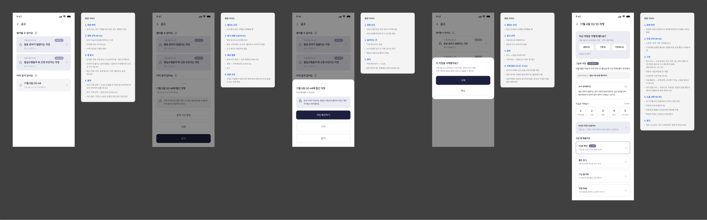

```text
9:41
금고
열어볼 수 있어요
2
11월 4일 02:10
새로 공개
발표 준비가 밀렸다는 걱정
봉인 전 불안도 4
11월 4일 01:35
새로 공개
말실수했을까 봐 신경 쓰인다는 걱정
봉인 전 불안도 3
아직 잠겨 있어요
1
11월 5일 00:48
11월 6일 오전 8:00에 열려요
화면 가이드
1. 화면 목적
공개 가능·잠긴 걱정을 모아 보는 금고. 홈에서 진입
2. 목록 규칙 (M-01)
공개 가능과 잠김을 영역으로 구분
영역별 작성 시각 최신순
삭제·만료된 기록은 제외
3. 행 표시
공개된 기록: 작성 일시 + AI 요약 한 줄 + 봉인 전 불안도
요약은 한 줄이고 길면 말줄임. 사용자가 수정했다면 수정
본 우선 (M-04)
잠긴 기록: 작성·공개 일시만. 요약·불안도는 숨김 
(AI-05)
4. 동작
공개 기록 선택 → S-08. 요약을 본 것만으로 상세 확인 완
료로 처리하지 않음 (M-02)
잠긴 기록 선택 → 잠금 안내 (LOCK-01)
하단 네비 ‘기록’(S-14)은 공개된 것만 모은 다른 화면
9:41
금고
열어볼 수 있어요
2
11월 4일 02:10
새로 공개
발표 준비가 밀렸다는 걱정
봉인 전 불안도 4
11월 4일 01:35
새로 공개
말실수했을까 봐 신경 쓰인다는 걱정
봉인 전 불안도 3
아직 잠겨 있어요
1
11월 5일 00:48
11월 6일 오전 8:00에 열려요
공개 시각까지는 원문·메모·AI 정리·불안도를 볼 수 없어요. 
조기 열기는 제공하지 않아요.
11월 5일 00:48에 맡긴 걱정
11월 6일 오전 8:00에 열려요
공개 시간 변경
삭제
닫기
화면 가이드
1. 열리는 조건
S-07에서 잠긴 기록을 선택했을 때
2. 표시 내용 (LOCK-01)
작성 일시와 공개 예정 일시
원문·선택 메모·AI 요약·불안도는 보여주지 않음
조기 열기는 제공하지 않음
3. 제공 행동
공개 시간 변경 → 시간 변경창 (TIME-03)
삭제 → 삭제 확인창 (LOCK-02)
닫기
4. 표현 규칙
삭제는 되돌릴 수 없으므로 회색 보조 버튼으로 두되 읽을 
수 있는 대비 확보
9:41
금고
열어볼 수 있어요
2
11월 4일 02:10
새로 공개
발표 준비가 밀렸다는 걱정
봉인 전 불안도 4
11월 4일 01:35
새로 공개
말실수했을까 봐 신경 쓰인다는 걱정
봉인 전 불안도 3
아직 잠겨 있어요
1
11월 5일 00:48
지금 열어볼 수 있어요
공개 시각이 지났어요. 원문은 자동으로 펼쳐지지 않고, 확인
하기를 누르면 열려요.
걱정 확인하기
11월 5일 00:48에 맡긴 걱정
11월 6일 오전 8:00에 열려요
삭제
닫기
화면 가이드
1. 전환 조건
시트가 열려 있는 동안 공개 시각에 도달
서버 상태를 확인한 뒤 이 안내로 전환
2. 달라지는 것
‘걱정 확인하기’ 제공
시간 변경은 숨기고 삭제·닫기는 유지
원문은 자동으로 펼치지 않음
3. 동작
‘걱정 확인하기’ → S-08
같은 갱신이 홈·목록에도 반영 (HOME-05)
9:41
금고
열어볼 수 있어요
2
11월 4일 02:10
새로 공개
발표 준비가 밀렸다는 걱정
봉인 전 불안도 4
11월 4일 01:35
새로 공개
이 걱정을 삭제할까요?
말실수했을까 봐 신경 쓰인다는 걱정. 상
대
 반응은 아직 모르는 일
일
봉인 전 불안도 3
11월 5일 00:48에 맡긴 걱정이에요. 원문과 분석·활동 
기록, 예약된 알림이 함께 지워지고 되돌릴 수 없어요.
아직 잠겨 있어요
1
11월 5일 00:48
삭제
11월 6일 오전 8:00에 열려요
취소
화면 가이드
1. 열리는 조건
잠금 안내에서 삭제를 선택했을 때
2. 표시 규칙
작성 일시로 대상을 표시
원문은 다시 보여주지 않음
3. 동작
취소 → 잠금 안내로 복귀
삭제 성공 → 창을 닫고 목록·홈 갱신
4. 삭제 범위 (H-02·D-01)
공개 후 파쇄와 같은 공통 삭제 처리를 적용
관련 데이터 삭제와 알림 예약 취소를 함께 수행
성공 전에는 완료로 표시하지 않음. 공개 전 삭제는 연출 
없이 목록 복귀
9:41
11월 4일 02:10 걱정
지난 걱정은 어떻게 됐나요?
11월 2일 02:40에 맡긴 걱정 · 선택 사항이에요
괜찮아짐
진행 중
걱정대로 됨
오늘은 건너뛰기
그날의 걱정
그날 불안도 4
내일 발표 자료가 아직 반도 안 끝났는데 시간 안에 될지 모르겠다
내일 확인할 것발표 자료 분량 확인하기
AI가 정리했어요
수정
발표 준비가 밀렸다는 점이 걱정의 중심이었어요. 남은 분량을 먼저 
확인해보면 무엇부터 할지 정하기 쉬워질 수 있어요.
지금은 어때요?
건너뛰기
1
2
3
4
5
거의 없음
조금
보통
많이
아주 많이
비슷한 걱정이 있었어요
11월 1일 · 그때는 10분 액션이 도움이 됐다고 답했어요
지금 뭘 해볼까요
10분 액션
AI 추천
지금 할 수 있는 작은 행동 3단계
짧은 휴식
3분 타이머와 간단한 휴식 안내
그냥 들어줘
이 걱정에 대한 짧은 공감 메시지
걱정 파쇄
삭제 범위를 확인하고 완전히 지우기
화면 가이드
1. 화면 목적
공개된 걱정의 원문과 AI 정리를 확인하고 도움을 고르는 
화면
2. 조회 규칙 (M-02)
소유권·공개·삭제·만료를 검사
이 화면에 실제로 들어온 시점에 최초 상세 확인 시각을 저
장
3. 구성
회고 카드 — 조건에 맞는 과거 걱정 1개. 선택 사항이고 
건너뛰면 같은 날 다시 제안하지 않음 
(REVIEW-01·02·03)
원문과 ‘내일 확인할 것’ 메모
AI 정리와 수정 진입 (M-04)
지금 불안도 — 선택 입력, 건너뛰기 가능, 수정은 덮어쓰
기 (M-03)
과거 경험 카드 — 최대 1개. ‘도움 됨’ 응답이 있을 때만 도
움이 된 경험으로 표현 (PAST-02)
4. 도움 선택 (M-05)
네 가지를 모두 제공하되 AI 추천 1개만 강조
추천과 다르게 골라도 됨
진행 중인 활동이 있으면 중단 확인을 거침
파쇄한 뒤에는 도움 방식 변경 불가
5. 참고
390×1224로 그린 스크롤 화면. 실제 뷰포트는 844

```


### P04 — S-13 완료.pdf

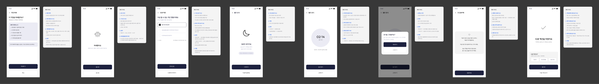

```text
9:41
걱정 파쇄
이 걱정을 파쇄할까요?
11월 4일 02:10에 맡긴 걱정이에요
함께 지워지는 것
걱정 원문과 ‘내일 확인할 것’ 메모
AI 정리와 도움 추천
이 걱정으로 한 활동 기록
회고 응답과 도움 여부 평가
이 걱정에 걸린 알림 예약
한 번 파쇄하면 되돌릴 수 없어요. 기록·추천에서도 모두 빠져요.
파쇄하기
취소
화면 가이드
1. 화면 목적
공개된 걱정을 완전히 지우기 전의 확인 화면
2. 안내 내용 (H-01)
함께 지워지는 범위를 항목으로 표시
되돌릴 수 없음을 명시
취소하면 아무것도 바뀌지 않음
3. 삭제 범위 (D-01)
원문·메모 / AI 정리·추천 / 활동 기록 / 회고·평가 / 알림 
예약
서버에서 검색·캐시까지 함께 삭제
4. 동작
‘파쇄하기’ → 삭제 실행. 성공 전에는 완료로 표시하지 않
음 (H-02)
파쇄한 뒤에는 도움 방식을 바꿀 수 없음 (M-05)
9:41
파쇄했어요
원문과 분석, 활동 기록까지 함께 지웠어요.
홈으로
금고로
화면 가이드
1. 표시 조건
서버 삭제가 성공한 뒤에만 표시
2. 구성 (H-03)
파쇄 연출 영역과 완료 문구
연출은 생략 가능하고 일반 버튼으로도 실행 가능 
(COM-02)
소리는 기본 꺼짐
3. 동작
‘홈으로’ → S-02, ‘금고로’ → S-07
4. 다른 활동과의 차이
S-13으로 가지 않고 도움 평가도 묻지 않음 — 완료 안내
는 파쇄에 적용하지 않음 (RESULT-01)
9:41
10분 액션
지금 할 수 있는 작은 행동이에요
순서는 자유롭게. 제한 시간은 없어요.
발표 자료 파일 열기
내일 발표할 분량이 어디까지인지 적어보기
첫 장에 쓸 문장 한 줄 적기
1 / 3 완료
세 단계를 모두 체크하면 완료 가능
전체 완료
나중에 이어하기
화면 가이드
1. 구성 (ACT-01)
생성된 작은 행동 3단계를 표시
시작 시각과 진행 상태를 저장
약 10분 내 시도할 수준이되 제한 시간은 없음
2. 체크 규칙 (ACT-02)
체크 순서는 자유
저장에 실패하면 미저장 상태를 알림
세 단계를 모두 체크하기 전에는 전체 완료 버튼 비활성 
(ACT-04)
3. 동작
‘전체 완료’ — 세 단계를 다 체크해도 버튼을 눌러야 완료. 
성공 후 S-13 (ACT-04)
‘나중에 이어하기’ — 체크 상태를 유지한 채 중단 
(ACT-03)
중단을 실패로 표현하지 않음
4. 연동
진행 중이면 홈에 ‘진행 중인 활동’으로 대표 표시 
(HOME-03)
9:41
짧은 휴식
3분만 쉬어가요
눈을 감거나 창밖을 보면서
숨을 천천히 쉬어보세요
직접 시작할 때까지 기다릴게요
시작하기
다음에 할게요
화면 가이드
1. 구성 (REST-01)
휴식 안내와 기본 3분 타이머
자동 시작 없음 — 사용자가 직접 시작
2. 저장
시작 시각과 종료 예정 시각을 저장
3. 동작
‘시작하기’ → 진행 중 상태
‘다음에 할게요’ → S-08로 복귀
4. 진입
진행 중인 다른 활동이 있으면 중단 확인을 먼저 거침 
(M-05)
9:41
짧은 휴식
02:14
남은 시간
천천히, 서두르지 않아도 돼요
일시정지
그만두기
화면 가이드
1. 타이머 (REST-02)
일시정지·재개 시 남은 시간을 저장하고 종료 예정 시각
을 갱신
정지 상태로 이탈하면 정지 그대로 유지
2. 복귀 (REST-03)
실행 중 이탈하면 시간은 계속 흐름
복귀 시 저장된 상태로 복원하고 음수 대신 0 표시
3. 완료 (REST-04)
시간이 끝났다고 자동 완료되지 않음
완료 시 S-13으로 이동
4. 동작
‘그만두기’ → 확인창. 조기 마무리는 확인 후 가능
9:41
짧은 휴식
휴식을 그만둘까요?
남은 2분 14초는 저장되지 않아요. 다시 시작하면 
처음 3분부터 시작해요.
02:14
남은 시간
계속하기
천천히, 서두르지 않아도 돼요
그만두기
일시정지
그만두기
화면 가이드
1. 열리는 조건
진행 중 화면에서 ‘그만두기’를 선택했을 때
2. 안내
남은 시간은 저장되지 않음
다시 시작하면 처음 3분부터 시작
3. 동작
‘계속하기’ → 타이머를 그대로 유지 (REST-02)
‘그만두기’ → 완료가 아니므로 S-13으로 가지 않음
4. 표현
완료 여부가 불명확하면 성공으로 안내하지 않음 
(COM-01)
9:41
그냥 들어줘
자료가 반도 안 끝난 채로 누우려니 
마음이 무거웠겠어요.

지금 당장 전부 끝내야 하는 건 아니에요. 

오늘 걱정을 적어둔 것만으로도 
할 수 있는 일을 하나 한 거예요.
읽었어요
화면 가이드
1. 콘텐츠 (EMP-01)
짧은 공감 메시지를 1회 제공
봉인 시 생성한 결과를 그대로 사용 — 이 화면에서 새로 
만들지 않음
실시간 입력창 없음
2. 완료 규칙 (EMP-02)
조회만으로는 완료 처리하지 않음
‘읽었어요’를 눌러야 완료 저장. 성공 후 S-13
3. 표현 (AI-02)
감정을 확정적으로 판단하거나 진단하는 표현은 쓰지 않
음
9:41
10분 액션을 마쳤어요
작게라도 움직인 게 기록으로 남아요
도움이 됐나요?
선택하지 않아도 완료는 그대로예요
도움 됨
잘 모르겠음
도움 안 됨
홈으로
다음 걱정 보기
화면 가이드
1. 적용 범위 (RESULT-01)
액션·휴식·공감 완료에만 적용
파쇄(S-09)에는 적용하지 않음
2. 평가 (RESULT-02)
도움 됨 / 잘 모르겠음 / 도움 안 됨
선택 입력이고 기본값 없음
삭제·만료된 기록에는 저장 불가
평가 저장 실패와 활동 완료를 구분해서 안내
3. 동작 (RESULT-03)
평가하지 않고 ‘홈으로’·‘다음 걱정 보기’로 나가도 완료
는 유지
4. 연동
여기서 받은 평가와 불안도는 기록(S-14)의 봉인 전후 비
교에 쓰임 (R-03)

```


### P05 — S-15.pdf

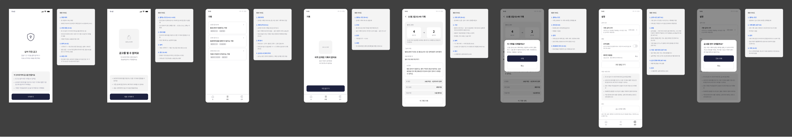

```text
9:41
심야 걱정 금고
잠들기 전 걱정을 짧게 맡겨두고
다음 날 정리된 내용을 확인해요
이 브라우저에 금고를 만들어요
로그인 없이 바로 시작할 수 있어요
브라우저 데이터를 지우거나 다른 기기에서 열면 기존 
금고에 접근하기 어려워요
기록은 작성일로부터 30일 뒤 자동으로 삭제돼요
시작하기
화면 가이드
1. 화면 목적
첫 이용자가 보는 화면
유효한 게스트가 있으면 이 화면 없이 S-02 홈으로 (A-01)
2. 안내 내용 (A-02)
로그인 없이 이 브라우저에 금고를 만든다는 점
브라우저 데이터 삭제·다른 기기 이용 시 접근이 어려울 
수 있음
기록은 작성일 +30일에 자동 삭제
3. 동작 (A-03)
‘시작하기’ → 게스트와 인증 정보 발급. 실패 시 재시도
생성 성공 → S-03 걱정 입력으로 바로 이동. 홈(S-02)을 
반드시 거치지는 않음
4. 표현 규칙
하드웨어 식별·브라우저 지문을 쓰지 않으므로 ‘이 기
기’가 아니라 ‘이 브라우저’로 표기
9:41
일러스트 영역
금고를 열 수 없어요
이 브라우저의 인증 정보가
만료되었거나 지워졌어요
브라우저 데이터를 지웠거나 다른 기기에서 열었을 수 
있어요
기존 금고에 접근하거나 복구하기 어려울 수 있어요
새로 시작하면 빈 금고가 새로 만들어져요
새로 시작하기
화면 가이드
1. 열리는 조건 (A-01·A-05)
인증 정보가 만료되었거나 지워져 금고에 접근할 수 없을 
때
신규 접속과 인증 오류를 구분 — 신규는 S-01, 오류는 이 
화면
2. 안내 내용
브라우저 데이터를 지웠거나 다른 기기에서 열었을 수 있
음
이전 기록 복구는 보장하지 않음
3. 동작
‘새로 시작하기’ → 별도 게스트를 새로 생성 (A-03)
4. 참고 (A-04)
인증은 기본 30일 유지되고 유효 접속 시 갱신
기록 보관 기간(작성일 +30일)과는 별개
9:41
기록
11월 2일 02:40
발표 준비가 밀렸다는 걱정
불안도 4 → 2
10분 액션
11월 1일 01:12
팀원에게 말을 잘못한 것 같다는 걱정
불안도 3 → 3
그냥 들어줘
10월 30일 23:58
지원서 마감이 다가온다는 걱정
불안도 5 → 미기록
짧은 휴식
홈
기록
설정
화면 가이드
1. 화면 목적
공개된 기록만 모아 보는 탭. 하단 네비 ‘기록’에서 진입
2. 목록 규칙 (R-01)
공개된 미삭제 기록을 최신순으로 표시
잠긴 기록은 표시하지 않음 — 잠긴 원문의 우회 노출 금지
작성 30일이 지난 기록은 자동 삭제되어 목록에서 빠짐 
(D-02)
3. 행 표시
작성 일시 + 요약 + 불안도 전후 + 고른 도움 방식
전후 값이 둘 다 있을 때만 ‘4 → 2’. 한쪽이 없으면 미기록 
(R-03)
4. 금고(S-07)와의 차이
금고는 잠긴 것까지 포함하고, 기록은 공개된 것만 모음
9:41
기록
일러스트 영역
아직 공개된 기록이 없어요
맡긴 걱정이 공개되면
여기에 하나씩 쌓여요
걱정 맡기기
홈
기록
설정
화면 가이드
1. 열리는 조건 (R-01)
공개된 기록이 하나도 없을 때
2. 안내
왜 비어 있는지와 무엇을 하면 채워지는지
잠긴 기록이 있어도 여기엔 나오지 않음 — 잠긴 건 S-07
3. 동작
‘걱정 맡기기’ → S-03
4. 표현
빈 상태 표현은 공통 상태 패턴을 따름 (COM-01)
9:41
11월 2일 02:40 기록
불안도 변화
4
2
봉인 전
공개 후
두 값이 모두 있을 때만 비교해요. 좋아지거나 나빠졌다는 판정은 하
지 않아요.
그날의 걱정
발표 준비가 반도 안 끝났는데 시간 안에 될지 모르겠다
내일 확인할 것
발표 자료 분량 확인하기
AI 정리
발표 준비가 밀렸다는 점이 걱정의 중심이었어요. 남은 
분량을 먼저 확인해보면 무엇부터 할지 정하기 쉬워질 
수 있어요.
한 활동
회고 응답
도움 여부
10분 액션 · 3단계 모두 완료
괜찮아짐
도움 됐어요
이 기록 삭제
화면 가이드
1. 조회 규칙 (R-02)
열 때마다 인증·공개·삭제·만료를 재검사
2. 구성
불안도 전후 비교 — 둘 다 있을 때만. 치료 효과나 실패 판
정으로 표현하지 않음 (R-03)
원문과 ‘내일 확인할 것’ 메모, AI 정리
한 활동 / 회고 응답 / 도움 여부
3. 동작
‘이 기록 삭제’ → 삭제 확인창 (R-04)
S-08의 과거 경험 카드가 이 화면으로 연결됨 (PAST-02)
4. 참고
스크롤 화면. 실제 뷰포트는 844
9:41
11월 2일 02:40 기록
불안도 변화
4
봉인 전
2
공개 후
두 값이 모두 있을 때만 비교해요. 좋아지거나 나빠졌다는 판정은 하
지 않아요.
이 기록을 삭제할까요?
그날의 걱정
발표 준비가 반도 안 끝났는데 시간 안에 될지 모르겠다
11월 2일 02:40 기록이에요. 원문과 AI 정리, 활동·
회고·도움 평가가 함께 지워지고 목록·추천에서도 
빠져요. 되돌릴 수 없어요.
내일 확인할 것
발표 자료 분량 확인하기
삭제
취소
AI 정리
발표 준비가 밀렸다는 점이 걱정의 중심이었어요. 남은 
분량을 먼저 확인해보면 무엇부터 할지 정하기 쉬워질 
수 있어요.
한 활동
회고 응답
도움 여부
10분 액션 · 3단계 모두 완료
괜찮아짐
도움 됐어요
이 기록 삭제
화면 가이드
1. 열리는 조건
기록 상세에서 ‘이 기록 삭제’를 선택했을 때
2. 안내 (R-04)
파쇄와 같은 삭제 범위임을 명시
되돌릴 수 없음
3. 동작
삭제 성공 후 목록 갱신. 목록·조회·추천에서 제외
성공 전에는 완료로 표시하지 않음 (H-02)
4. 파쇄와의 차이 (H-03)
파쇄 연출은 적용하지 않고 목록으로 복귀
9:41
설정
공개 시간
기본 공개 시각
이후 만드는 걱정에만 적용돼요. 이미 맡긴 걱정
은 금고에서 개별 변경
오전 8:00
알림
공개 알림
공개 시각에 한 번 알려드려요. 끄면 아직 보내지 않은 예
약이 취소돼요
예약된 재알림
오늘 23:40 · 활성 예약은 한 번에 하나
모든 알림 끄기
취소
이용·보관 안내
로그인 없이 이 브라우저에서만 금고에 접근해요
브라우저 데이터를 지우거나 다른 기기에서 열면 기존 금고
에 접근하거나 복구하기 어려울 수 있어요
모든 기록은 작성일로부터 30일이 지나면 자동으로 삭제돼
요
파쇄하면 원문뿐 아니라 분석·활동 기록까지 함께 지워져요
걱정 정리에 외부 AI를 사용해요. 실제 처리 범위는 운영 조
건에 맞춰 안내
금고
금고 전체 삭제
모든 기록·설정·예약과 이 브라우저의 게스트 정보를 지워요. 삭제 후 S-01
로 돌아가요.
홈
기록
설정
화면 가이드
1. 공개 시간 (SET-01)
기본 공개 시각 변경. 이후 만드는 기록에만 적용
이미 맡긴 걱정은 S-07 잠금 안내에서 개별 변경
2. 알림
공개 알림 — 끄면 아직 보내지 않은 예약 취소. 다시 켜면 
미공개 기록부터 적용되고 과거 알림을 소급 발송하지 않
음 (SET-02)
예약된 재알림 확인·취소. 활성 예약은 한 번에 하나 
(AL-06)
‘모든 알림 끄기’는 두 종류의 처리 결과를 모두 확인 
(SET-03)
3. 이용·보관 안내 (SET-04)
접근 제한, 보관 기간, 삭제 범위를 표시
실제 백업·외부 AI 처리 조건에 맞춰 문구를 맞춰야 함
4. 금고 전체 삭제 (SET-05)
최종 확인창을 거쳐 실행
5. 참고
스크롤 화면. 실제 뷰포트는 844
9:41
설정
공개 시간
기본 공개 시각
이후 만드는 걱정에만 적용돼요. 이미 맡긴 걱정
은 금고에서 개별 변경
알림
오전 8:00
공개 알림
금고를 전부 삭제할까요?
공개 시각에 한 번 알려드려요. 끄면 아직 보내지 않은 예
약이 취소돼요
모든 걱정 기록과 설정, 예약된 알림, 이 브라우저의 
게스트 정보를 지워요. 복구할 수 없고 삭제가 끝나
면 처음 화면으로 돌아가요.
예약된 재알림
오늘 23:40 · 활성 예약은 한 번에 하나
전부 삭제
취소
모든 알림 끄기
취소
이용·보관 안내
로그인 없이 이 브라우저에서만 금고에 접근해요
브라우저 데이터를 지우거나 다른 기기에서 열면 기존 금고
에 접근하거나 복구하기 어려울 수 있어요
모든 기록은 작성일로부터 30일이 지나면 자동으로 삭제돼
요
파쇄하면 원문뿐 아니라 분석·활동 기록까지 함께 지워져요
걱정 정리에 외부 AI를 사용해요. 실제 처리 범위는 운영 조
건에 맞춰 안내
금고
금고 전체 삭제
모든 기록·설정·예약과 이 브라우저의 게스트 정보를 지워요. 삭제 후 S-01
로 돌아가요.
홈
기록
설정
화면 가이드
1. 열리는 조건
설정에서 ‘금고 전체 삭제’를 선택했을 때
2. 삭제 범위 (SET-05)
모든 기록·설정·예약과 이 브라우저의 게스트 정보
복구할 수 없음
3. 동작
서버 삭제 성공 후 브라우저 인증을 제거하고 S-01로 이동
완료 여부가 불명확하면 성공으로 안내하지 않음 
(COM-01)
4. 이후 (A-03)
다시 시작하면 별도 게스트가 새로 생성되고 이전 금고는 
복구되지 않음

```


### P06 — S-18 시연.pdf

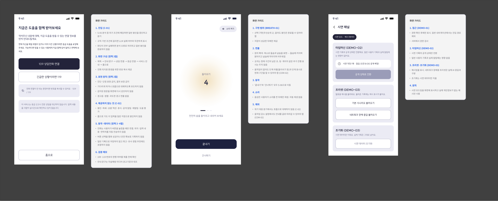

```text
9:41
지금은 도움을 함께 받아보세요
적어주신 내용에 대해, 지금 도움을 받을 수 있는 연결 정보를 
먼저 안내드릴게요.
현재 자신을 해칠 위험이 있거나 이미 다친 상황이라면 응급 도움을 요청해 
주세요. 가능하다면 믿을 수 있는 사람에게 지금 함께 있어 달라고 연락해 보
세요.
109 상담전화 연결
긴급한 상황이라면 119
전화 연결이 안 되는 환경이면 번호를 복사할 수 있어요 · 109 
/ 119
이 서비스는 응급 신고나 전문 상담을 대신하지 않습니다. 입력 내용
을 사람이 실시간으로 확인하고 있지 않습니다.
홈으로
화면 가이드
1. 진입 (C-01)
S-05 분석 중 위기 조건에 해당하면 일반 봉인을 중단하고 
분기
규칙 기반 조건에 걸리면 LLM 실패 여부와 무관하게 표시
판단이 전부 실패하면 분석 오류로 처리하고 일반 봉인을 
완료하지 않음
2. 화면 구성 (정책 3절)
제목 → 안내 문구 → 상담 연결 → 응급 연결 → 서비스 안
내 → 홈으로
전화 미지원 환경을 위한 번호 복사 제공
3. 표현 원칙 (정책 2절)
진단·단정 표현 금지, 결과 보장 금지
기다리게 하거나 호흡으로 대체하도록 유도하지 않음
감지된 원문을 화면에 다시 강조하지 않음
경고음·점멸·과도한 경고 연출 없음
4. 제공하지 않는 것 (C-02)
봉인·파쇄·10분 액션·휴식·공개 알림·재알림·도움 평
가
홈으로 가도 이 입력을 일반 걱정으로 봉인하지 않음
5. 동작·데이터 (정책 3·4절)
전화는 사용자가 버튼을 눌렀을 때만 연결. 위치·입력 내
용·연락처를 자동 전송하지 않음
버튼 선택을 통화 성공이나 안전 확보로 기록하지 않음
일반 기록으로 저장하지 않고 회고·유사 경험 추천에도 
포함하지 않음
6. 검증 메모
109·119 번호의 현행 여부를 제출 전에 확인
안내 문구는 자살예방 미디어 권고기준과 대조
9:41
소리 켜기
들이쉬기
4
천천히 숨을 들이쉬고 내쉬어 보세요
끝내기
건너뛰기
화면 가이드
1. 구현 범위 (BREATH-01)
선택 구현(우선순위 2). 없어도 봉인은 완료될 수 있어야 
함
저장이 성공한 뒤에만 제공
2. 연출
원의 확대·축소로 들숨과 날숨을 표현 — 들숨에 커지며 
밝아지고 날숨에 작아지며 어두워짐
숫자는 현재 구간의 남은 초. 링·게이지 같은 추가 진행 표
시는 두지 않음
움직임이 없어도 단계 라벨(들이쉬기 등)과 단계 표시로 
현재 구간을 알 수 있어야 함 (COM-02)
3. 동작
‘끝내기’와 ‘건너뛰기’ 모두 S-06으로 이동
4. 소리
음성은 사용자가 소리를 켠 뒤에만 재생. 자동 재생 없음
5. 제외
위기 대응 분기에서는 호흡으로 대체하지 않음 (C-02)
움직임 감소 설정에서도 안내를 글로 따라갈 수 있어야 함 
(COM-02)
9:41
시연 패널
시연 모드 · 예시 데이터
타임머신 (DEMO-02)
시연 기록의 공개 상태만 전환해요. 일반 사용자 기록과 실제 알림에
는 영향이 없어요.
시연 걱정 1개 · 잠김 (오전 8:00 공개 예정)
공개 상태로 전환
프리셋 (DEMO-03)
발표용 예시를 불러와요. 불러온 기록에는 예시 표시가 붙어요.
기본 시나리오 불러오기
네트워크 장애 응답 불러오기
초기화 (DEMO-03)
시연 데이터만 지워요. 실제 기록은 그대로 남아요.
시연 데이터 초기화
화면 가이드
1. 접근 (DEMO-01)
권한 확인 후에만 표시. 일반 내비게이션에서는 진입 경로 
제외
서버에서 권한 검사
2. 타임머신 (DEMO-02)
시연 기록의 공개 상태만 전환
일반 사용자 기록과 실제 알림에는 영향 없음
3. 프리셋·초기화 (DEMO-03)
예시임을 표시. 네트워크 장애용 프리셋은 실제 AI 응답과 
구분
초기화는 시연 데이터만 지움
4. 원칙
시연 모드임을 화면에 표시하고 실제 개인정보가 없는 예
시만 사용

```


### P07 — 중단 확인.pdf

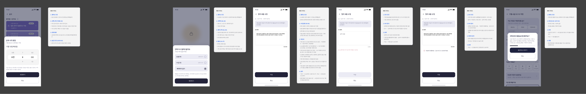

```text
9:41
금고
열어볼 수 있어요
2
11월 4일 02:10
새로 공개
발표 준비가 밀렸다는 걱정
그날 불안도 4
11월 4일 02:10
새로 공개
AI 요약 한 줄
그날 불안도 4
공개 시각 변경
아직 잠겨 있어요
11월 5일 00:48에 맡긴 걱정
1
11월 10일 화요일
11월 5일 00:48
11월 6일 오전 8:00에 열려요
오후
7
50
오전
8
00
9
10
지금 이후이고 삭제 예정 시각(작성일 +30일) 이전만 고를 수 있어요. 이미 
공개된 걱정은 다시 잠글 수 없어요.
변경하기
취소
화면 가이드
1. 열리는 조건
잠금 안내에서 ‘공개 시간 변경’을 선택했을 때
2. 선택 규칙 (TIME-03)
아직 공개 전인지 서버가 먼저 검사
미래이면서 삭제 예정 시각(작성일 +30일) 이전만 허용
이미 공개된 기록은 다시 잠글 수 없음
3. 반영 범위
성공하면 목록·홈·잠금 안내·공개 알림 예약을 함께 갱
신
4. 숨김 조건 (LOCK-03)
공개 시각이 지나면 이 진입 자체가 사라짐
9:41
맡겨두었어요.
언제 다시 알려드릴까요
이제 폰을 내려놓아도 돼요.
기본은 예약 없음이에요
11월 5일 오전 8:00에 열려요
30분 뒤
1시간 뒤
예약하지 않기
홈으로
오전 10:11
오전 10:41
재알림은 한 번에 하나만 예약돼요. 이미 예약이 있으면 새 시각으로 바뀌어
요. 공개 알림 동의와는 별개예요.
새 걱정 맡기기
조금 뒤에 다시 알려주세요
예약하기
화면 가이드
1. 열리는 조건
S-06에서 ‘조금 뒤에 다시 알려주세요’를 선택했을 때
2. 선택지 (AL-04)
30분 뒤 / 1시간 뒤 / 예약하지 않기
기본은 예약 없음
3. 예약 규칙 (AL-05)
사용자당 활성 예약 1개. 기존 예약이 있으면 교체 안내
서버 예약 성공 시각을 기준으로 계산
공개 알림 동의와는 별개
4. 발송 (AL-07)
예약당 1회만 발송
공개 알림과 시각이 겹치면 공개 알림 하나만 발송
구독 성공 전에는 ‘예약 완료’로 표시하지 않음 (AL-02)
9:41
정리 내용 수정
그날의 걱정 · 수정되지 않아요
내일 발표 자료가 아직 준비가 안 끝났는데 시간 안에 될지 

모르겠다
AI 정리
발표 준비가 밀렸다는 점이 걱정의 중심이었어요. 남은 분량을 
먼저 확인해보면 무엇부터 할지 정하기 쉬워질 수 있어요.
50/500
저장
취소
화면 가이드
1. 열리는 조건
S-08에서 정리 내용의 ‘수정’을 선택했을 때
열리면 입력란에 현재 정리 내용이 채워진 상태로 시작
2. 수정 범위 (M-04)
정리 내용만 수정하고 원문은 읽기 전용
원문 블록에 자물쇠 아이콘으로 읽기 전용임을 함께 표시
공백 제외 1자 이상, 최대 500자
미달 상태로 ‘저장’을 누르면 입력란 테두리 강조 + 아래 
인라인 에러 1줄. 기본 상태에서는 표시하지 않음
3. 저장 후
저장 성공 시 S-08로 복귀한 뒤 토스트 1줄 — ‘저장했어
요 · 도움 추천은 그대로예요’
S-08 블록 제목이 ‘AI가 정리했어요’ → ‘내가 정리했어
요’로 바뀜. 수정 여부를 기록에 저장
이후 표시에 수정본이 우선 적용 — S-07 목록의 요약 한 
줄, 회고·유사 경험 매칭 근거 포함
AI 원본은 서버에만 보관하고 화면에 노출하지 않음. 되돌
리기는 제공하지 않음
어떤 자동 재생성도 수정본을 덮지 않음
도움 콘텐츠(액션·휴식·공감)는 자동으로 다시 만들지 않
음
저장 실패 시 입력 내용을 초안으로 유지하고 화면을 벗어
나지 않음. 실패를 저장 완료로 표시하지 않음
4. 동작
‘저장’ → S-08 복귀 + 결과 토스트 / ‘취소’ → 변경 없이 
S-08 복귀
화면 제목은 ‘정리 내용 수정’ — AI 첨삭이 아니라 내 기록
의 라벨 교정이므로
9:41
정리 내용 수정
그날의 걱정 · 수정되지 않아요
내일 발표 자료가 아직 준비가 안 끝났는데 시간 안에 될지 

모르겠다
AI 정리
입력 내용
0/500
공백 제외 1자 이상 써야 저장할 수 있어요
저장
취소
화면 가이드
1. 표시 조건
‘저장’을 눌렀을 때 공백 제외 글자 수가 1자 미만인 경우
기본 상태에서는 표시하지 않음
2. 표시 방식
입력란 테두리를 강조하고 카운터 아래 인라인 에러 1줄
문구 — ‘공백 제외 1자 이상 써야 저장할 수 있어요’
3. 동작
입력이 1자 이상이 되면 에러 해제
‘저장’을 비활성화하지 않음 — 눌러서 사유를 확인할 수 
있어야 함
‘취소’ → 변경 없이 S-08 복귀
9:41
정리 내용 수정
그날의 걱정 · 수정되지 않아요
내일 발표 자료가 아직 준비가 안 끝났는데 시간 안에 될지 

모르겠다
AI 정리
발표 준비가 밀렸다는 점이 걱정의 중심이었어요. 남은 분량을 
먼저 확인해보면 무엇부터 할지 정하기 쉬워질 수 있어요.
50/500
저장하지 못했어요 · 잠시 뒤 다시 시도해 주세요
저장
취소
화면 가이드
1. 표시 조건
서버 저장 요청이 실패했을 때 (네트워크·서버 오류)
글자 수 미달과는 다른 상태 — 입력 자체는 유효함
2. 표시 방식
입력란 아래 배너 1줄 — ‘저장하지 못했어요 · 잠시 뒤 다
시 시도해 주세요’
실패를 저장 완료로 표시하지 않음. 성공 토스트를 띄우지 
않음
3. 데이터 유지
입력 내용을 초안으로 유지하고 화면을 벗어나지 않음
재시도는 ‘저장’을 다시 눌러 수행
4. 동작
‘취소’ → 초안을 버리고 변경 없이 S-08 복귀
9:41
11월 4일 02:10 걱정
지난 걱정은 어떻게 됐나요?
11월 2일 02:40에 맡긴 걱정 · 선택 사항이에요
괜찮아짐
진행 중
걱정대로 됨
오늘은 건너뛰기
그날의 걱정진행 중인 활동을 중단할까요?
그날 불안도 4
내일 발표 자료가 아직 반도 안 끝났는데 시간 안에 될지 모르겠다
내일 확인할 것
10분 액션이 1/3 단계까지 진행돼 있어요. 다른 도
움을 고르면 지금 활동은 중단돼요. 체크한 단계는 
그대로 남고, 중단을 실패로 기록하지 않아요.
발표 자료 분량 확인하기
AI가 정리했어요중단하고 바꾸기
수정
발표 준비가 밀렸다는 점이 걱정의 중심이었어요. 남은 분
량을 먼저 확인해보면 무엇부터 할지 정하기 쉬워질 수 있
어요.
취소
지금은 어때요?
건너뛰기
1
2
3
4
5
거의 없음
조금
보통
많이
아주 많이
비슷한 걱정이 있었어요
11월 1일 · 그때는 10분 액션이 도움이 됐다고 답했어요
지금 뭘 해볼까요
10분 액션
AI 추천
지금 할 수 있는 작은 행동 3단계
화면 가이드
1. 열리는 조건
진행 중인 활동이 있는 상태에서 다른 도움을 선택했을 때
2. 안내 (M-05·ACT-03)
체크한 단계는 그대로 남음
중단을 실패로 기록하지 않음
3. 동작
‘중단하고 바꾸기’ → 새 도움으로 전환. 과거 활동 이력은 
유지
‘취소’ → 기존 활동 유지
4. 연동
중단하면 홈의 ‘진행 중인 활동’ 카드도 함께 갱신 
(HOME-03)

```


### P08 — 공통 상태 패턴.pdf

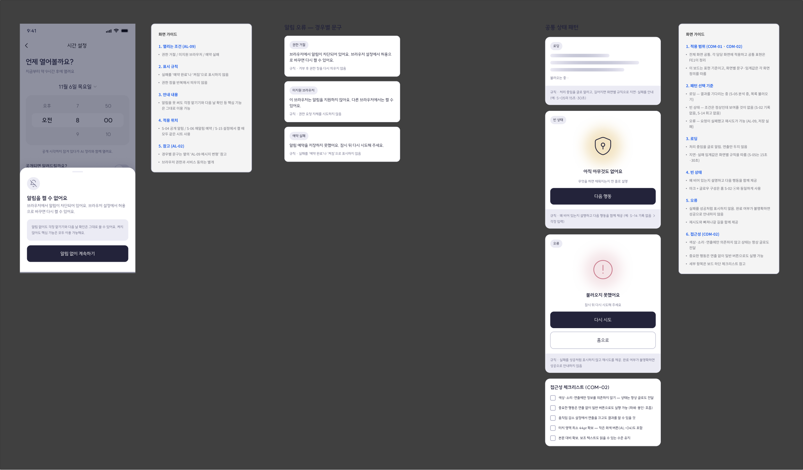

```text
9:41
시간 설정
언제 열어볼까요?
지금부터 약 9시간 후에 열려요
11월 6일 목요일
오후
7
50
오전
8
00
9
10
공개 시각까지 잠겨 있다가 AI 정리와 함께 열려요.
공개되면 알려드릴까요?
기본은 꺼짐. 켜면 공개 시각에 한 번만 알려드려요
알림을 켤 수 없어요
브라우저에서 알림이 차단되어 있어요. 브라우저 설정에서 허용
으로 바꾸면 다시 켤 수 있어요.
알림 없이도 걱정 맡기기와 다음 날 확인은 그대로 쓸 수 있어요. 켜지 
않아도 핵심 기능은 모두 이용 가능해요.
알림 없이 계속하기
금고에 맡기기
화면 가이드
1. 열리는 조건 (AL-09)
권한 거절 / 미지원 브라우저 / 예약 실패
2. 표시 규칙
실패를 ‘예약 완료’나 ‘켜짐’으로 표시하지 않음
권한 창을 반복해서 띄우지 않음
3. 안내 내용
알림을 못 써도 걱정 맡기기와 다음 날 확인 등 핵심 기능
은 그대로 이용 가능
4. 적용 위치
S-04 공개 알림 / S-06 재알림 예약 / S-15 설정에서 켤 때 
모두 같은 시트 사용
5. 참고 (AL-02)
경우별 문구는 옆의 ‘AL-09 메시지 변형’ 참고
브라우저 권한과 서비스 동의는 별개
알림 오류 — 경우별 문구
권한 거절
브라우저에서 알림이 차단되어 있어요. 브라우저 설정에서 허용으
로 바꾸면 다시 켤 수 있어요.
규칙 · 거부 후 권한 창을 다시 띄우지 않음
미지원 브라우저
이 브라우저는 알림을 지원하지 않아요. 다른 브라우저에서는 켤 수 
있어요.
규칙 · 권한 요청 자체를 시도하지 않음
예약 실패
알림 예약을 저장하지 못했어요. 잠시 뒤 다시 시도해 주세요.
규칙 · 실패를 ‘예약 완료’나 ‘켜짐’으로 표시하지 않음
공통 상태 패턴
로딩
불러오는 중…
규칙 · 처리 중임을 글로 알리고, 길어지면 화면별 규칙으로 지연·실패를 안내 
(예: S-05의 15초·30초)
빈 상태
아직 아무것도 없어요
무엇을 하면 채워지는지 한 줄로 설명
다음 행동
규칙 · 왜 비어 있는지 설명하고 다음 행동을 함께 제공 (예: S-14 기록 없음 → 
걱정 입력)
오류
불러오지 못했어요
잠시 뒤 다시 시도해 주세요
다시 시도
홈으로
규칙 · 실패를 성공처럼 표시하지 않고 재시도를 제공. 완료 여부가 불명확하면 
성공으로 안내하지 않음
접근성 체크리스트 (COM-02)
색상·소리·연출에만 정보를 의존하지 않기 — 상태는 항상 글로도 전달
중요한 행동은 연출 없이 일반 버튼으로도 실행 가능 (파쇄·봉인·호흡)
움직임 감소 설정에서 연출을 끄고도 결과를 알 수 있을 것
터치 영역 최소 44pt 확보 — 작은 회색 버튼(AL-04)도 포함
본문 대비 확보. 보조 텍스트도 읽을 수 있는 수준 유지
화면 가이드
1. 적용 범위 (COM-01 · COM-02)
전체 화면 공통. 각 담당 화면에 적용하고 공통 표현은 
FE1이 정리
이 보드는 표현 기준이고, 화면별 문구·임계값은 각 화면
정의를 따름
2. 패턴 선택 기준
로딩 — 결과를 기다리는 중 (S-05 분석 중, 목록 불러오
기)
빈 상태 — 조건은 정상인데 보여줄 것이 없음 (S-02 기록 
없음, S-14 회고 없음)
오류 — 요청이 실패했고 재시도가 가능 (AL-09, 저장 실
패)
3. 로딩
처리 중임을 글로 알림. 연출만 두지 않음
지연·실패 임계값은 화면별 규칙을 따름 (S-05는 15초
·30초)
4. 빈 상태
왜 비어 있는지 설명하고 다음 행동을 함께 제공
마크 + 글로우 구성은 홈 S-02 ⓐ와 동일하게 사용
5. 오류
실패를 성공처럼 표시하지 않음. 완료 여부가 불명확하면 
성공으로 안내하지 않음
재시도와 빠져나갈 길을 함께 제공
6. 접근성 (COM-02)
색상·소리·연출에만 의존하지 않고 상태는 항상 글로도 
전달
중요한 행동은 연출 없이 일반 버튼으로도 실행 가능
세부 항목은 보드 하단 체크리스트 참고

```


### P09 — 재알림 (푸시).pdf

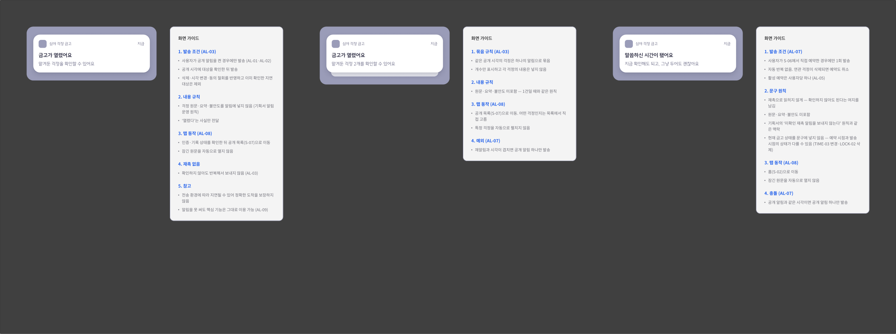

```text
심야 걱정 금고
지금
금고가 열렸어요
맡겨둔 걱정을 확인할 수 있어요
화면 가이드
1. 발송 조건 (AL-03)
사용자가 공개 알림을 켠 경우에만 발송 (AL-01·AL-02)
공개 시각에 대상을 확인한 뒤 발송
삭제·시각 변경·동의 철회를 반영하고 이미 확인한 지연 
대상은 제외
2. 내용 규칙
걱정 원문·요약·불안도를 알림에 넣지 않음 (기획서 알림 
운영 원칙)
‘열렸다’는 사실만 전달
3. 탭 동작 (AL-08)
인증·기록 상태를 확인한 뒤 공개 목록(S-07)으로 이동
잠긴 원문을 자동으로 열지 않음
4. 재촉 없음
확인하지 않아도 반복해서 보내지 않음 (AL-03)
5. 참고
전송 환경에 따라 지연될 수 있어 정확한 도착을 보장하지 
않음
알림을 못 써도 핵심 기능은 그대로 이용 가능 (AL-09)
심야 걱정 금고
지금
금고가 열렸어요
맡겨둔 걱정 2개를 확인할 수 있어요
화면 가이드
1. 묶음 규칙 (AL-03)
같은 공개 시각의 걱정은 하나의 알림으로 묶음
개수만 표시하고 각 걱정의 내용은 넣지 않음
2. 내용 규칙
원문·요약·불안도 미포함 — 1건일 때와 같은 원칙
3. 탭 동작 (AL-08)
공개 목록(S-07)으로 이동. 어떤 걱정인지는 목록에서 직
접 고름
특정 걱정을 자동으로 펼치지 않음
4. 예외 (AL-07)
재알림과 시각이 겹치면 공개 알림 하나만 발송
심야 걱정 금고
지금
말씀하신 시간이 됐어요
지금 확인해도 되고, 그냥 두어도 괜찮아요
화면 가이드
1. 발송 조건 (AL-07)
사용자가 S-06에서 직접 예약한 경우에만 1회 발송
자동 반복 없음. 연관 걱정이 삭제되면 예약도 취소
활성 예약은 사용자당 하나 (AL-05)
2. 문구 원칙
재촉으로 읽히지 않게 — 확인하지 않아도 된다는 여지를 
남김
원문·요약·불안도 미포함
기획서의 ‘미확인 재촉 알림을 보내지 않는다’ 원칙과 같
은 맥락
현재 금고 상태를 문구에 넣지 않음 — 예약 시점과 발송 
시점의 상태가 다를 수 있음 (TIME-03 변경·LOCK-02 삭
제)
3. 탭 동작 (AL-08)
홈(S-02)으로 이동
잠긴 원문을 자동으로 열지 않음
4. 충돌 (AL-07)
공개 알림과 같은 시각이면 공개 알림 하나만 발송

```


### P10 — 디자인 시스템.pdf


```text
Text Styles
Name
Font
Weight
Font size
Line height
letter spacing
Headline L
Suite
Font Family
Bold
Font Weight B
36
5xl
125%
0
Letter Spacing
Headline M
Suite
Font Family
Bold
Font Weight B
32
4xl
125%
0
Letter Spacing
Headline S
Suite
Font Family
Bold
Font Weight B
28
3xl
125%
0
Letter Spacing
Title 1
Suite
Font Family
Bold
Font Weight B
24
2xl
125%
0
Letter Spacing
Title 2
Suite
Font Family
Bold
Font Weight B
20
xl
125%
0
Letter Spacing
Title 3
Suite
Font Family
Bold
Font Weight B
18
lg
125%
0
Letter Spacing
Label L
Suite
Font Family
Bold
Font Weight B
16
md
24
Line Height L
0
Letter Spacing
Label M
Suite
Font Family
Bold
Font Weight B
14
sm
20
Line Height M
0
Letter Spacing
Label S
Suite
Font Family
Bold
Font Weight B
12
xs
20
Line Height M
0
Letter Spacing
Body 1
Suite
Font Family
Regular
Font Weight R
16
md
180%
0
Letter Spacing
Body2
Suite
Font Family
Regular
Font Weight R
14
sm
180%
0
Letter Spacing
Caption L
Suite
Font Family
Regular
Font Weight R
16
md
24
Line Height L
0
Letter Spacing
Caption M
Suite
Font Family
Regular
Font Weight R
14
sm
20
Line Height M
0
Letter Spacing
Caption S
Suite
Font Family
Regular
Font Weight R
12
xs
20
Line Height M
0
Letter Spacing

```


## 부록 D. 나이트 이미지15개 개별 확인 기록

모든 PNG를 열어 확인했다. N08~13의 가이드 문장은 대응 PDF의 TIME-03·AL-04·M-04·M-05 가이드와 내용이 일치하며, 전문은 부록 C에 보존했다. N01의 안전/호흡/시연 가이드는 P06, N14의 전역 가이드는 P08과 대조했다. 나이트 적용 기준 N15는 본문3.3에 전사했다. 픽셀 RGB 빈도는 평면색 식별 보조이며 토큰 원본이 아니다.


### N01 — S-18 시연.png

크기 2790×1128. 원본: `design_sources\night\나이트 UI\6. 안전·보조 — S-16 위기 대응\S-17 호흡\S-18 시연.png`

안전·호흡·시연3화면과 가이드3개. 앱 화면만 나이트, 가이드는 라이트 유지. 시연 버튼 Gold 강조/어두운 보조 버튼. 화면 x80/960/1840, y80, 폭390.


| 대표 RGB 픽셀 | 픽셀 수 |
| --- | --- |
| #404040 | 1505860 |
| #F4F4F5 | 602672 |
| #14172B | 551997 |
| #24243A | 160804 |
| #1E2240 | 94678 |
| #E8C98A | 54534 |
| #3A3A3A | 7827 |
| #ECEBF5 | 6688 |


### N02 — S-06 · 재알림 시간 선택 (AL-04).png

크기 390×844. 원본: `design_sources\night\나이트 UI\7. 보조 창 — 시각 선택\재알림\요약 수정\S-06 · 재알림 시간 선택 (AL-04).png`

하단 시트 y404~844, x0~390. 내부 x20~370. 선택지3개. 예약하지 않기 선택 라디오. Gold 예약 버튼.


| 대표 RGB 픽셀 | 픽셀 수 |
| --- | --- |
| #14172B | 93441 |
| #1E2240 | 89338 |
| #24243A | 55829 |
| #E8C98A | 18302 |
| #534C47 | 3814 |
| #544C48 | 3760 |
| #15182B | 2610 |
| #15182C | 2398 |


### N03 — S-07 · 공개 시각 변경창 (TIME-03).png

크기 390×844. 원본: `design_sources\night\나이트 UI\7. 보조 창 — 시각 선택\재알림\요약 수정\S-07 · 공개 시각 변경창 (TIME-03).png`

하단 시트 y310~844. 날짜·휠·제약설명·Gold 변경하기·어두운 취소. 뒤쪽 금고 원문 비노출.


| 대표 RGB 픽셀 | 픽셀 수 |
| --- | --- |
| #1E2240 | 124366 |
| #14172B | 107887 |
| #323058 | 30615 |
| #E8C98A | 18290 |
| #24243A | 14481 |
| #3B3B5D | 9173 |
| #39395B | 2753 |
| #3A3A5C | 2243 |


### N04 — S-08 · 정리 내용 수정 (M-04).png

크기 390×844. 원본: `design_sources\night\나이트 UI\7. 보조 창 — 시각 선택\재알림\요약 수정\S-08 · 정리 내용 수정 (M-04).png`

기본 수정. 원문 면x20 y140 350×72, 입력x20 y256 342×148. 저장x20 y692 350×54, 취소y754 350×56. 카운터와 홈 인디케이터.


| 대표 RGB 픽셀 | 픽셀 수 |
| --- | --- |
| #14172B | 211880 |
| #1E2240 | 64751 |
| #24243A | 24698 |
| #E8C98A | 18454 |
| #555768 | 708 |
| #ECEBF5 | 700 |
| #51546D | 369 |
| #6B6D84 | 288 |


### N05 — S-08 · 정리 내용 수정 — 저장 불가 (M-04).png

크기 390×844. 원본: `design_sources\night\나이트 UI\7. 보조 창 — 시각 선택\재알림\요약 수정\S-08 · 정리 내용 수정 — 저장 불가 (M-04).png`

공백 미달 인라인 오류·입력 테두리·비활성처럼 보이는 저장. 가이드의 활성 유지 규칙과 충돌 D01.


| 대표 RGB 픽셀 | 픽셀 수 |
| --- | --- |
| #14172B | 210900 |
| #1E2240 | 67521 |
| #24243A | 42259 |
| #D4D4D8 | 892 |
| #555768 | 708 |
| #ECEBF5 | 623 |
| #8B8DA8 | 234 |
| #7C7E98 | 218 |


### N06 — S-08 · 정리 내용 수정 — 저장 실패 (M-04).png

크기 390×844. 원본: `design_sources\night\나이트 UI\7. 보조 창 — 시각 선택\재알림\요약 수정\S-08 · 정리 내용 수정 — 저장 실패 (M-04).png`

유효 초안 유지·카운터·서버 저장 실패 배너. Gold 저장 재시도, 취소.


| 대표 RGB 픽셀 | 픽셀 수 |
| --- | --- |
| #14172B | 210718 |
| #1E2240 | 64751 |
| #24243A | 24698 |
| #E8C98A | 18454 |
| #555768 | 708 |
| #ECEBF5 | 700 |
| #51546D | 369 |
| #6B6D84 | 288 |


### N07 — S-08 · 활동 중단 확인 (M-05).png

크기 390×844. 원본: `design_sources\night\나이트 UI\7. 보조 창 — 시각 선택\재알림\요약 수정\S-08 · 활동 중단 확인 (M-05).png`

중앙 모달x36~354,y303~572 관찰. 제목·본문·3분할 바·Gold 중단하고 바꾸기·취소. 뒤 상세는 스크림.


| 대표 RGB 픽셀 | 픽셀 수 |
| --- | --- |
| #14172B | 99440 |
| #1E2240 | 72287 |
| #191B30 | 72014 |
| #171A31 | 31799 |
| #E8C98A | 13752 |
| #15182C | 3956 |
| #14172C | 3553 |
| #15182D | 2850 |


### N08 — 화면정의 · S-06 · 재알림 시간 선택 (AL-04).png

크기 340×478. 원본: `design_sources\night\나이트 UI\7. 보조 창 — 시각 선택\재알림\요약 수정\화면정의 · S-06 · 재알림 시간 선택 (AL-04).png`

AL-04 가이드 전문 확인. 기본예약없음·활성1개·서버성공시각·독립동의·충돌시공개알림우선.


| 대표 RGB 픽셀 | 픽셀 수 |
| --- | --- |
| #F4F4F5 | 149031 |
| #9A9CB8 | 1563 |
| #D3D3D6 | 946 |
| #B2B2B7 | 811 |
| #818189 | 740 |
| #2563EB | 655 |
| #C3C3C7 | 635 |
| #E3E3E5 | 621 |


### N09 — 화면정의 · S-07 · 공개 시각 변경창 (TIME-03).png

크기 340×416. 원본: `design_sources\night\나이트 UI\7. 보조 창 — 시각 선택\재알림\요약 수정\화면정의 · S-07 · 공개 시각 변경창 (TIME-03).png`

TIME-03 가이드 전문 확인. 공개전·미래·삭제예정이전·목록/홈/안내/알림동시갱신.


| 대표 RGB 픽셀 | 픽셀 수 |
| --- | --- |
| #F4F4F5 | 129770 |
| #9A9CB8 | 1439 |
| #2563EB | 717 |
| #D3D3D6 | 650 |
| #B2B2B7 | 627 |
| #818189 | 540 |
| #E3E3E5 | 523 |
| #C3C3C7 | 508 |


### N10 — 화면정의 · S-08 · 정리 내용 수정 (M-04).png

크기 340×811. 원본: `design_sources\night\나이트 UI\7. 보조 창 — 시각 선택\재알림\요약 수정\화면정의 · S-08 · 정리 내용 수정 (M-04).png`

정리수정 가이드 전문 확인. 읽기전용원문·1~500·수정본우선·성공토스트·재생성금지·초안유지.


| 대표 RGB 픽셀 | 픽셀 수 |
| --- | --- |
| #F4F4F5 | 244920 |
| #D3D3D6 | 2645 |
| #B2B2B7 | 2477 |
| #9A9CB8 | 2229 |
| #818189 | 2030 |
| #E3E3E5 | 2019 |
| #A2A2A8 | 1908 |
| #C3C3C7 | 1899 |


### N11 — 화면정의 · S-08 · 정리 내용 수정 — 저장 불가 (M-04).png

크기 340×402. 원본: `design_sources\night\나이트 UI\7. 보조 창 — 시각 선택\재알림\요약 수정\화면정의 · S-08 · 정리 내용 수정 — 저장 불가 (M-04).png`

저장불가 가이드 전문 확인. 저장시도후표시·입력시해제·저장비활성금지.


| 대표 RGB 픽셀 | 픽셀 수 |
| --- | --- |
| #F4F4F5 | 125416 |
| #9A9CB8 | 1411 |
| #D3D3D6 | 781 |
| #A2A2A8 | 724 |
| #C3C3C7 | 691 |
| #B2B2B7 | 691 |
| #818189 | 643 |
| #E3E3E5 | 625 |


### N12 — 화면정의 · S-08 · 정리 내용 수정 — 저장 실패 (M-04).png

크기 340×462. 원본: `design_sources\night\나이트 UI\7. 보조 창 — 시각 선택\재알림\요약 수정\화면정의 · S-08 · 정리 내용 수정 — 저장 실패 (M-04).png`

저장실패 가이드 전문 확인. 서버실패·배너·초안유지·저장재시도·취소초안폐기.


| 대표 RGB 픽셀 | 픽셀 수 |
| --- | --- |
| #F4F4F5 | 143887 |
| #9A9CB8 | 1531 |
| #D3D3D6 | 970 |
| #B2B2B7 | 966 |
| #A2A2A8 | 761 |
| #818189 | 738 |
| #E3E3E5 | 715 |
| #C3C3C7 | 666 |


### N13 — 화면정의 · S-08 · 활동 중단 확인 (M-05).png

크기 340×435. 원본: `design_sources\night\나이트 UI\7. 보조 창 — 시각 선택\재알림\요약 수정\화면정의 · S-08 · 활동 중단 확인 (M-05).png`

활동중단 가이드 전문 확인. 체크유지·실패아님·기존이력유지·홈동시갱신.


| 대표 RGB 픽셀 | 픽셀 수 |
| --- | --- |
| #F4F4F5 | 137164 |
| #9A9CB8 | 1477 |
| #D3D3D6 | 675 |
| #E3E3E5 | 586 |
| #C3C3C7 | 561 |
| #A2A2A8 | 546 |
| #B2B2B7 | 522 |
| #2563EB | 493 |


### N14 — 공통 상태 패턴.png

크기 2710×1589. 원본: `design_sources\night\나이트 UI\8. 전역 상태 — 알림 오류\공통 상태 패턴.png`

알림오류시트·거절/미지원/예약실패카드·로딩/빈/오류패턴·접근성·라이트가이드. 앱화면과 설명용보드구분.


| 대표 RGB 픽셀 | 픽셀 수 |
| --- | --- |
| #404040 | 2974604 |
| #1E2240 | 448016 |
| #F4F4F5 | 375017 |
| #14172B | 117864 |
| #24243A | 106233 |
| #E8C98A | 57179 |
| #191B30 | 43836 |
| #171A31 | 13800 |


### N15 — 나이트 적용 기준.png

크기 1048×1052. 원본: `design_sources\night\나이트 UI\나이트 적용 기준.png`

나이트 적용기준6절 전부 확인. 본문3.3과 D04~06/D11 참고.


| 대표 RGB 픽셀 | 픽셀 수 |
| --- | --- |
| #F4F4F5 | 1044208 |
| #D3D3D6 | 4710 |
| #9A9CB8 | 4127 |
| #818189 | 4091 |
| #B2B2B7 | 3899 |
| #A2A2A8 | 3762 |
| #E3E3E5 | 3579 |
| #C3C3C7 | 3334 |


## 부록 E. 컴포넌트 SVG18개 규격·원본 스타일

SVG는 모두 글자를 path로 외곽선화했다. font-size·원래 텍스트 내용·폰트 굵기가 XML에 없으므로 시각 경로와 디자인 시스템을 함께 사용한다. 캔버스 폭762인 Field/Step/Processing은 상태나 여백을 포함한 묶음이지 모바일 폼의 실제 폭762를 뜻하지 않는다. Bottom Nav 폭400은 필터 외곽 포함 여부와 실제 화면390 적용을 구분한다. bottomsheet 캔버스454×605도 그림자 외곽 포함이다.


### C01 — bottomsheet

공개 시간 선택 시트 참고. 드롭다운·휠·안내·CTA·취소·그림자. 실제 TIME-03와 문구/높이가 다르므로 화면 시안 우선.

크기: 454×605; viewBox: `0 0 454 605`. 원본: `design_sources\components\컴포넌ㄴ트\bottomsheet.svg`.


| 속성 | 원본 값 | 출현 횟수 |
| --- | --- | --- |
| fill | none | 1 |
| fill | white | 4 |
| fill | #ECEBF5 | 1 |
| fill | #24243A | 4 |
| fill | #6E6F8A | 2 |
| stroke-width | 1.5 | 1 |
| stroke | #B5B5B5 | 1 |
| rx | 20 | 1 |
| fill | #F4F4F5 | 1 |
| fill | #71717A | 5 |
| rx | 12 | 1 |
| fill | #18181B | 3 |
| rx | 16 | 1 |
| rx | 15.5 | 2 |
| stroke | #9A9CB8 | 1 |


요소 수: svg=1, g=1, path=17, rect=5, defs=1, filter=1, feFlood=1, feColorMatrix=2, feOffset=1, feGaussianBlur=1, feBlend=2.


### C02 — App Header

앱 제목과 오른쪽 설정 아이콘.

크기: 390×48; viewBox: `0 0 390 48`. 원본: `design_sources\components\컴포넌ㄴ트\WF\App Header.svg`.


| 속성 | 원본 값 | 출현 횟수 |
| --- | --- | --- |
| fill | none | 1 |
| fill | #18181B | 1 |
| stroke-width | 1.6 | 2 |
| stroke | #71717A | 2 |


요소 수: svg=1, path=3.


### C03 — Bottom Nav

홈·기록·설정3탭, 홈선택 상태. 라벤더 배경·상단 둥근 모서리.

크기: 400×91; viewBox: `0 0 400 91`. 원본: `design_sources\components\컴포넌ㄴ트\WF\Bottom Nav.svg`.


| 속성 | 원본 값 | 출현 횟수 |
| --- | --- | --- |
| fill | none | 1 |
| fill | #ECEBF5 | 1 |
| fill | #24243A | 2 |
| stroke-width | 1.6 | 1 |
| stroke | #9A9CB8 | 1 |
| fill | #9A9CB8 | 3 |


요소 수: svg=1, g=1, path=7, defs=1, filter=1, feFlood=1, feColorMatrix=2, feOffset=1, feGaussianBlur=1, feComposite=1, feBlend=2.


### C04 — Button Primary

Primary 기본. 342×56, path에서 반경12 확인.

크기: 342×56; viewBox: `0 0 342 56`. 원본: `design_sources\components\컴포넌ㄴ트\WF\Button Primary.svg`.


| 속성 | 원본 값 | 출현 횟수 |
| --- | --- | --- |
| fill | none | 1 |
| fill | #1E2240 | 1 |
| fill | white | 1 |


요소 수: svg=1, path=2.


### C05 — Button Secondary

Secondary 기본.342×58, 외곽선 포함.

크기: 342×58; viewBox: `0 0 342 58`. 원본: `design_sources\components\컴포넌ㄴ트\WF\Button Secondary.svg`.


| 속성 | 원본 값 | 출현 횟수 |
| --- | --- | --- |
| fill | none | 1 |
| fill | white | 1 |
| stroke | #D4D4D8 | 1 |
| fill | #18181B | 1 |


요소 수: svg=1, path=3.


### C06 — Field

한줄/여러줄 입력 예시 및0/500.

크기: 762×201; viewBox: `0 0 762 201`. 원본: `design_sources\components\컴포넌ㄴ트\WF\Field.svg`.


| 속성 | 원본 값 | 출현 횟수 |
| --- | --- | --- |
| fill | none | 1 |
| fill | #18181B | 2 |
| fill | white | 3 |
| stroke | #D4D4D8 | 2 |
| fill | #71717A | 4 |
| rx | 5 | 1 |


요소 수: svg=1, g=1, path=10, defs=1, clipPath=1, rect=1.


### C07 — Flow Header

뒤로가기와 타이틀.51높이.

크기: 390×51; viewBox: `0 0 390 51`. 원본: `design_sources\components\컴포넌ㄴ트\WF\Flow Header.svg`.


| 속성 | 원본 값 | 출현 횟수 |
| --- | --- | --- |
| fill | none | 1 |
| stroke-width | 1.8 | 1 |
| stroke | #18181B | 1 |
| fill | #18181B | 1 |


요소 수: svg=1, path=2.


### C08 — Processing Card

정리중 카드.실제 채움은 왼쪽342폭,캔버스는762폭.

크기: 762×73; viewBox: `0 0 762 73`. 원본: `design_sources\components\컴포넌ㄴ트\WF\Processing Card.svg`.


| 속성 | 원본 값 | 출현 횟수 |
| --- | --- | --- |
| fill | none | 1 |
| fill | #ECEBF5 | 1 |
| stroke-width | 2.4 | 2 |
| stroke | #6E6F8A | 1 |
| stroke | #9A9CB8 | 2 |
| fill | #6E6F8A | 1 |
| fill | #24243A | 1 |
| stroke-width | 1.8 | 1 |
| rx | 5 | 1 |
| fill | white | 1 |


요소 수: svg=1, g=1, path=6, defs=1, clipPath=1, rect=1.


### C09 — Scale Chip

3/보통 칩.62×69, 화면 실사용과 높이 다를 수 있음.

크기: 62×69; viewBox: `0 0 62 69`. 원본: `design_sources\components\컴포넌ㄴ트\WF\Scale Chip.svg`.


| 속성 | 원본 값 | 출현 횟수 |
| --- | --- | --- |
| fill | none | 1 |
| fill | white | 1 |
| stroke | #D4D4D8 | 1 |
| fill | #18181B | 1 |
| fill | #71717A | 1 |


요소 수: svg=1, path=4.


### C10 — Status Bar

390×44 상태바.사용환경의 실제OS와 구분.

크기: 390×44; viewBox: `0 0 390 44`. 원본: `design_sources\components\컴포넌ㄴ트\WF\Status Bar.svg`.


| 속성 | 원본 값 | 출현 횟수 |
| --- | --- | --- |
| fill | none | 1 |
| fill | #18181B | 1 |
| fill | #E4E4E7 | 3 |
| fill | white | 1 |


요소 수: svg=1, path=4, g=1, defs=1, clipPath=1, rect=1.


### C11 — Step Row

체크전/후 상태2개.각342×56,체크선2.6.

크기: 762×56; viewBox: `0 0 762 56`. 원본: `design_sources\components\컴포넌ㄴ트\WF\Step Row.svg`.


| 속성 | 원본 값 | 출현 횟수 |
| --- | --- | --- |
| fill | none | 1 |
| fill | white | 4 |
| stroke | #D4D4D8 | 3 |
| fill | #18181B | 3 |
| stroke | #18181B | 1 |
| stroke-width | 2.6 | 1 |
| stroke | white | 1 |
| rx | 5 | 1 |


요소 수: svg=1, g=1, path=11, defs=1, clipPath=1, rect=1.


### C12 — Tab Header

탭 제목용52높이.

크기: 390×52; viewBox: `0 0 390 52`. 원본: `design_sources\components\컴포넌ㄴ트\WF\Tab Header.svg`.


| 속성 | 원본 값 | 출현 횟수 |
| --- | --- | --- |
| fill | none | 1 |
| fill | #18181B | 1 |


요소 수: svg=1, path=1.


### C13 — Time Picker

342×229.날짜행·휠을 묶은 예시.

크기: 342×229; viewBox: `0 0 342 229`. 원본: `design_sources\components\컴포넌ㄴ트\WF\Time Picker.svg`.


| 속성 | 원본 값 | 출현 횟수 |
| --- | --- | --- |
| fill | none | 1 |
| fill | white | 2 |
| stroke | #D4D4D8 | 1 |
| fill | #18181B | 4 |
| stroke-width | 1.8 | 1 |
| stroke | #A1A1AA | 1 |
| fill | #F4F4F5 | 1 |
| fill | #71717A | 6 |


요소 수: svg=1, path=15.


### C14 — Toggle Row

토글행342×76,Off 예시.

크기: 342×76; viewBox: `0 0 342 76`. 원본: `design_sources\components\컴포넌ㄴ트\WF\Toggle Row.svg`.


| 속성 | 원본 값 | 출현 횟수 |
| --- | --- | --- |
| fill | none | 1 |
| fill | white | 2 |
| stroke | #D4D4D8 | 1 |
| fill | #18181B | 1 |
| fill | #71717A | 1 |
| fill | #E4E4E7 | 1 |


요소 수: svg=1, path=5, circle=1.


### C15 — Vault Row

공개목록행342×99 기본.현재 P03의342×104와 차이.

크기: 342×99; viewBox: `0 0 342 99`. 원본: `design_sources\components\컴포넌ㄴ트\WF\Vault Row.svg`.


| 속성 | 원본 값 | 출현 횟수 |
| --- | --- | --- |
| fill | none | 1 |
| fill | white | 2 |
| stroke | #D4D4D8 | 1 |
| stroke-width | 1.6 | 2 |
| stroke | #18181B | 2 |
| fill | #71717A | 1 |
| fill | #E4E4E7 | 1 |
| fill | #18181B | 2 |
| fill | black | 1 |
| stroke-width | 1.8 | 1 |
| stroke | #A1A1AA | 1 |


요소 수: svg=1, path=10, g=1, defs=1, clipPath=1, rect=1.


### C16 — 금고 상태 — 잠김

홈 잠김 상태342×216.마크·개수·일시·버튼.

크기: 342×216; viewBox: `0 0 342 216`. 원본: `design_sources\components\컴포넌ㄴ트\WF\금고 상태 — 잠김.svg`.


| 속성 | 원본 값 | 출현 횟수 |
| --- | --- | --- |
| fill | none | 1 |
| fill | white | 2 |
| stroke-width | 1.5 | 2 |
| stroke | #131313 | 2 |
| fill | #18181B | 1 |
| fill | #71717A | 1 |
| fill | #9A9CB8 | 1 |


요소 수: svg=1, path=7.


### C17 — 재알림

재알림342×80.좌아이콘·문구·시간·취소.

크기: 342×80; viewBox: `0 0 342 80`. 원본: `design_sources\components\컴포넌ㄴ트\WF\재알림.svg`.


| 속성 | 원본 값 | 출현 횟수 |
| --- | --- | --- |
| fill | none | 1 |
| fill | #ECEBF5 | 1 |
| fill | #6E6F8A | 2 |
| fill | #24243A | 1 |
| fill | #9A9CB8 | 1 |


요소 수: svg=1, path=5.


### C18 — 진행 중 활동

진행활동342×80.좌아이콘·진행·화살표.

크기: 342×80; viewBox: `0 0 342 80`. 원본: `design_sources\components\컴포넌ㄴ트\WF\진행 중 활동.svg`.


| 속성 | 원본 값 | 출현 횟수 |
| --- | --- | --- |
| fill | none | 1 |
| fill | #ECEBF5 | 1 |
| fill | #6E6F8A | 1 |
| fill | #71717A | 1 |
| fill | #24243A | 1 |
| stroke-width | 1.8 | 1 |
| stroke | #9A9CB8 | 1 |


요소 수: svg=1, path=5.


## 부록 F. 저장·검토 결과

- 원본: PDF10개·PNG15개·SVG18개, 총43개 비압축 자료의 해시·경로를 보존했다.
- PDF10쪽 전체 텍스트와 가이드42개를 읽었고,390폭 프레임41개·모든 나이트PNG·컴포넌트SVG18개를 렌더로 확인했다.
- 주요 시각 수치와 정책·시안 충돌은 분리했다. 이 자료 밖 Figma 노드·반응형·모션·API 완성까지 확인한 것으로 간주하지 않는다.
- 원본 PDF/PNG/SVG와 좌표JSON·개별크롭을 함께 보존하므로 이후 화면 구현에서 다시 추측할 필요를 줄였다.
